# MOH Coop Trilogy

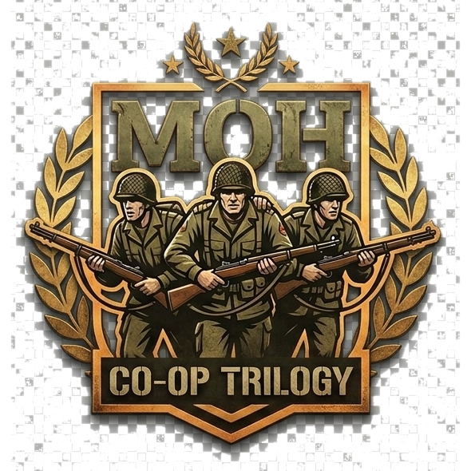

> *The MOH Trilogy Coop Mod is a love letter to the early Medal of Honor franchise.*

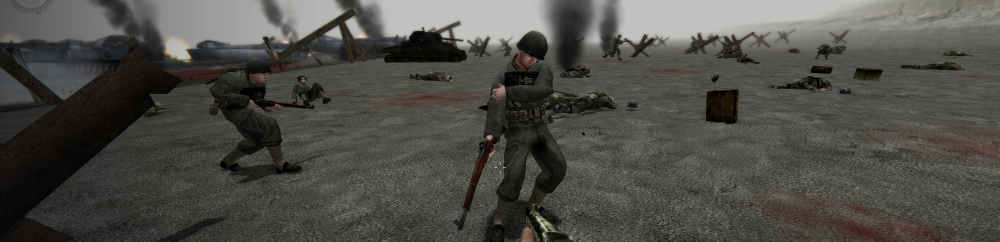

&nbsp;

&nbsp;

One ~3 MB installer · needs a GOG copy of MOH: Allied Assault War Chest · <b><a href="https://github.com/MOHCoopTrilogy/releases/releases/latest">Release notes</a></b>

> [!IMPORTANT]
> ### 🎖️ Testers wanted - solo players and whole squads
> This is an **early alpha**, and we need people to play it. Grab some friends (or come find a squad), play
> through missions, and tell us what breaks, what feels off and what you love.
> **[Join the Discord](https://discord.gg/ukumnzBAhK)** to find games and send feedback. If something breaks, Start menu →
> **MOH Trilogy Coop - Report a Problem** sends us your logs in one click.

Play the complete **Allied Assault**, **Spearhead** and **Breakthrough** campaigns in co-op, **built for 4** (multiplayer modes scale to 16). Built on the [HaZardModding Coop Mod](https://github.com/HaZardModding/hzm-mohaa-coop-mod) and a custom fork of the [OpenMOHAA](https://github.com/openmoh/openmohaa) engine, then heavily extended: weighty guns, aimed reloads, ragdolls, an unlockable Armory, smarter enemies, a full audio overhaul and HD visuals. Updates install themselves at every launch, and your original game is never touched.

## Install

1. **[Download the installer](https://github.com/MOHCoopTrilogy/releases/releases/latest/download/MOHCoopTrilogy-WebSetup.exe)** (~3 MB) and run it. It finds your GOG game and creates a **MOH Trilogy Coop** shortcut. No admin rights needed.
2. **Launch from the shortcut.** The first launch downloads about 8 GB of game files from GitHub, with a progress bar. After that, each launch fetches only what changed.
   **Other downloads** (every file has a SHA-256 on the release page; see [WINDOWS_SECURITY.md](docs/public/WINDOWS_SECURITY.md) if Windows blocks something):
   - **WebSetup.exe**: pick this for a normal install (it finds your game and downloads everything).
   - **NoInstaller zip** (several parts, unzip all into your game folder; INSTALL.txt inside): pick this if Windows blocks the installer or you prefer to unzip by hand.
   - **ModFilesOnly zip** (only on releases that do not change the exe/dll files): pick this if you already run the previous release and just want the new mod files.
3. **Host:** Multiplayer → Start Game → **MOH Coop Trilogy (HZM)**, pick a mission, Apply. **Join:** Multiplayer → Join Game, or `connect <ip>` in the console.

**Needs:** Windows, a GOG install of [MOH: Allied Assault War Chest](https://www.gog.com/game/medal_of_honor_allied_assault_war_chest), an internet connection, and about 10 GB free.

Your existing game is safe

The mod installs into its own folder (you pick it; the default is `%LOCALAPPDATA%\MOH Coop Trilogy`). It only *reads* your GOG game and never writes to it, and setup refuses any folder that would overwrite a game install. Uninstalling removes only the mod's folder.

Developer and debug tools are switched on

They ship enabled so testers can get unstuck (`coop_dev 1`: noclip, god, heal, teleport and more). There is no anti-cheat, so on public servers it's an honour system.

## What's new

### v1.10.38 - v1.10.43 - Two new finales and a 3D attic menu

- **U-boat pens finale (early access)** - destroy two U-boats by defending crane drops, then hold the radio room while reinforcements push in
- **Norway station finale (early access)** - grab the demolition charges (and the weapons in the storage room), rig the comms gear and fuel tanks, kill the station commander, then hold the station through a building blizzard until the train arrives - with snipers and MG42 nests on the rooftops
- **The 3D attic is the main menu** - fly to the doors, the map, the desk or the radio shelf; the chalkboard names what you point at, and Manon and General Weathers work the room. MENU STYLE > Classic brings the flat menu back
- **Officer reinforcements and enemy voice lines work again** (broken since v1.10.38), and the menu cursor no longer sticks in the lobby
- **Fixes** - Spearhead's parachute cut in the barn, Omaha's beach crowd no longer drowns the mix, New Objective cards match the objective list, dropped MG42s can be picked up again
- **Scopes (work in progress)** - coated glass on the lens from the hip, the live view when you aim

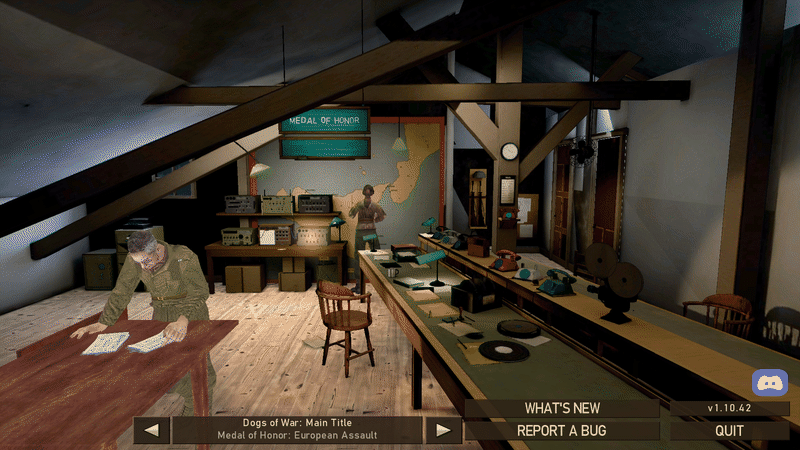
The attic main menu: General Weathers at his table, Manon at the map.

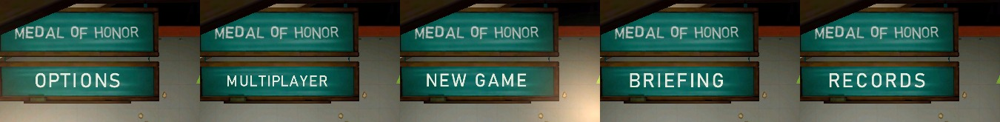
Point at a door or the radio shelf and the chalkboard names it.

### v1.10.23 - v1.10.37

- **v1.10.37** - 3D Options attic with a radio shelf, soldiers react to blasts, burning wrecks and scorch marks, bolts that cycle, realistic shell ejection, stress reloads, soft-lock fixes on m4l1-m4l3, m5l1a and m5l2b
- **v1.10.36** - a WW2 radio room for the settings, full HD loading movies, real gamepad button icons, an alarm switch-off
- **v1.10.35** - a new 3D main menu (the Breakthrough attic), keyboard-driven menus, alarm snipers on eight maps
- **v1.10.34** - bolts and cocking handles that move on every shot, hand-on-bolt reloads, new gun finishes
- **v1.10.32 - 33** - a squad lobby before every mission, the Showroom Armory, a busier battlefield, cutscenes without crosshairs, text sized right on every screen
- **v1.10.29 - 31** - smarter Germans (squad tactics, alarms they run for, counter-attacks after the main objective), a cleaner HUD, a better Armory
- **v1.10.23 - 28** - your XP, rank, challenges and unlocks follow you to any server; smooth joins and play on dedicated servers at any frame rate; briefing and lobby fixes

**Public co-op servers:** **MOH Coop Trilogy #1, #2 and #3** run the whole trilogy back to back - find them in Multiplayer > Join Game.

### v1.10.22 - Eyes on Target

- **Aimed reloads that stay on target** - BAR, StG 44, DP-28, the MP40s, 17 pistols (now aimed **two-handed**), the bolt-action rifles, and a pump shotgun with real sights that pumps while you aim
- **Two new guns** - the **Gewehr 43 with iron sights** and a **Double Barrel shotgun**
- **Looting** with the Use key - pick up enemy guns and ammo, search bodies
- **A paratrooper squad** that holds a line and sets up a .30 cal you can man
- **Rain that reaches the ground**, plus rare blizzards and downpours
- **New scope view** with each optic's own reticle, clouds on by default, smoother Frame Generation (beta)

<table>
<tr>
<td width="50%">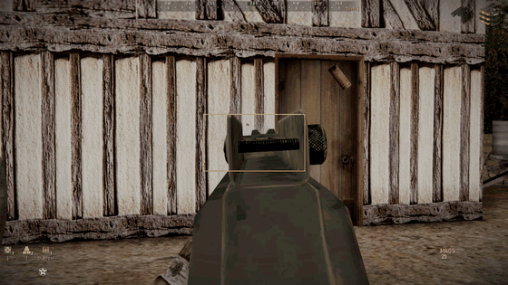 BAR reload without leaving the sights</td>
<td width="50%">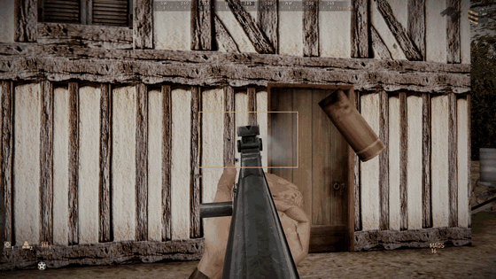 StG 44, same idea</td>
</tr>
<tr>
<td width="50%">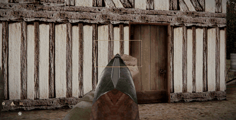 The shotgun pumps between shots while you aim</td>
<td width="50%">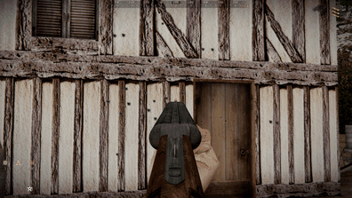 New Double Barrel shotgun (mesh by Jean PFP, CC0)</td>
</tr>
<tr>
<td width="50%">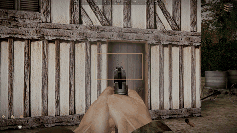 Pistols aim two-handed and reload on target</td>
<td width="50%">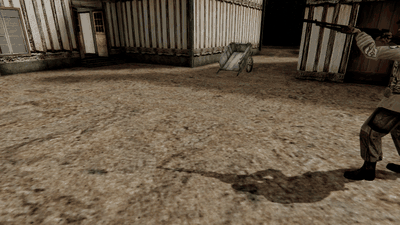 Paratroopers set up a .30 cal on cover</td>
</tr>
</table>

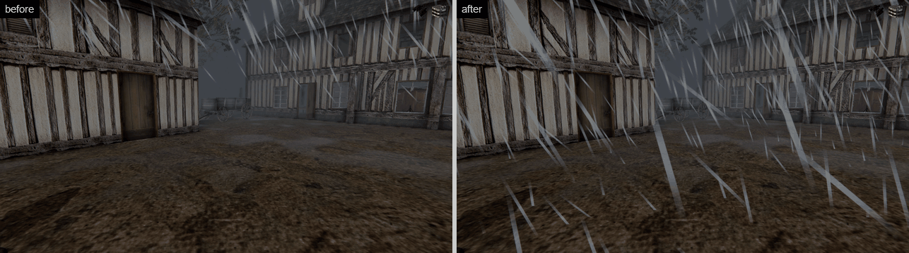
Downpour, before and after: the rain now falls all the way to the ground.

<b>Earlier releases</b> (full notes for every version are on the <a href="https://github.com/MOHCoopTrilogy/releases/releases">Releases page</a>)

- **v1.10.21 - All Cores Forward** - big battles much faster (Omaha ~31 → ~75 fps on our test PC), a Graphics Quality control with a Recommended button, exact frame-rate limits, Frame Generation (beta), an enemies-remaining counter
- **v1.10.20 - Clear the Beach** - Omaha ~19 → ~31 fps, Quality Presets, join-in-progress crash fixed, U-boat / Omaha bunker / church-defence blockers fixed
- **v1.10.17-19 - Steady Aim** - first reloads while aiming (Garand, PPSh, Thompson, Moschetto, then most guns) and bolts worked while aiming
- **v1.10.14 - Quick Hands** - fast quick draw, smarter sprint, authentic belt / drum / pan reloads, a cleaner HUD and mission debrief, visible paratrooper planes, nation-matched voices
- **v1.10.4 - On Target** - iron sights that line up in every stance, MSAA on by default, footprints, briefing films for joiners
- **v1.10.3 - Storm Front** - realistic lightning, water reflections and puddles, bodies that react to blasts
- **v1.10.0-2** - HD skies and moving clouds, dust storms, multiplayer weather, 116 loading tips, headlights, and a tribute to Vince Zampella

<table>
<tr>
<td width="50%">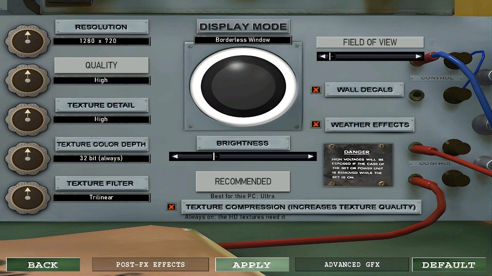 Video with the Quality control and the Recommended button"> v1.10.21: one Quality control with a Recommended button</td>
<td width="50%">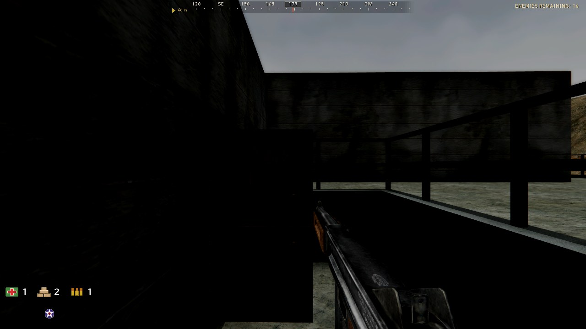 v1.10.21: enemies-remaining counter</td>
</tr>
<tr>
<td width="50%">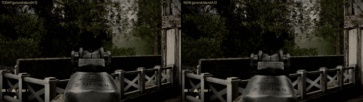 v1.10.14: quick draw (old left, new right)</td>
<td width="50%">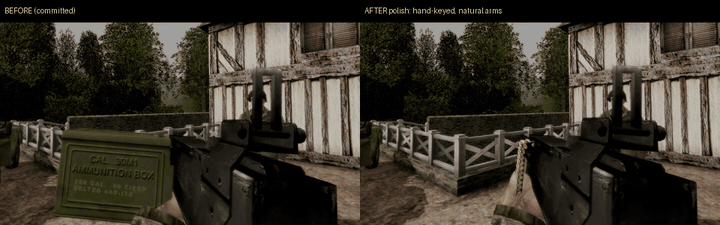 v1.10.14: the .30 cal takes a belt</td>
</tr>
<tr>
<td width="50%">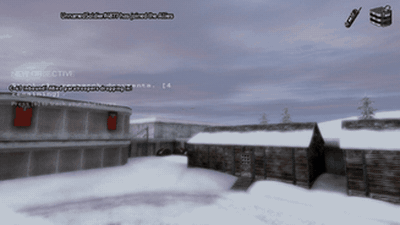 v1.10.14: paratrooper C-47s you can see</td>
<td width="50%">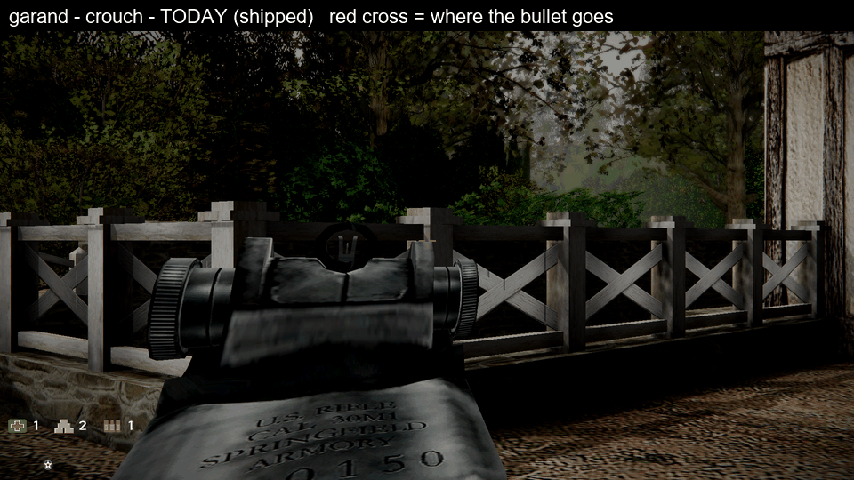 v1.10.4: sights line up in every stance</td>
</tr>
<tr>
<td width="50%">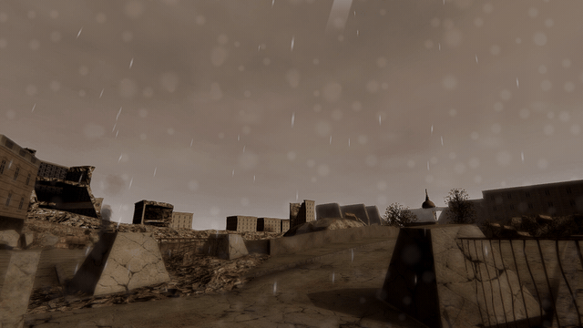 v1.10.3: realistic lightning</td>
<td width="50%">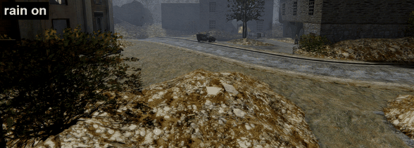 v1.10.3: wet ground in rain</td>
</tr>
</table>

## Screenshots

<table>
<tr>
<td width="50%">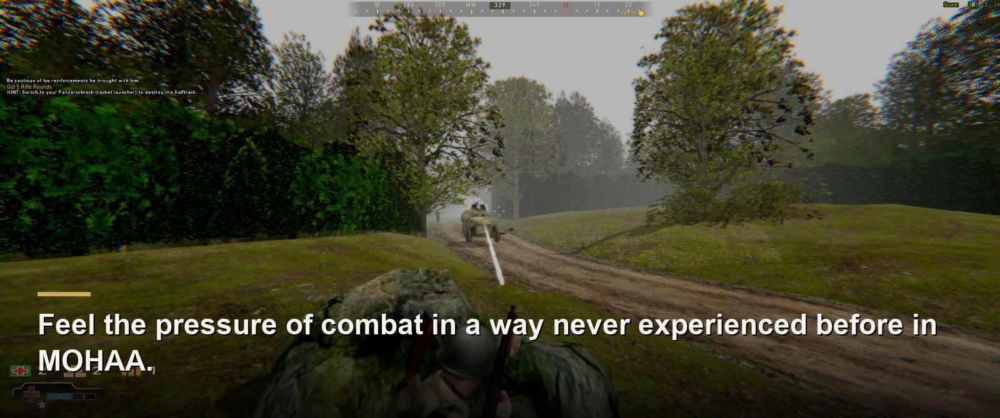</td>
<td width="50%">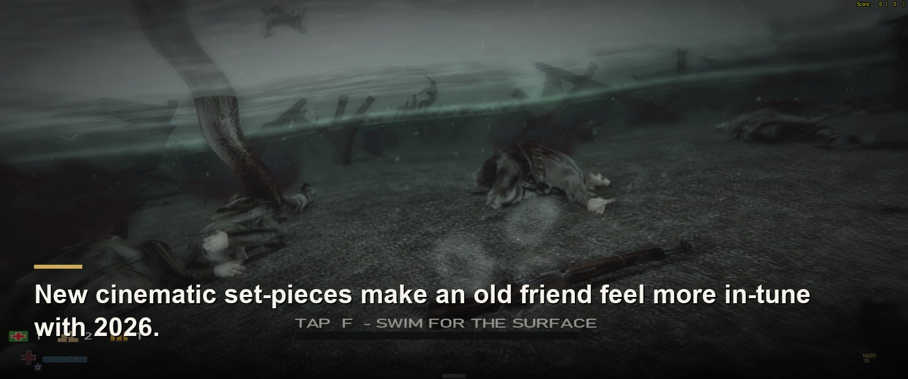</td>
</tr>
<tr>
<td width="50%">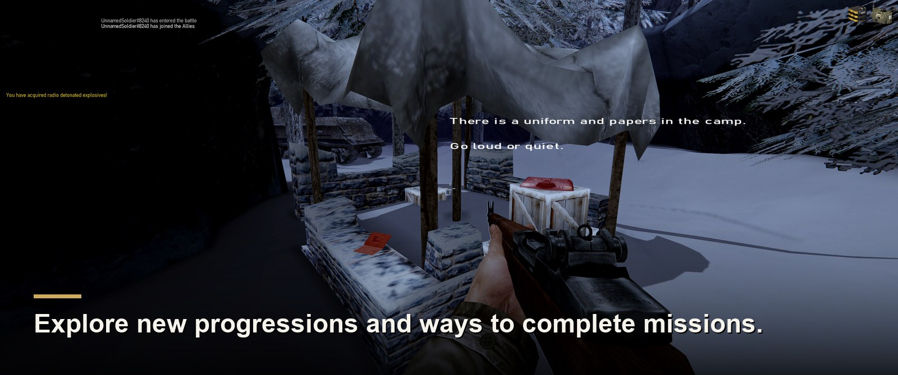</td>
<td width="50%">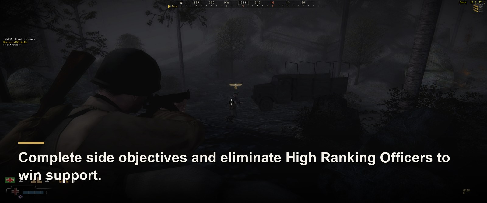</td>
</tr>
<tr>
<td width="50%">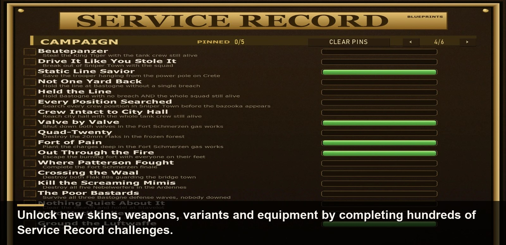</td>
<td width="50%">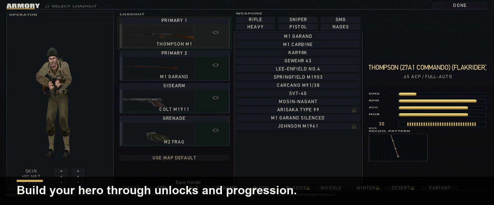</td>
</tr>
<tr>
<td width="50%">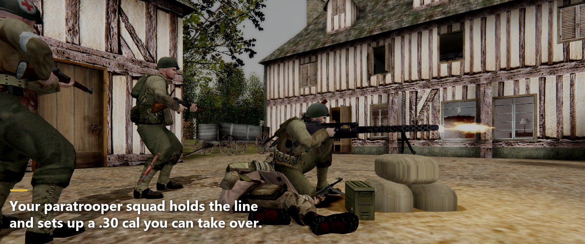</td>
<td width="50%">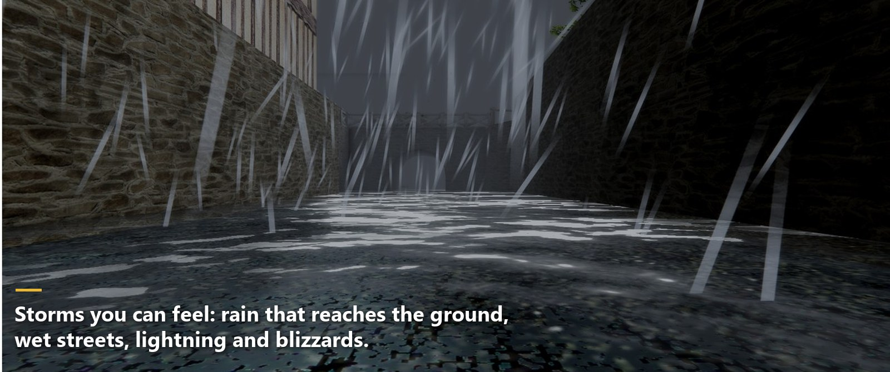</td>
</tr>
<tr>
<td width="50%">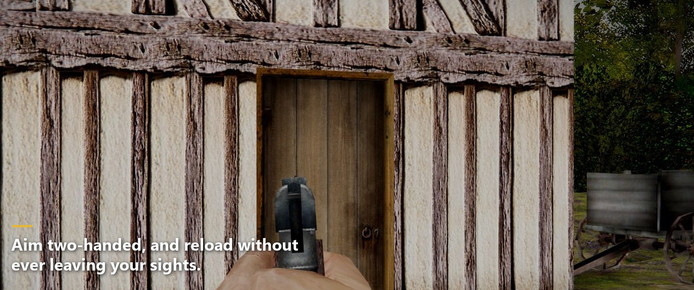</td>
<td width="50%">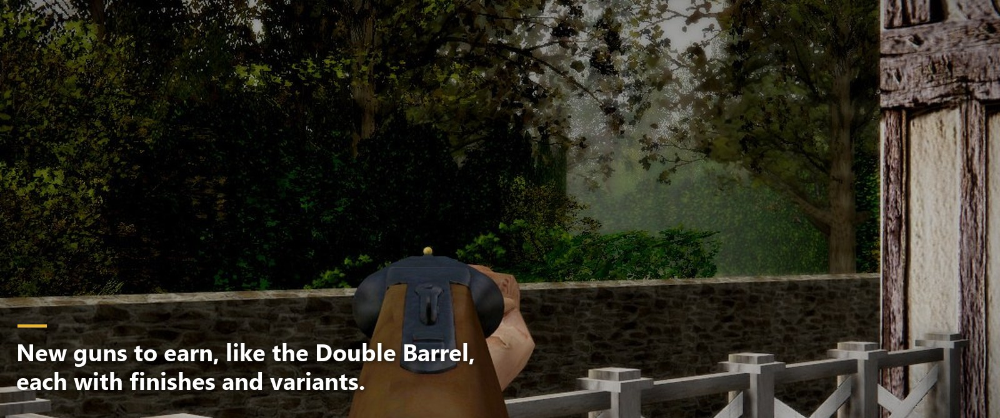</td>
</tr>
</table>

## Features

<b>Full-campaign co-op</b>

- 50+ missions across all three campaigns with working objectives, cutscenes, escorts and vehicle rides
- **Down-But-Not-Out**: go down instead of dying, crawl, and self-revive with a medkit or bleed out
- Optional **Last Man Standing** lives pool, spawn protection, and enemy counts that scale with your squad
- **Officer bosses** that radio in reinforcement waves; kill them for airstrike binoculars and supply-drop smoke
- Allied escorts go down instead of dying and can be revived

<b>Multiplayer, modes and bots</b>

- A dozen modes with friends or bots: Push, Base Assault, Domination, King of the Hill, CTF, Countdown, Assassination, Demolition, Gun Game, Freeze Tag, Prop Hunt, Last Man Standing
- Modifiers: One-Shot, One-Ammo, Hardcore, Realism
- Bots that play the objective; drivable tanks and jeeps, mountable Flak 88s and Nebelwerfers
- Campaign maps playable in Push and Base Assault; XP and challenges carry across co-op and multiplayer
- Kept fully separate from co-op by an automated check on every build

<b>The Armory and unlocks</b> (F7)

- Choose two primaries, a sidearm and a grenade from 70+ weapons, with live 3D previews
- Hundreds of weapon finishes and credited community model variants, plus helmets, uniforms and skins
- Everything is **earned, never bought or random**: through rank, challenges and hidden blueprints
- Changes made mid-mission land in your hands in seconds

<b>Weapon feel and movement</b>

- Guns have weight: recoil, recovery, sway and breathing scale with what you carry
- Aim down sights on its own key, with **reloads and bolt / pump work that keep you on target**
- Sprint and stamina, lean, vault, weapon bash, quick draw, take cover *(experimental)*
- First person, third person and a free camera on one key; emotes; deployable ammo boxes and sandbags

<b>Enemies, ragdolls and gore</b>

- Germans take cover, go prone, flank, retreat when hurt, and sometimes surrender (and can be recruited)
- AI grenades work again (an engine bug had blocked almost all of them)
- **Ragdolls** on by default: bodies land on what's under them and react to bullets and blasts (`coop_ragdoll 0` turns them off)
- Blood trails, wounds and pools on a strict budget; helmets that fly off

<b>Audio</b>

- Re-recorded guns from licensed sound libraries, 60 new explosions, and handling sounds for your hands
- Reverb by room type, occlusion through walls, HRTF for headphones, distant gunfire that sounds distant
- Near-miss cracks, tinnitus after close blasts, 1,389 unused retail voice lines restored
- A real mixer (Master, Music, SFX, Ambience, Dialogue) and an output-device picker

<b>Visuals and weather</b>

- Bundled HD texture, character, world, FX and sky packs
- Bloom, ambient occlusion, sharpening, MSAA and optional Frame Generation (beta)
- Rain, snow, dust storms and lightning with wet ground, puddles and water reflections
- Layered vehicle deaths, restored headlight glow, teammate and officer icons

<b>HUD, progression and settings</b>

- A HUD that fades when things are quiet; Coop Settings, Advanced Graphics and Post-FX menus
- Persistent XP with 13 WW2 US Army ranks, 445 challenges, medals, and pinned challenge tracking
- A What's New report after each update and a Report a Bug button in game

<b>Map and engine work</b>

- Every campaign map repaired for co-op: objective failsafes, rebuilt convoy and jeep rides, the U-boat stealth mission made a real stealth mission, ~550 missing German soldiers restored on Spearhead and Breakthrough
- Engine limits raised (entities, models, sounds) with guards so they can't silently regress; dozens of crash fixes
- 2,000+ fixes logged with root causes: **[every fix, by area](docs/public/BUGFIXES.md)**

Full generated reference: **[Features](docs/public/FEATURES.md)** · **[Maps](docs/public/MAPS.md)** · **[Challenges](docs/public/CHALLENGES.md)** · **[Unlockables](docs/public/UNLOCKABLES.md)** · **[Roadmap and known issues](docs/public/ROADMAP.md)**

## Known issues

Read before reporting

**Newest and least settled:** the U-boat pens and Norway finales (early access), the 3D attic main menu, the scopes, the multiplayer modes and bots (little human playtesting yet), ragdolls, take cover, the free camera, the jeep and tank machine-gun seats, and squad AI behaviour.

**Open bugs:**
- e3l4: a jeep passenger can fail the first supply run (failsafes still complete the mission)
- t2l2: some extra MG42 nests go unmanned and one German vehicle can fail to appear (the map still plays through)
- m1l1: a couple of Rangers on the opening truck can render with mangled limbs
- The down-but-not-out crawl animation plays backwards
- Reload magazines keep the stock skin on a finished gun
- Pinned challenges have no in-mission panel yet
- OpenGL2 renderer: some animated lights pulse red, and distant objects can pop through fog
- Dedicated servers crash on plain deathmatch maps (listen servers are fine)

Found something else? Use **Report a Problem**, post on Discord, or open an [issue](https://github.com/MOHCoopTrilogy/releases/issues).

## Roadmap

No dates promised: online play without port forwarding, skill trees (Ranger, Corpsman, Pathfinder), a carryable MG42, new player animations, a wave-survival mode, and in-game update notices.

**Want to help?** We're looking for animators, mappers and artists (new weapons and skins, aimed animations, map ports). It's a passion project and nobody is paid, including me. Say hi on **[Discord](https://discord.gg/ukumnzBAhK)**.

## Credits

- **chrissstrahl, Smithy (1337Smithy) and HaZardModding** - the original [HZM Coop Mod](https://github.com/HaZardModding/hzm-mohaa-coop-mod) this project builds on, and its testers and community ([hazardmodding.com](http://www.hazardmodding.com))
- **The OpenMOHAA team** - the open-source [engine](https://github.com/openmoh/openmohaa)
- **HD packs** by their authors: *MOHAA HD Project*, *HRRTM - HD Realism Texture Mod* (and its blood addon), HD gun sounds, geared soldiers and HD foliage packs, plus in-house upscales made for this project
- **Weapon models and finishes** by their original authors, credited individually in game; the Double Barrel shotgun mesh by **Jean PFP** (OpenGameArt, CC0). Archive-era content is included with attribution and removed on request
- **Sound design** from licensed professional sound libraries
- **2015, Inc. / Electronic Arts** - the original *Medal of Honor: Allied Assault* trilogy

*MOH Coop Trilogy is an independent, non-commercial fan project, not affiliated with or endorsed by Electronic Arts, 2015 Inc. or any other Medal of Honor rights holder. All trademarks and assets remain their owners' property. A legitimate copy of the game is required.*

## License

- **Engine fork** - GPLv2, source at [MOHCoopTrilogy/openmohaa](https://github.com/MOHCoopTrilogy/openmohaa) (upstream [openmoh/openmohaa](https://github.com/openmoh/openmohaa))
- **Mod scripts and content** - the original HZM Coop Mod's terms; see `hzm_legal.txt` in the [mod repo](https://github.com/MOHCoopTrilogy/hzm-mohaa-coop-mod)
- **Game assets** - remain their owners' property

## For developers

| Repo | Holds |
|---|---|
| [MOHCoopTrilogy/releases](https://github.com/MOHCoopTrilogy/releases) | This repo: downloads, the update manifest, the build and installer pipeline (`build.ps1`, `installer/`, `updater/`, `publish_release.ps1`) |
| [MOHCoopTrilogy/hzm-mohaa-coop-mod](https://github.com/MOHCoopTrilogy/hzm-mohaa-coop-mod) | Mod source: scripts, UI, configs, assets |
| [MOHCoopTrilogy/openmohaa](https://github.com/MOHCoopTrilogy/openmohaa) | Engine fork source (GPLv2) |
