# MOH Coop Trilogy

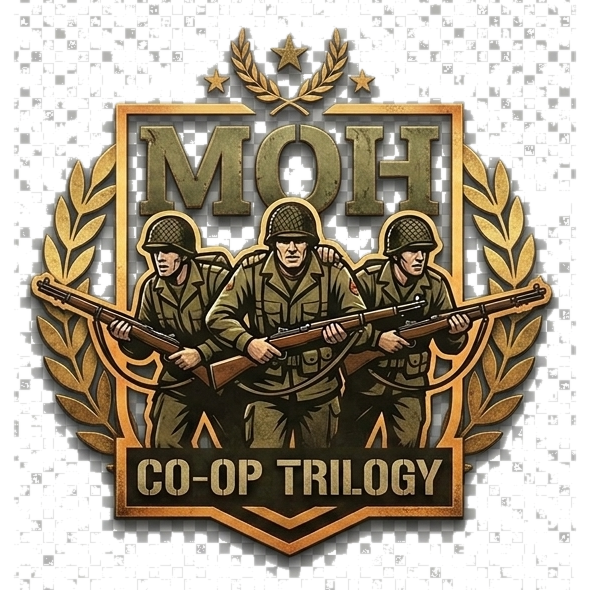

> *The MOH Trilogy Coop Mod is a love letter to the early Medal of Honor franchise.*

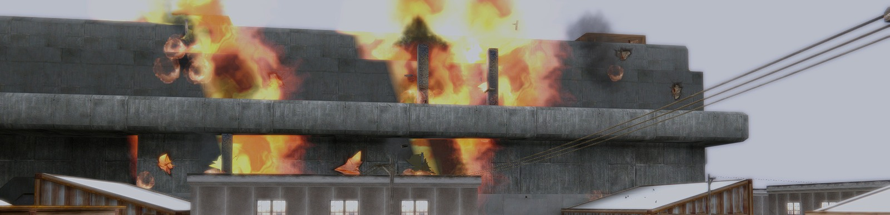

&nbsp;

&nbsp;

One ~3 MB installer · needs a GOG copy of MOH: Allied Assault War Chest · <b><a href="https://github.com/MOHCoopTrilogy/releases/releases/latest">Release notes</a></b>

> [!IMPORTANT]
> ### 🎖️ Testers wanted - solo players and whole squads
> This is an **early alpha**, and we need people to play it. Grab some friends (or come find a squad), play
> through missions, and tell us what breaks, what feels off and what you love.
> **[Join the Discord](https://discord.gg/ukumnzBAhK)** to find games and send feedback. If something breaks, Start menu →
> **MOH Trilogy Coop - Report a Problem** sends us your logs in one click.

Play the complete **Allied Assault**, **Spearhead** and **Breakthrough** campaigns in co-op, **built for 4** (multiplayer modes scale to 16). Built on the [HaZardModding Coop Mod](https://github.com/HaZardModding/hzm-mohaa-coop-mod) and a custom fork of the [OpenMOHAA](https://github.com/openmoh/openmohaa) engine, then heavily extended: weighty guns, aimed reloads, ragdolls, an unlockable Armory, smarter enemies, a full audio overhaul and HD visuals. Updates install themselves at every launch, and your original game is never touched.

## Install

1. **[Download the installer](https://github.com/MOHCoopTrilogy/releases/releases/latest/download/MOHCoopTrilogy-WebSetup.exe)** (~3 MB) and run it. It finds your GOG game and creates a **MOH Trilogy Coop** shortcut. No admin rights needed.
2. **Launch from the shortcut.** The first launch downloads about 8 GB of game files from GitHub, with a progress bar. After that, each launch fetches only what changed.
   **Other downloads** (every file has a SHA-256 on the release page; see [WINDOWS_SECURITY.md](docs/public/WINDOWS_SECURITY.md) if Windows blocks something):
   - **WebSetup.exe**: pick this for a normal install (it finds your game and downloads everything).
   - **NoInstaller zip** (several parts, unzip all into your game folder; INSTALL.txt inside): pick this if Windows blocks the installer or you prefer to unzip by hand.
   - **ModFilesOnly zip** (only on releases that do not change the exe/dll files): pick this if you already run the previous release and just want the new mod files.
3. **Host:** Multiplayer → Start Game → **MOH Coop Trilogy (HZM)**, pick a mission, Apply. **Join:** Multiplayer → Join Game, or `connect <ip>` in the console.

**Needs:** Windows, a GOG install of [MOH: Allied Assault War Chest](https://www.gog.com/game/medal_of_honor_allied_assault_war_chest), an internet connection, and about 10 GB free.

Your existing game is safe

The mod installs into its own folder (you pick it; the default is `%LOCALAPPDATA%\MOH Coop Trilogy`). It only *reads* your GOG game and never writes to it, and setup refuses any folder that would overwrite a game install. Uninstalling removes only the mod's folder.

Developer and debug tools are switched on

They ship enabled so testers can get unstuck (`coop_dev 1`: noclip, god, heal, teleport and more). There is no anti-cheat, so on public servers it's an honour system.

## What's new

### v1.10.76 - Liberation

- **New contract: LIBERATION** - a solo hunt in Field Operations. You go in alone against 12 to 25 dug-in Germans who never respawn, with one life and a clock
- **Your co-op kit comes with you** - weapons, finishes, gloves and engraving from the Armory
- **Double XP for a win**, nothing for a loss, with a radio briefing to send you in
- **The war map reaches 18 places** (it was 9), and 16 maps are in the Liberation pool
- **Needs playtesting** - a full hunt won by real kills, the out-of-time ending, and whether the time limits feel fair

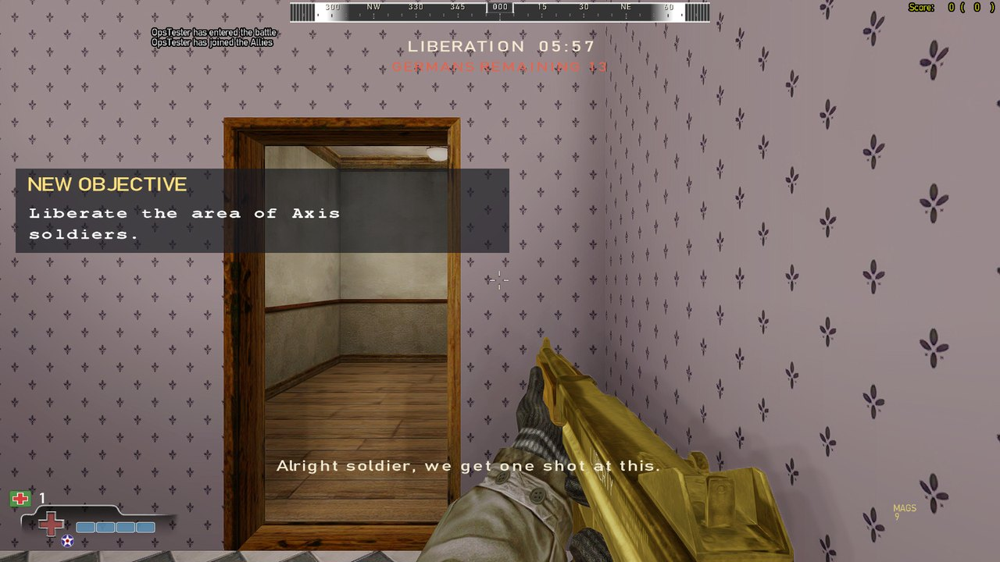

### v1.10.75 - Real Steel

- **Real recoil and fire rates** - every gun kicks and cycles like the real thing, for players and the AI alike. Sustained fire climbs; the MG42 is a buzzsaw, the BAR is slow and heavy
- **USE key flipped** - tap to take ammo from a dropped weapon, hold to swap to it
- **New Escape menu** - cleaner layout in co-op, multiplayer and single player, a SCOREBOARD row, and DISCONNECT asks first
- **The attic has weather** - real rain and fog over the rooftops, rain you can hear, and a ladder hatch to quit. The main menu also opens faster, and every loading clip is now HD
- **Multiplayer unlock progress saves**, and Field Operations always put you on the Allies
- **Own-disc missions rebuilt** - Sealed Orders and Their Dying Breath follow the original levels much more closely
- **Needs playtesting** - both disc missions end to end, and how the new recoil feels in long firefights

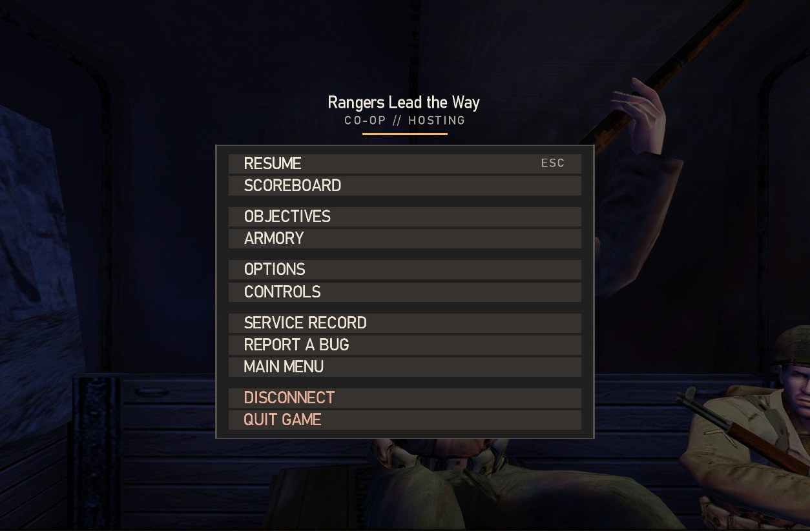 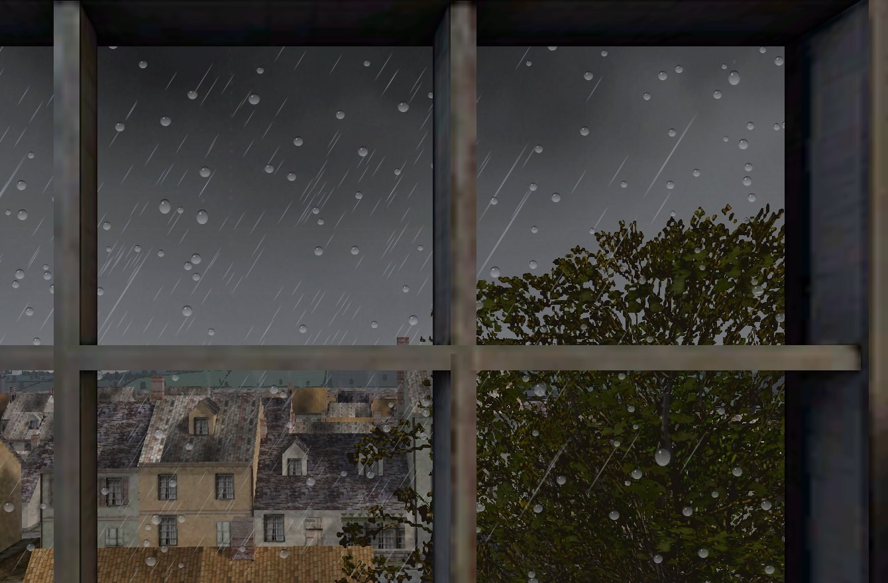

### v1.10.72 - Live Fire

- **Live Operations** - timed Team Deathmatch and Objective contracts pop up as pins on the New Game war map, Payday-style. Open a dispatch card, DEPLOY into a match against bots, and earn bonus XP (half if the operation fails). Contracts are seeded by the clock, so your friends see the same ones; no unlocks needed
- **Advanced Training at The Farmhouse** - eleven stations covering every co-op addition: medkits, patching and searching, down-but-not-out, sandbags and ammo boxes, MG heat, the supply drop and the bombing run, ending in a live final. A practice target on an easel in the attic opens Basic or Advanced Training
- **Customize bench** - drag to tilt the gun as well as turn it, slide engravings and emblems across a whole face, bigger move steps, and ZOOM steps from gun to face to close-up
- **Loading clips for every mission** re-rendered from the widened war map, now including Sealed Orders and Their Dying Breath
- **Needs playtesting** - planting in Live Operations Objective rounds and the Advanced Training movement drills have only had automated tests

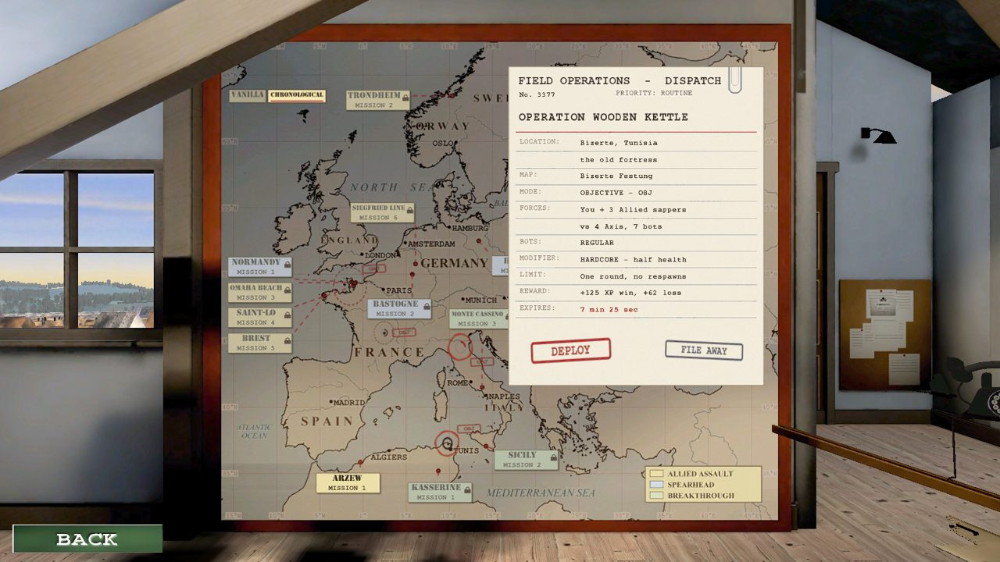 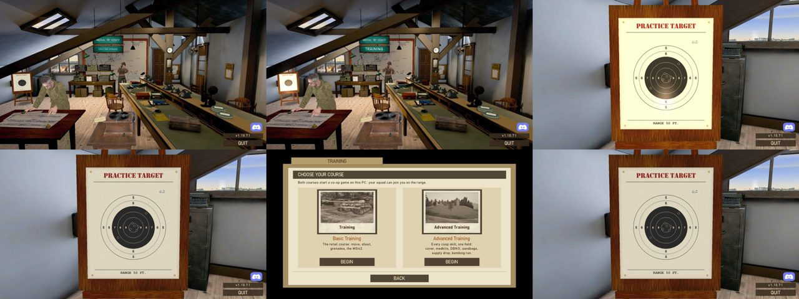

### v1.10.70 - Sealed Orders

- **SEALED ORDERS and THEIR DYING BREATH are fully playable** in co-op and single player, from your own Medal of Honor: Frontline / European Assault Xbox (USA) disc image converted on your PC (Settings -> OWN DISCS). Nothing from those games ships with the mod. They run through the Full and Chronological campaigns in their place in the war
- **New challenge: Saving Private Castro** - find out how in Sealed Orders
- **Main menu** - OWN DISCS now has a home in the attic (the film cans by the projector), and the war map reaches east to Stalingrad
- **Fixes** - no more host crash when a mission starts from the lobby, enemy callouts on the disc missions, and the single-player script errors at Saint-Lo
- **Needs playtesting** - both disc missions have only been through automated tests so far. If you have the disc, play them and tell us how they feel on Discord or with Report a Bug

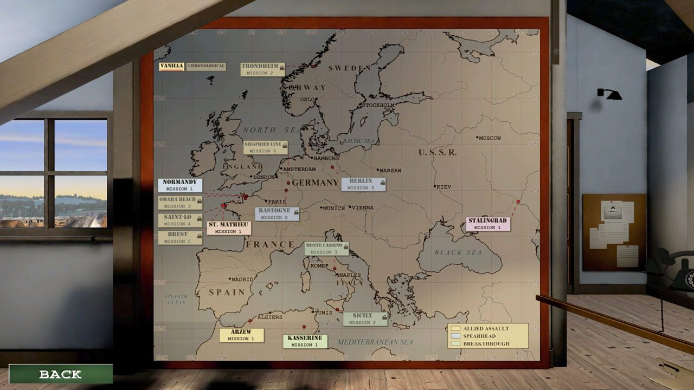 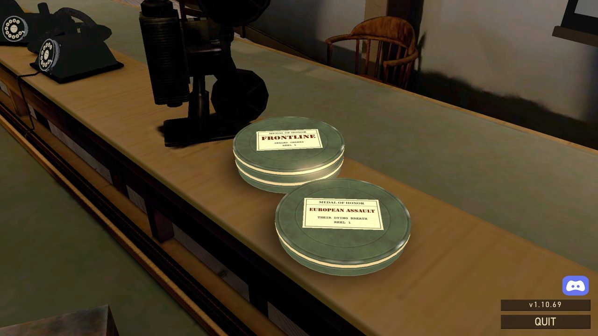

### v1.10.69 - Home front

- **The Bren is back** - rebuilt iron sights on the gun itself (offset left of the magazine like the real one), its own aim pose, and aimed reloads that keep you on target
- **The join-game room is lived in** - four real 1942-43 Allied posters, a NOTICES board for daily orders, your Service Record and promotions, a field radio that changes the music, a soldier playing cards by the stove, and the weapons rack on the left wall
- **Main menu** - the projector faces a new pull-down screen that plays a looping newsreel, PLAY in the film room flies the camera to the screen with the projector running, and the horizon outside the window gets real woods and hedgerows
- **Frontline and European Assault missions from your own disc** - SEALED ORDERS (St. Mathieu, 1944) and THEIR DYING BREATH (Stalingrad, 1943). Point Settings -> OWN DISCS at your own Xbox (USA) disc image and the mission is converted on your PC; nothing from those games is shipped. Until then the tiles show a padlock; once converted they play like any other map and join the Full and Chronological campaigns

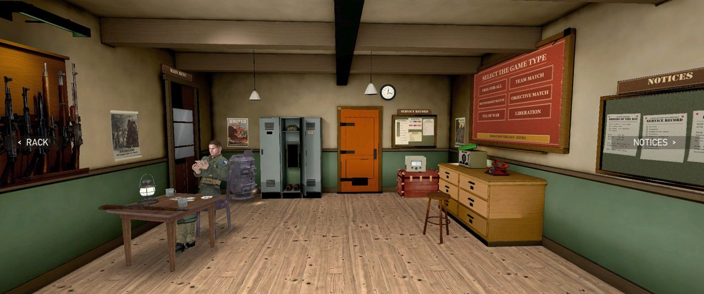 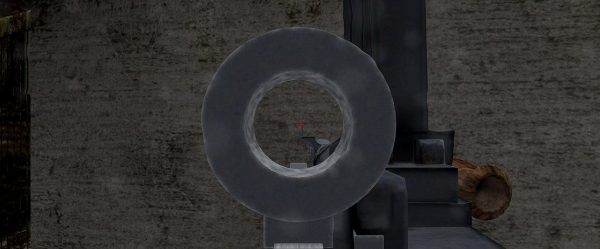

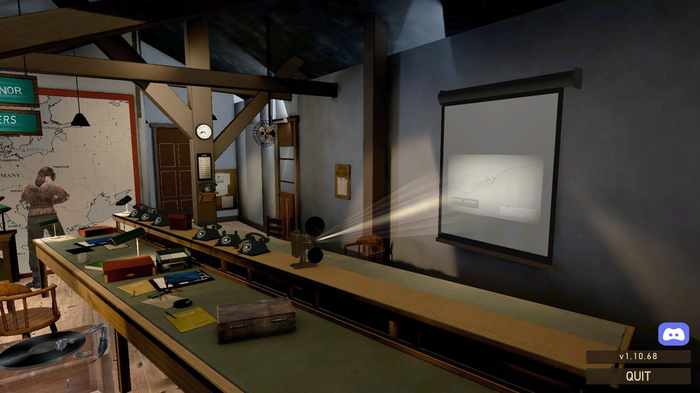 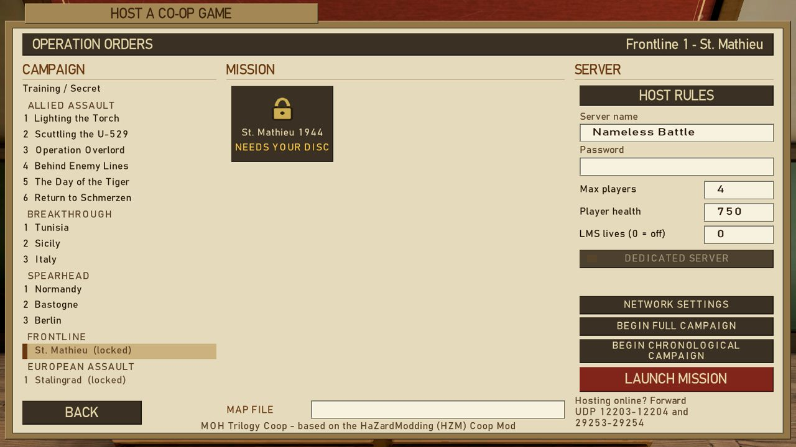

### v1.10.68 - Make it yours

- **13 new gun finishes** - Whitewash, Afrika Korps, Kriegsmarine, Airborne, Splinter, Pea Dot, Telo, Amoeba, Airborne 101st, Battle-Worn, Trench Art, Parade and Captured, earned with kills on each gun and shown as a second row in the Armory
- **Two new guns** - the MP 28 (unlock with 60 MP40 kills) and the single-shot Panzerfaust 60 (unlock with 10 Panzerschreck kills), both with the full set of finishes
- **Customize bench** - press CUSTOMIZE in the Armory to knife-cut your own words into any gun and add insignia, medals and emblems; move, tilt, resize and save a design for each gun, and see it on the gun in your hands
- **The town outside the attic window, rebuilt** - terraced streets, cleaner banners, and a new distance of hills, fields, woods and the church
- **Fixes** - finished guns aim through the same sights as the plain gun, the war map is no longer covered by desk props, and the game no longer traps your mouse when its window is out of focus

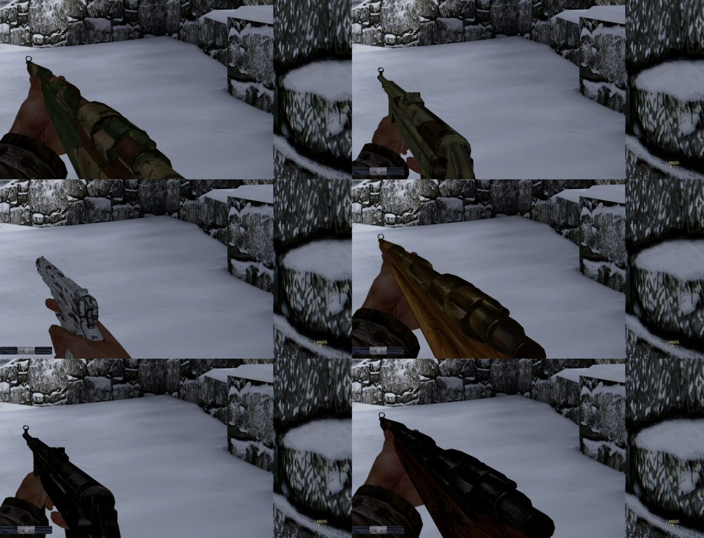 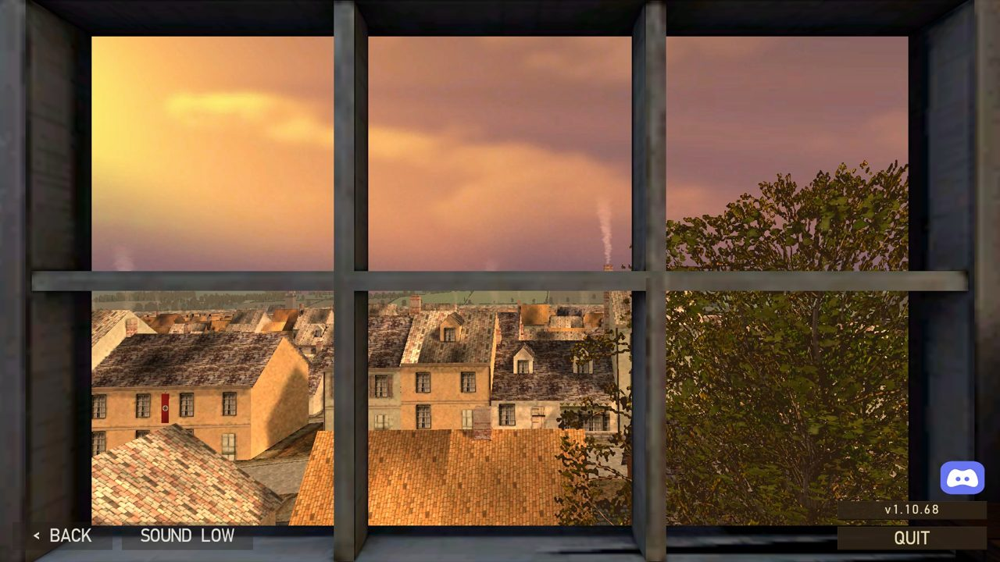

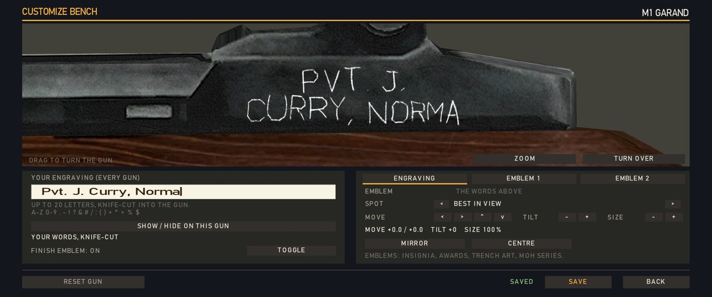

### v1.10.67 - A view outside

- **The attic window looks out onto an occupied town** - rooftops, chimney smoke, a church spire, an oak by the window and banners on the buildings
- **It follows your clock and the weather** - dawn, day, golden hour, dusk and night with lit windows, stars and moon; fair skies, overcast, rain on the glass and the odd thunderstorm with lightning
- **LOOK OUTSIDE and LOOK UP** - a close view of the town, and a new roof skylight to look straight up through. Planes cross the skyline every few minutes, and sometimes a formation passes overhead
- **The sounds of the town** - rain, wind, birds or crickets, a church bell on the hour, a passing tank, soldiers talking below and a loudspeaker, muffled behind the glass. SOUND in the window view sets it to off, low or medium
- **No more guns cut open by the camera** - guns and hands no longer slice open when they come close to the screen during reloads, bolt work, switches and sprints, checked on all 70 guns
- **Fixes** - the multiplayer map list names Remagen and Algiers correctly, and the double-barrel reload keeps your hand further from your face

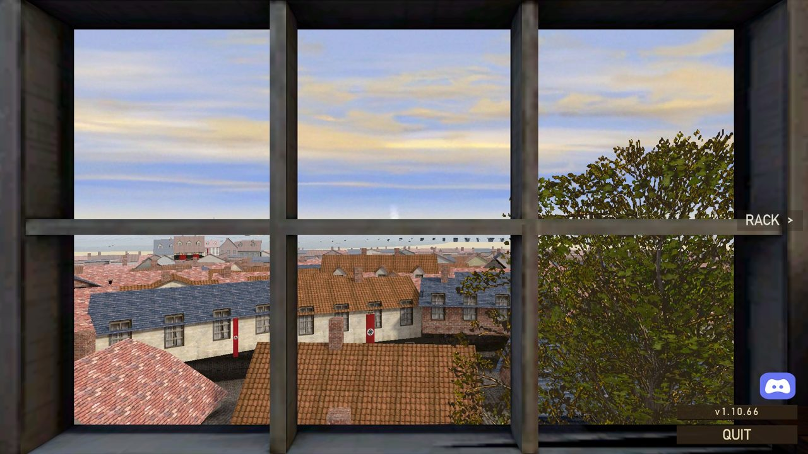 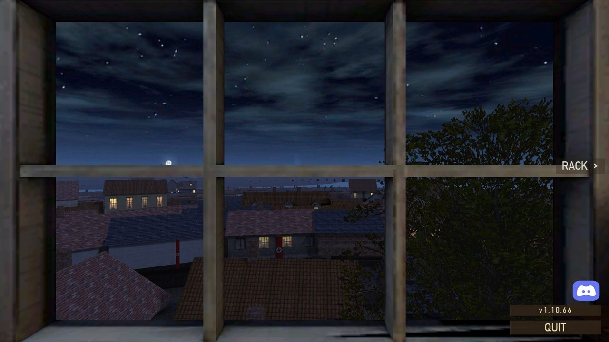

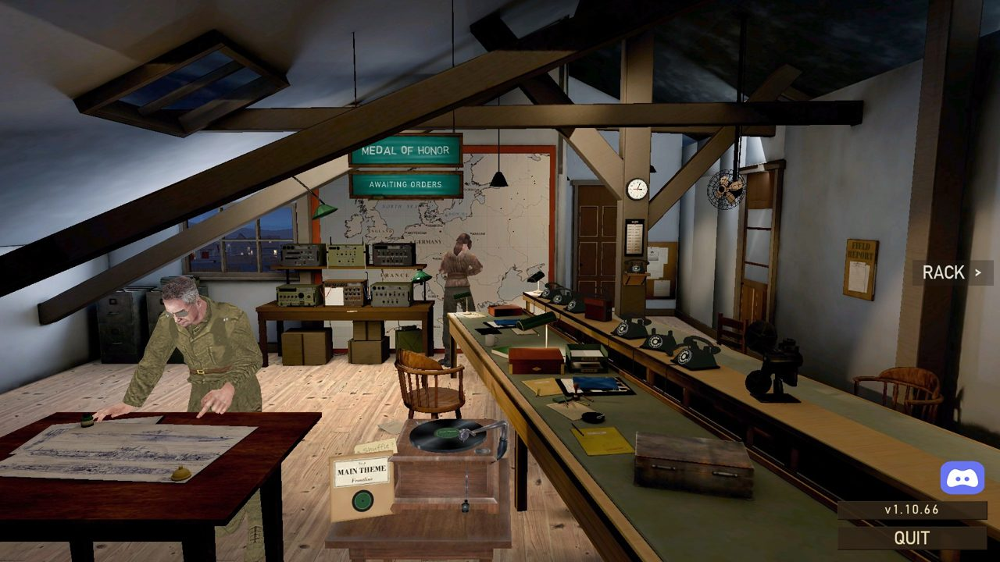 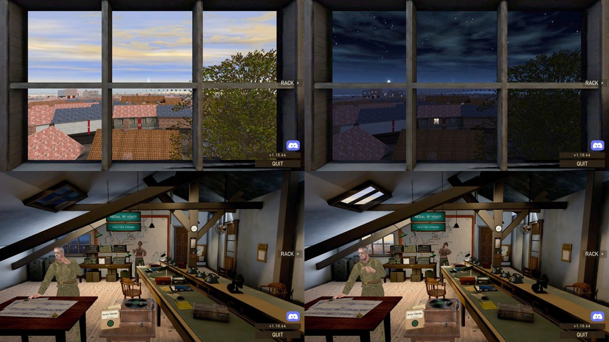

### v1.10.66 - Every campaign, one war map

- **All three campaigns start in single player again** - Allied Assault, Spearhead and Breakthrough, from the 3D map or the classic menu
- **A new campaign war map** - one map of Europe and North Africa with every mission pinned at its real location. A small switch picks **Chronological** (the default, historical order) or **Vanilla** (each campaign's own order); missions unlock as you finish them, with separate progress for each order
- **New loading screens** - the war map pushes in to the mission's real location and the title, unit, place and date type in. Loads are 1-2 seconds faster, and the soldiers that used to glitch over the old clips are gone
- **Main menu** - the same war map on the attic wall and in the classic room, much sharper desk props (readable phone dials, books, lamp, typewriter), real 3D records on the gramophone, a U-boat blueprint on the general's table, and a live clock in the multiplayer room
- **New FG 42 model** - both FG 42s get a detailed wood-stock model, a clean diopter ring on the iron sights and a fine ZFG 42 reticle on the scope (model by Shorty_Digitan, CC BY 4.0)
- **Fixes** - the Armory previews are framed correctly at 21:9 and 3440x1440, a controller's Y button no longer opens the Windows on-screen keyboard from a background window, and a single-player mission end no longer throws a script error

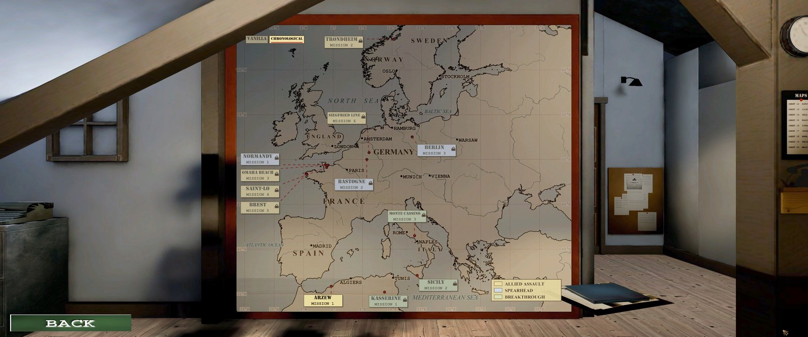 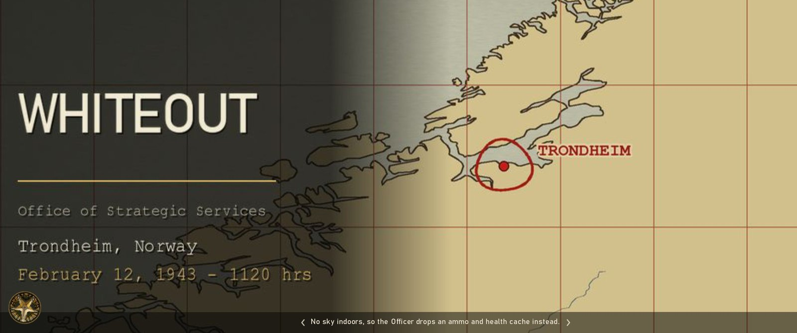

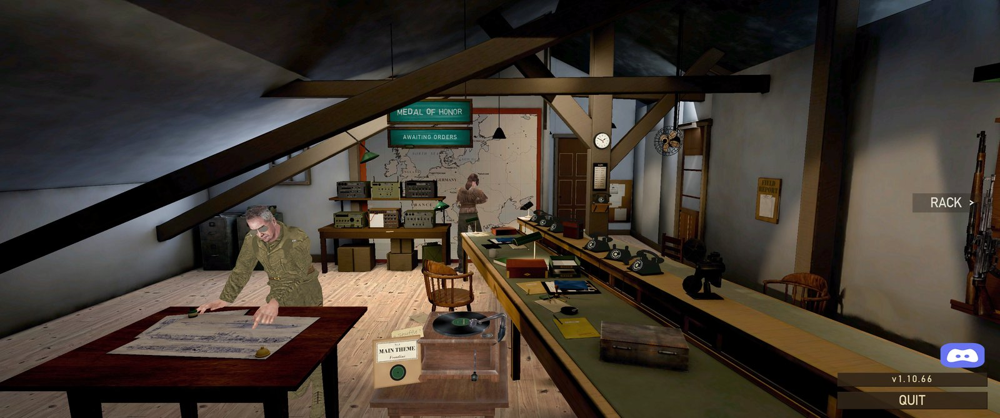 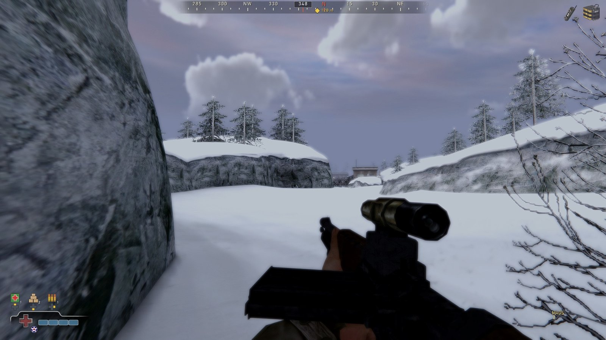

### v1.10.65 - A finish for every gun

- **189 new weapon finishes** - the 27 guns that had none (the M1 Carbine, the scoped and silenced rifles and snipers, the silenced SMGs, the M1919, MG42 and Lewis, and the pistols) now get gold, chrome, blued, bloody, woodland, winter and desert, unlocked by kills with that gun like the rest. Kills you already have count
- **Fixed:** kills with the M1 Carbine, the Lewis Gun, the silenced Colt and the BAR M1918 variants now count toward their challenges

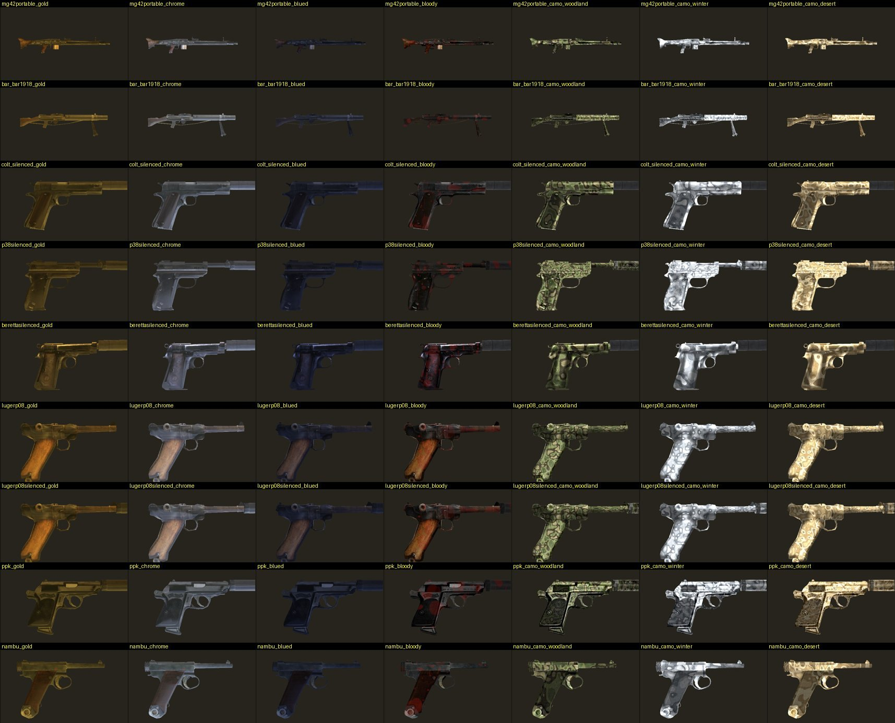

### v1.10.64 - Chronological Campaign, heavy machine guns and title cards

- **Chronological Campaign** - a new button under Begin Full Campaign plays Allied Assault, Spearhead and Breakthrough in the order the events happened, from Operation Torch to Berlin, with Continue or Start Over when you come back
- **Title cards** - join with nobody alive to watch and you get a black screen with the level's title, your rank and name, your unit, the place and the date and time, typed in one line at a time; you follow a teammate once one is alive
- **Heavy machine guns** - the Lewis Gun is its own heavy weapon, and the Lewis, DP-28, Breda and Vickers-Berthier heat up and cook off like the MG42 (the BAR doesn't). The Thompson Drum gets its own variants and finishes, and the two M38s are one Beretta M38A
- **Cover** - proper throws from cover (round the corner, overhand, over the top) that land at your aim marker, an over-the-shoulder view so you can see where you aim mid-wall, and low arcs for short throws
- **Smarter Germans** - a squadmate behind or beside a German no longer blocks his shot, on every map
- **Fixes** - your player name saves between restarts, Bastogne's mortars spread across the squad, spawn protection lasts its full 8 seconds, script errors fixed on three levels, the scoped M1903 and G98 are visible again, and grenades on snow throw white powder

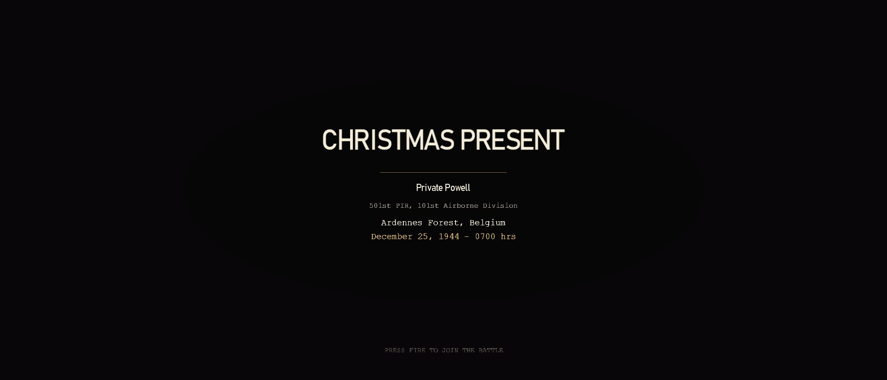 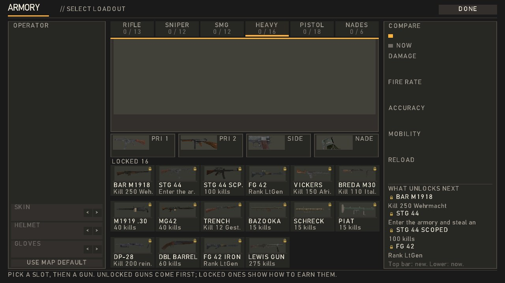

### v1.10.63 - Daily Orders, the weapon rack and a fully 3D attic

- **Daily Orders** - five new orders every day, the same for everyone, built around what makes this mod different: revives, the ammo crate, officers, objectives, fighting while downed, cover, braced MGs and kicked grenades. Real XP toward your rank (400 / 750 / 1,250, +1,500 for clearing the day), a progress panel in every lobby, an ORDERS OF THE DAY page in the Service Record, and a pop-up when you finish one. Coop and multiplayer
- **Weapon rack and viewer** - a lit rifle rack in the attic (move the mouse right, or use the RACK tab); click it to turn every gun, finish and skin in the mod in 3D, with its history, who made it and how to unlock it
- **Records and briefing in 3D** - the vanilla medal box on the records desk, the briefing at the big wall map, and the camera flies to Field Report, Report a Bug and Records. The projector runs, and the gramophone has two more records
- **Cover** - aim anywhere the cover allows on either side of the wall, hold the trigger to empty an automatic weapon, and grenades thrown from cover land where you aim
- **Five more emotes**, a readable Survive card in the Norway blizzard, no more soldiers stuck behind the halftracks, and server demo recordings that are saved by map and date instead of overwriting each other

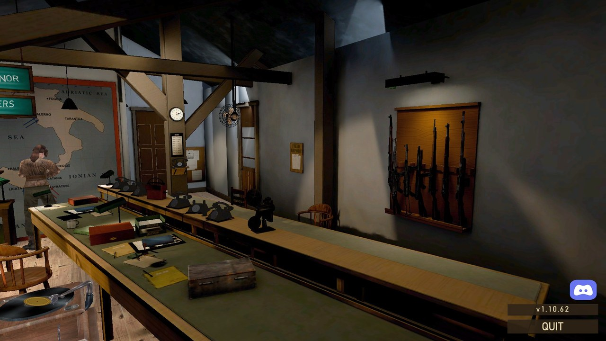 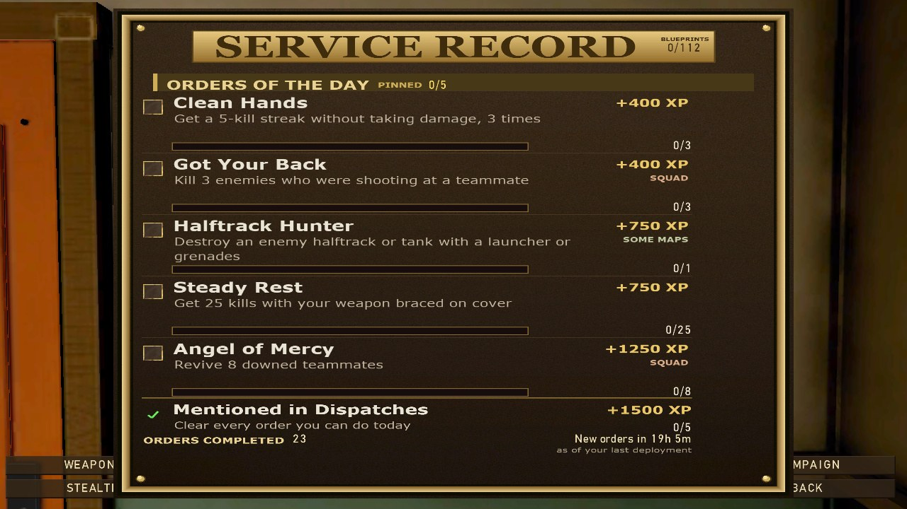

### v1.10.62 - Emotes, a new debrief, Demo Studio and a livelier attic

- **Emotes** - a new EMOTES page on the Tab wheel (coop). Everyone starts with the salute; the rest unlock through rank and Service Record challenges, each with its own icon and a padlock until earned
- **A new mission debrief** - a service-record sheet with a rank bar that fills as your XP counts up, a PROMOTED stamp, each unlock on its own card one at a time, and the challenges you completed that mission. Challenges now pay XP too (100 to 600, +250 for an Elite)
- **Demo Studio: ten new tools** - bullet time, an auto highlight reel, newsreel looks with title cards, a music bed, split screen, a handheld camera, drawing on the picture, trails and heatmaps, a free camera that rides planes, and a Film Room of picture cards. [Demo Editor field manual](docs/demo-editor/DEMO_EDITOR.md)
- **Cover** - the mouse or stick turns the view from cover, and blind fire goes where you look, with a marker for where the rounds land
- **Norway** - rooftop snipers and MG42 nests placed where they can actually hit the defence by the tracks, MG teams that keep coming, snow kicking up under bullets and grenades, and placed guns that pick up and drop like a German's
- **Sounds** - a real bullet-into-flesh hit and a heavier kill confirm (headshots still clank on top), artery hits with a wet impact and an audible bleed-out, and a pickup sound for every weapon off the ground
- **The attic** - a wall clock on your PC's time, a turning fan, the gramophone's arm and record that move, a Field Report board on the wall and a Report-a-Bug toolbox on the desk, the multiplayer door matching on both sides, and Escape in a game now opens the 3D attic and multiplayer room

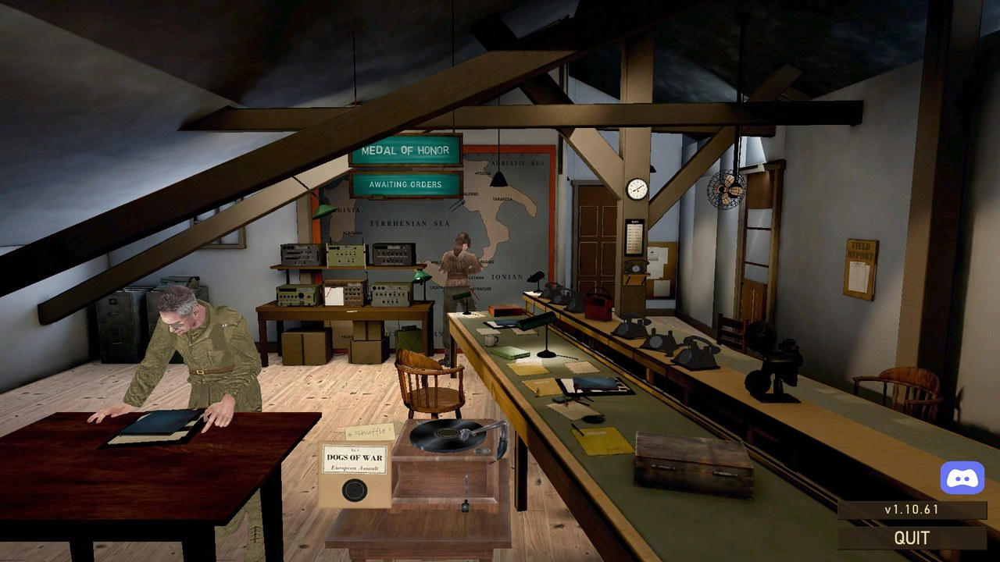 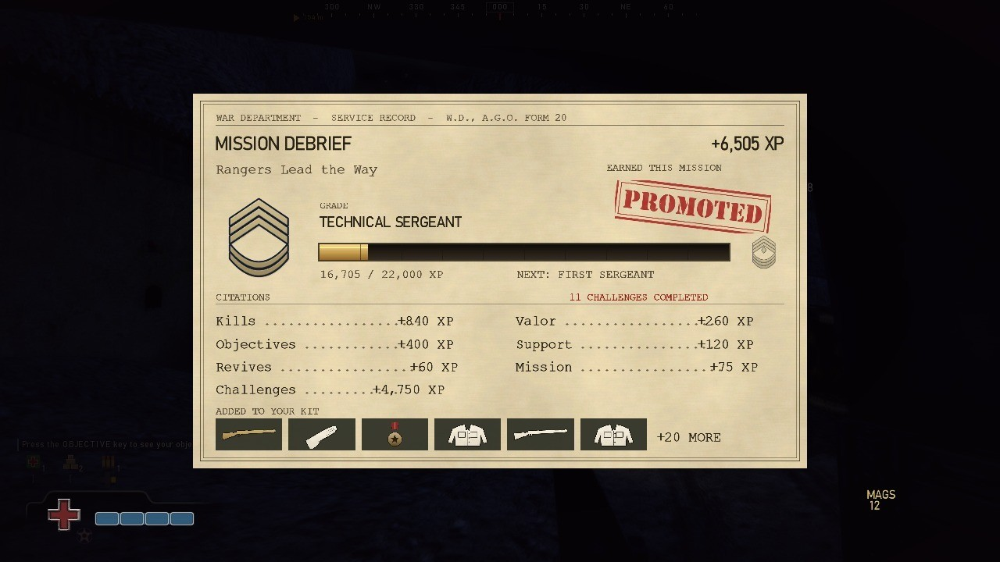

### v1.10.59 - v1.10.61 - The Norway finale, cover fixes, 3D multiplayer menus

- **Norway: the train defence** (v1.10.61) - radio the train crew, call sign **Snowplow**, over a broken, static-filled line, then hold the station until the train comes. Partway through, a blizzard rolls in, the train stops and your objective changes to **Survive** while the Germans push in under the snow. Assault waves come in along real routes from cover, halftracks and MG teams arrive out of sight, Stukas strafe the yard (shoot them down with the new flak gun by the station entrance) and the facility's air-raid siren sounds over it all. Your two allies come in by the gates and hold the train platform
- **Norway: the ending** (v1.10.61) - the facility blows apart in a chain of explosions from the roof to the fuel store; windows and walls blow out, the tall structure comes down in chunks, and fires keep burning in every blast hole
- **Norway: first mission** (v1.10.61) - after Grillo dies, report in to the extraction team from the radio in his guard tower; radio messages across the Norway missions now show in the text feed
- **Cover** (v1.10.59 - v1.10.61) - the wall-cover camera looks out past the corner so you can see what you blind-fire at, low cover sits higher so you can see over it, a new low-cover blind-fire pose, a proper round-the-corner pose on right-hand corners, and **v1.10.60 fixed a crash** when taking cover with the open side to your right
- **3D multiplayer menus** (v1.10.61) - the camera flies to Join Game, Host Game, Armory and Service Record in the multiplayer room; a server browser with internet, LAN and favourites plus a co-op-only filter; the room's exit is the same attic door you came in by. Click the attic gramophone to change the menu music
- **Fixes** - placed guns on Norway pick up with Use, the flak gun and halftracks sound right, leaving a game no longer leaves the 3D menus empty, and a "Norway train finale" test start for testers

### v1.10.57 - v1.10.58 - Seamless cover, the full demo studio

- **Cover, rebuilt** (v1.10.58) - walk into a wall and you take cover; glide along it, stop at door jambs and corners, blind fire round the corner or over the top (never into the wall), aim out with RMB and settle back, all with a third-person camera that eases in and never clips the wall. Works with ping and on a controller
- **Demo studio** (v1.10.58) - press **F1** in any demo for a menu with every tool: sound in renders, trim and save clips, captions, zoom and tilt on camera paths, an auto-director, depth of field, motion blur, see-through outlines, and kill feed / chat / compass / objectives toggles. [Demo Editor field manual](docs/demo-editor/DEMO_EDITOR.md)
- **Fix** (v1.10.57) - demos with camera paths saved before v1.10.56 open again

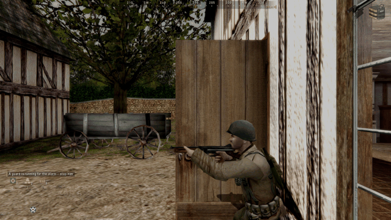

### v1.10.53 - v1.10.56 - Demo studio, Film Room, a new Norway ending

- **Demo studio** (v1.10.56) - slow-motion camera paths, a camera that follows a player, H for a clean shot and L for letterbox bars, highlights you jump between with PgDn / PgUp, an automatic highlight reel (KP 8), a corner view through another player's eyes (I / O) and F10 renders straight to MP4 when ffmpeg is installed. Hold KP 4 / KP 6 to scrub. [Demo Editor field manual](docs/demo-editor/DEMO_EDITOR.md)
- **Film Room** (v1.10.54) - open it from the projector in the attic menu: every demo you have recorded, with a picture and details; play, render, rename or delete. HOME saves an instant replay of the last moments
- **New gun textures** (v1.10.56) - every base gun's wood and metal rebuilt from free CC0 scans, with the camo, blood and metal finishes re-baked to match
- **Norway: a new ending in one unbroken shot** (v1.10.54) - giant roof blasts and fireballs that hang in the air, holes blown across the facade, the yard's small buildings burning and blowing apart, and a shockwave racing across the snow to the train
- **Norway: the hold at the station** (v1.10.55 - v1.10.56) - the Axis push for the boarding platform and hit hardest as the train comes in; two halftracks every time; snipers on the near rooftops; the Allied help hangs back by the train instead of doing the work for you
- **Braced MGs** (v1.10.54) - brace on any waist-high cover and the bipod sits on top of it; the carried MG42 and .30 cal show a heat meter
- **Mission 1** (v1.10.53) - the extra North Africa objectives that could lock a mission's ending are gone

<table>
<tr>
<td width="50%">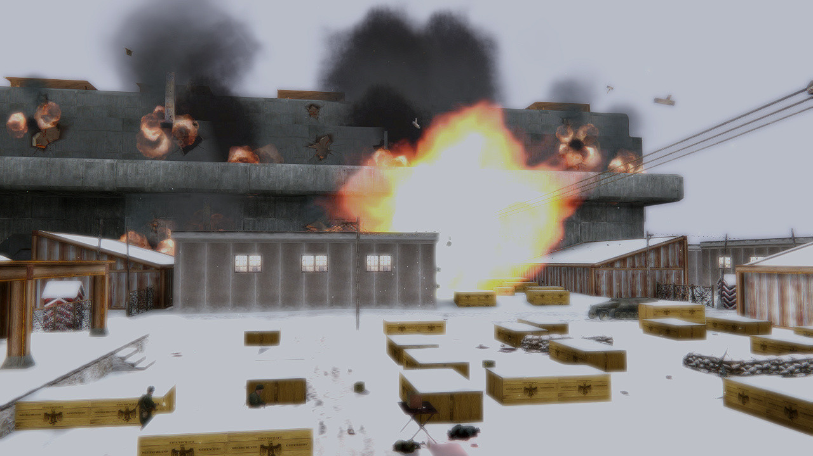</td>
<td width="50%">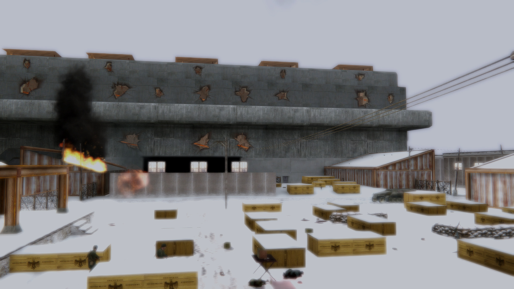</td>
</tr>
<tr>
<td width="50%">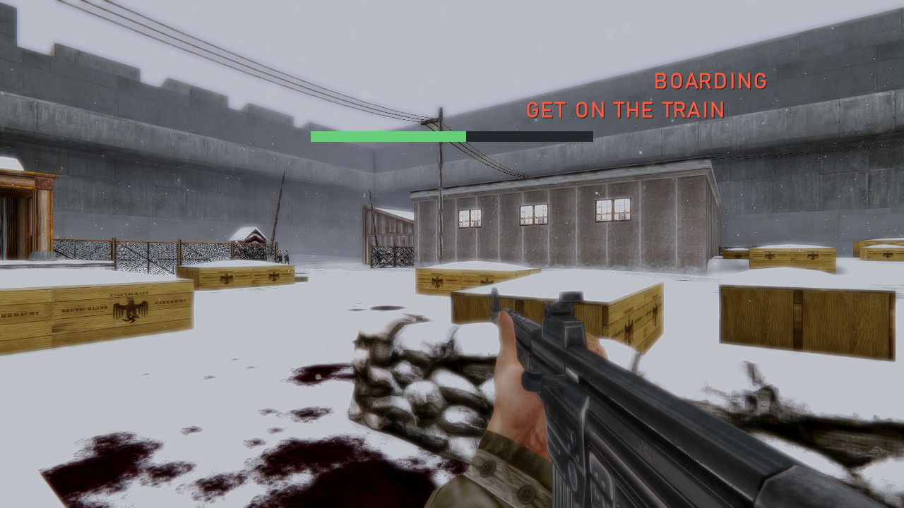</td>
<td width="50%">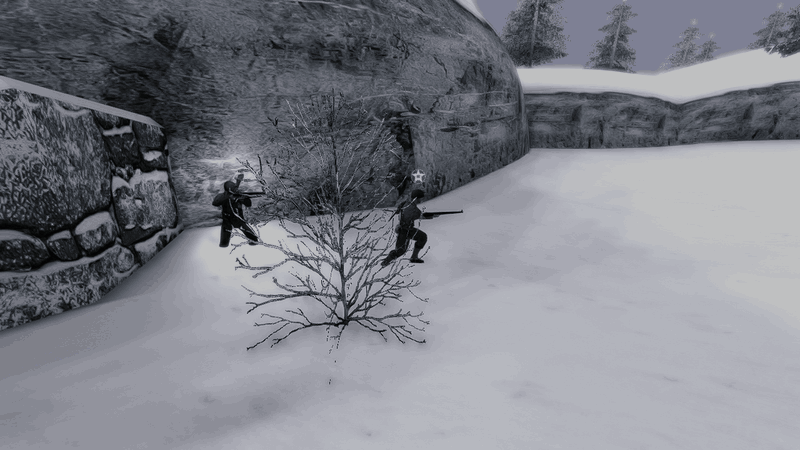</td>
</tr>
<tr>
<td width="50%">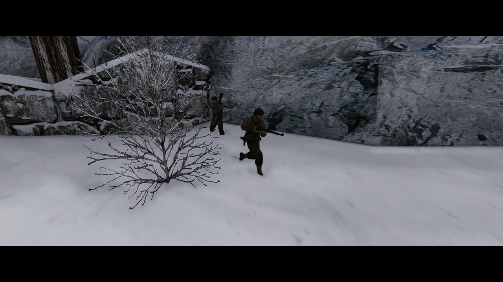</td>
<td width="50%">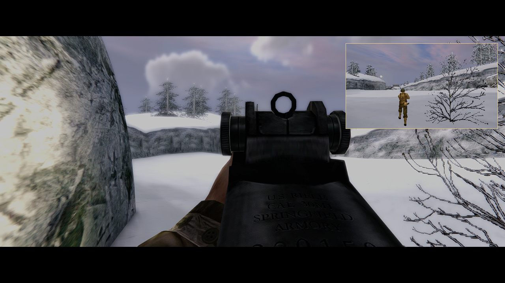</td>
</tr>
</table>

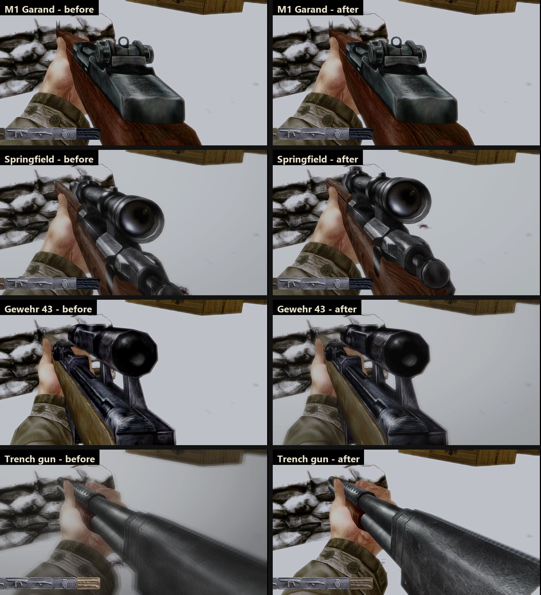

### v1.10.48 - v1.10.52 - Demo editor, Norway rebuilt

- **Demo editor** (v1.10.52) - play back any demo and step out of the soldier's eyes: a free camera you fly with WASD and the mouse, a YouTube-style timeline you can click and drag, smooth camera paths, a clean HUD and film filters. When you host, F9 records the whole map - every player, soldier and effect - so the camera can go anywhere. Full guide: [Demo Editor field manual](docs/demo-editor/DEMO_EDITOR.md)
- **Norway station finale rebuilt** - fuel tanks, charges and the explosives pickup laid out by hand; the storage room is now the armory, with its own objective to plant charges; no invisible walls round the fuel tanks
- **The Axis really push the Norway holdout** - waves from both roadblocks and the facility door, out of sight, through the blizzard; snipers and MG nests on the grey facility
- **MG nests** - walk straight into the sandbag semicircle; the bags block where the bags are, not as one big invisible box
- **Carried MG42 and .30 cal** - braced on the bipod they barely kick, and they overheat like the mounted MG42s
- **Fixes** - no soldiers spawning inside props, freed POWs leave the map instead of standing there, no suppression from bullets behind a wall

<table>
<tr>
<td width="50%">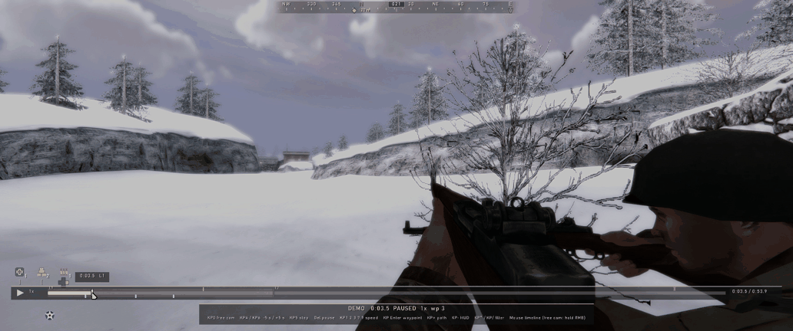</td>
<td width="50%">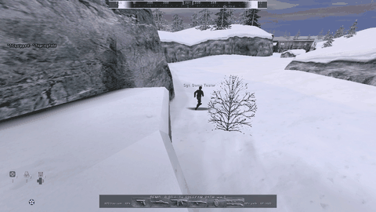</td>
</tr>
<tr>
<td width="50%">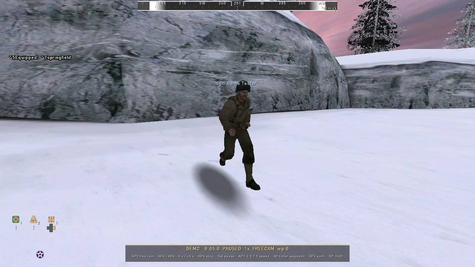</td>
<td width="50%">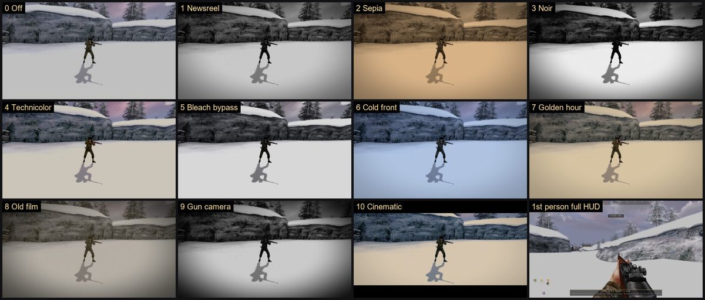</td>
</tr>
<tr>
<td width="50%">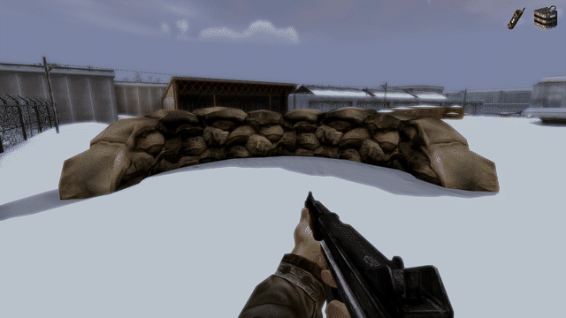</td>
<td width="50%">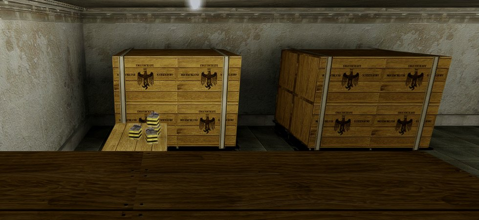</td>
</tr>
<tr>
<td width="50%">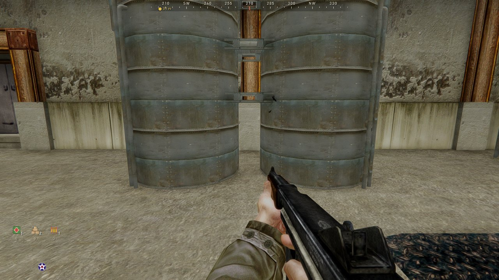</td>
<td width="50%"></td>
</tr>
</table>

### v1.10.44 - v1.10.47 - Weapon wheel, controllers and the Norway holdout

- **Norway holdout** - secure the defensive line before the prep countdown; the Axis push into the line and on to the train platform (blizzard or not), a second MG halftrack through the east roadblock, respawns behind cover, a shorter storm, storage-room guns picked up with F
- **Controller feel** - round deadzone sized for your pad, exponential look curve, a light aim-assist slowdown over enemies; in cover L3 goes to the sights and R3 swaps shoulders

- **Weapon wheel** - hold Tab (or Y on a controller) and point at a slot: every slot shows the exact gun you carry, with its ammo; carry two of a kind and the mouse wheel or D-pad picks which. Right-click or LB / RB flips to the abilities wheel - ammo box, sandbags, medkit, airstrike, paradrop - with how many you have
- **New keys** (set once, rebind any time) - scoreboard on B, 8 medkit, 9 sandbags, 0 ammo box
- **Controllers** - PlayStation, Xbox and generic pads are recognised automatically and show their own buttons; a Controller Layout page (Options > Controls > AIM / SENSITIVITY) shows your pad and lets you rebind every button; the touchpad / Share button opens the objectives
- **U-boat missions** - radio the Assault team from the pens and the U-boat, and a hidden way onto the U-boat: the Seaside Stowaway challenge
- **Holding your breath** through a scope now costs stamina

### v1.10.38 - v1.10.43 - Two new finales and a 3D attic menu

- **U-boat pens finale (early access)** - destroy two U-boats by defending crane drops, then hold the radio room while reinforcements push in
- **Norway station finale (early access)** - grab the demolition charges (and the weapons in the storage room), rig the comms gear and fuel tanks, kill the station commander, then hold the station through a building blizzard until the train arrives - with snipers and MG42 nests on the rooftops
- **The 3D attic is the main menu** - fly to the doors, the map, the desk or the radio shelf; the chalkboard names what you point at, and Manon and General Weathers work the room
- **Officer reinforcements and enemy voice lines work again** (broken since v1.10.38), and the menu cursor no longer sticks in the lobby
- **Fixes** - Spearhead's parachute cut in the barn, Omaha's beach crowd no longer drowns the mix, New Objective cards match the objective list, dropped MG42s can be picked up again
- **Scopes (work in progress)** - coated glass on the lens from the hip, the live view when you aim

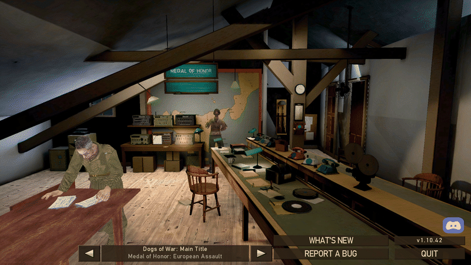
The attic main menu: General Weathers at his table, Manon at the map.

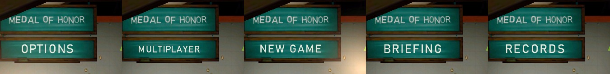
Point at a door or the radio shelf and the chalkboard names it.

### v1.10.23 - v1.10.37

- **v1.10.37** - 3D Options attic with a radio shelf, soldiers react to blasts, burning wrecks and scorch marks, bolts that cycle, realistic shell ejection, stress reloads, soft-lock fixes on m4l1-m4l3, m5l1a and m5l2b
- **v1.10.36** - a WW2 radio room for the settings, full HD loading movies, real gamepad button icons, an alarm switch-off
- **v1.10.35** - a new 3D main menu (the Breakthrough attic), keyboard-driven menus, alarm snipers on eight maps
- **v1.10.34** - bolts and cocking handles that move on every shot, hand-on-bolt reloads, new gun finishes
- **v1.10.32 - 33** - a squad lobby before every mission, the Showroom Armory, a busier battlefield, cutscenes without crosshairs, text sized right on every screen
- **v1.10.29 - 31** - smarter Germans (squad tactics, alarms they run for, counter-attacks after the main objective), a cleaner HUD, a better Armory
- **v1.10.23 - 28** - your XP, rank, challenges and unlocks follow you to any server; smooth joins and play on dedicated servers at any frame rate; briefing and lobby fixes

**Public co-op servers:** **MOH Coop Trilogy #1, #2 and #3** run the whole trilogy back to back - find them in Multiplayer > Join Game.

### v1.10.22 - Eyes on Target

- **Aimed reloads that stay on target** - BAR, StG 44, DP-28, the MP40s, 17 pistols (now aimed **two-handed**), the bolt-action rifles, and a pump shotgun with real sights that pumps while you aim
- **Two new guns** - the **Gewehr 43 with iron sights** and a **Double Barrel shotgun**
- **Looting** with the Use key - pick up enemy guns and ammo, search bodies
- **A paratrooper squad** that holds a line and sets up a .30 cal you can man
- **Rain that reaches the ground**, plus rare blizzards and downpours
- **New scope view** with each optic's own reticle, clouds on by default, smoother Frame Generation (beta)

<table>
<tr>
<td width="50%">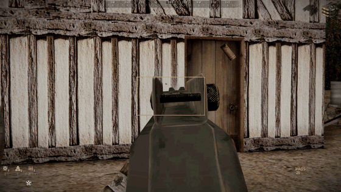 BAR reload without leaving the sights</td>
<td width="50%">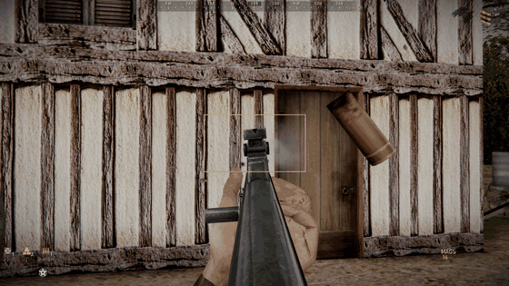 StG 44, same idea</td>
</tr>
<tr>
<td width="50%"> The shotgun pumps between shots while you aim</td>
<td width="50%"> New Double Barrel shotgun (mesh by Jean PFP, CC0)</td>
</tr>
<tr>
<td width="50%"> Pistols aim two-handed and reload on target</td>
<td width="50%"> Paratroopers set up a .30 cal on cover</td>
</tr>
</table>

Downpour, before and after: the rain now falls all the way to the ground.

<b>Earlier releases</b> (full notes for every version are on the <a href="https://github.com/MOHCoopTrilogy/releases/releases">Releases page</a>)

- **v1.10.21 - All Cores Forward** - big battles much faster (Omaha ~31 → ~75 fps on our test PC), a Graphics Quality control with a Recommended button, exact frame-rate limits, Frame Generation (beta), an enemies-remaining counter
- **v1.10.20 - Clear the Beach** - Omaha ~19 → ~31 fps, Quality Presets, join-in-progress crash fixed, U-boat / Omaha bunker / church-defence blockers fixed
- **v1.10.17-19 - Steady Aim** - first reloads while aiming (Garand, PPSh, Thompson, Moschetto, then most guns) and bolts worked while aiming
- **v1.10.14 - Quick Hands** - fast quick draw, smarter sprint, authentic belt / drum / pan reloads, a cleaner HUD and mission debrief, visible paratrooper planes, nation-matched voices
- **v1.10.4 - On Target** - iron sights that line up in every stance, MSAA on by default, footprints, briefing films for joiners
- **v1.10.3 - Storm Front** - realistic lightning, water reflections and puddles, bodies that react to blasts
- **v1.10.0-2** - HD skies and moving clouds, dust storms, multiplayer weather, 116 loading tips, headlights, and a tribute to Vince Zampella

<table>
<tr>
<td width="50%"> Video with the Quality control and the Recommended button"> v1.10.21: one Quality control with a Recommended button</td>
<td width="50%"> v1.10.21: enemies-remaining counter</td>
</tr>
<tr>
<td width="50%"> v1.10.14: quick draw (old left, new right)</td>
<td width="50%"> v1.10.14: the .30 cal takes a belt</td>
</tr>
<tr>
<td width="50%"> v1.10.14: paratrooper C-47s you can see</td>
<td width="50%"> v1.10.4: sights line up in every stance</td>
</tr>
<tr>
<td width="50%"> v1.10.3: realistic lightning</td>
<td width="50%"> v1.10.3: wet ground in rain</td>
</tr>
</table>

## Screenshots

<table>
<tr>
<td width="50%"></td>
<td width="50%"></td>
</tr>
<tr>
<td width="50%"></td>
<td width="50%"></td>
</tr>
<tr>
<td width="50%"></td>
<td width="50%"></td>
</tr>
<tr>
<td width="50%"></td>
<td width="50%"></td>
</tr>
<tr>
<td width="50%"></td>
<td width="50%"></td>
</tr>
</table>

## Features

<b>Full-campaign co-op</b>

- 50+ missions across all three campaigns with working objectives, cutscenes, escorts and vehicle rides
- **Down-But-Not-Out**: go down instead of dying, crawl, and self-revive with a medkit or bleed out
- Optional **Last Man Standing** lives pool, spawn protection, and enemy counts that scale with your squad
- **Officer bosses** that radio in reinforcement waves; kill them for airstrike binoculars and supply-drop smoke
- Allied escorts go down instead of dying and can be revived

<b>Multiplayer, modes and bots</b>

- A dozen modes with friends or bots: Push, Base Assault, Domination, King of the Hill, CTF, Countdown, Assassination, Demolition, Gun Game, Freeze Tag, Prop Hunt, Last Man Standing
- Modifiers: One-Shot, One-Ammo, Hardcore, Realism
- Bots that play the objective; drivable tanks and jeeps, mountable Flak 88s and Nebelwerfers
- Campaign maps playable in Push and Base Assault; XP and challenges carry across co-op and multiplayer
- Kept fully separate from co-op by an automated check on every build

<b>The Armory and unlocks</b> (F7)

- Choose two primaries, a sidearm and a grenade from 70+ weapons, with live 3D previews
- Hundreds of weapon finishes and credited community model variants, plus helmets, uniforms and skins
- Everything is **earned, never bought or random**: through rank, challenges and hidden blueprints
- Changes made mid-mission land in your hands in seconds

<b>Weapon feel and movement</b>

- Guns have weight: recoil, recovery, sway and breathing scale with what you carry
- Aim down sights on its own key, with **reloads and bolt / pump work that keep you on target**
- Sprint and stamina, lean, vault, weapon bash, quick draw, take cover *(experimental)*
- First person, third person and a free camera on one key; emotes; deployable ammo boxes and sandbags

<b>Enemies, ragdolls and gore</b>

- Germans take cover, go prone, flank, retreat when hurt, and sometimes surrender (and can be recruited)
- AI grenades work again (an engine bug had blocked almost all of them)
- **Ragdolls** on by default: bodies land on what's under them and react to bullets and blasts (`coop_ragdoll 0` turns them off)
- Blood trails, wounds and pools on a strict budget; helmets that fly off

<b>Audio</b>

- Re-recorded guns from licensed sound libraries, 60 new explosions, and handling sounds for your hands
- Reverb by room type, occlusion through walls, HRTF for headphones, distant gunfire that sounds distant
- Near-miss cracks, tinnitus after close blasts, 1,389 unused retail voice lines restored
- A real mixer (Master, Music, SFX, Ambience, Dialogue) and an output-device picker

<b>Visuals and weather</b>

- Bundled HD texture, character, world, FX and sky packs
- Bloom, ambient occlusion, sharpening, MSAA and optional Frame Generation (beta)
- Rain, snow, dust storms and lightning with wet ground, puddles and water reflections
- Layered vehicle deaths, restored headlight glow, teammate and officer icons

<b>HUD, progression and settings</b>

- A HUD that fades when things are quiet; Coop Settings, Advanced Graphics and Post-FX menus
- Persistent XP with 13 WW2 US Army ranks, 445 challenges, medals, and pinned challenge tracking
- A What's New report after each update and a Report a Bug button in game

<b>Map and engine work</b>

- Every campaign map repaired for co-op: objective failsafes, rebuilt convoy and jeep rides, the U-boat stealth mission made a real stealth mission, ~550 missing German soldiers restored on Spearhead and Breakthrough
- Engine limits raised (entities, models, sounds) with guards so they can't silently regress; dozens of crash fixes
- 2,000+ fixes logged with root causes: **[every fix, by area](docs/public/BUGFIXES.md)**

Full generated reference: **[Features](docs/public/FEATURES.md)** · **[Maps](docs/public/MAPS.md)** · **[Challenges](docs/public/CHALLENGES.md)** · **[Unlockables](docs/public/UNLOCKABLES.md)** · **[Roadmap and known issues](docs/public/ROADMAP.md)**

## Known issues

Read before reporting

**Newest and least settled:** the U-boat pens and Norway finales (early access), the 3D attic main menu, the scopes, the multiplayer modes and bots (little human playtesting yet), ragdolls, take cover, the free camera, the jeep and tank machine-gun seats, and squad AI behaviour.

**Open bugs:**
- e3l4: a jeep passenger can fail the first supply run (failsafes still complete the mission)
- t2l2: some extra MG42 nests go unmanned and one German vehicle can fail to appear (the map still plays through)
- m1l1: a couple of Rangers on the opening truck can render with mangled limbs
- The down-but-not-out crawl animation plays backwards
- Reload magazines keep the stock skin on a finished gun
- Pinned challenges have no in-mission panel yet
- OpenGL2 renderer: some animated lights pulse red, and distant objects can pop through fog
- Dedicated servers crash on plain deathmatch maps (listen servers are fine)

Found something else? Use **Report a Problem**, post on Discord, or open an [issue](https://github.com/MOHCoopTrilogy/releases/issues).

## Roadmap

No dates promised: online play without port forwarding, skill trees (Ranger, Corpsman, Pathfinder), a carryable MG42, new player animations, a wave-survival mode, and in-game update notices.

**Want to help?** We're looking for animators, mappers and artists (new weapons and skins, aimed animations, map ports). It's a passion project and nobody is paid, including me. Say hi on **[Discord](https://discord.gg/ukumnzBAhK)**.

## Credits

- **chrissstrahl, Smithy (1337Smithy) and HaZardModding** - the original [HZM Coop Mod](https://github.com/HaZardModding/hzm-mohaa-coop-mod) this project builds on, and its testers and community ([hazardmodding.com](http://www.hazardmodding.com))
- **The OpenMOHAA team** - the open-source [engine](https://github.com/openmoh/openmohaa)
- **HD packs** by their authors: *MOHAA HD Project*, *HRRTM - HD Realism Texture Mod* (and its blood addon), HD gun sounds, geared soldiers and HD foliage packs, plus in-house upscales made for this project
- **Weapon models and finishes** by their original authors, credited individually in game; the Double Barrel shotgun mesh by **Jean PFP** (OpenGameArt, CC0). Archive-era content is included with attribution and removed on request
- **Sound design** from licensed professional sound libraries
- **2015, Inc. / Electronic Arts** - the original *Medal of Honor: Allied Assault* trilogy

*MOH Coop Trilogy is an independent, non-commercial fan project, not affiliated with or endorsed by Electronic Arts, 2015 Inc. or any other Medal of Honor rights holder. All trademarks and assets remain their owners' property. A legitimate copy of the game is required.*

## License

- **Engine fork** - GPLv2, source at [MOHCoopTrilogy/openmohaa](https://github.com/MOHCoopTrilogy/openmohaa) (upstream [openmoh/openmohaa](https://github.com/openmoh/openmohaa))
- **Mod scripts and content** - the original HZM Coop Mod's terms; see `hzm_legal.txt` in the [mod repo](https://github.com/MOHCoopTrilogy/hzm-mohaa-coop-mod)
- **Game assets** - remain their owners' property

## For developers

| Repo | Holds |
|---|---|
| [MOHCoopTrilogy/releases](https://github.com/MOHCoopTrilogy/releases) | This repo: downloads, the update manifest, the build and installer pipeline (`build.ps1`, `installer/`, `updater/`, `publish_release.ps1`) |
| [MOHCoopTrilogy/hzm-mohaa-coop-mod](https://github.com/MOHCoopTrilogy/hzm-mohaa-coop-mod) | Mod source: scripts, UI, configs, assets |
| [MOHCoopTrilogy/openmohaa](https://github.com/MOHCoopTrilogy/openmohaa) | Engine fork source (GPLv2) |
