# Demo Editor - Field Manual

Play back any recorded demo, step out of the soldier's eyes, fly a free camera around the fight,
lay down smooth camera paths, hide the HUD and put a film look over the picture. It is all built
into the game: nothing to install, nothing external. Run it from the numeric keypad or the console.

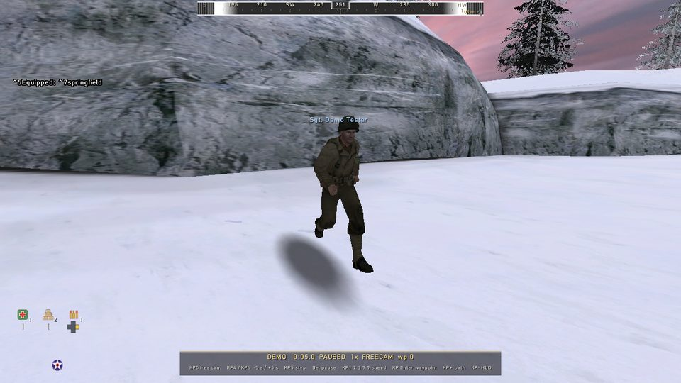

## Quick start

1. **Record while you play.** Press **F9** to start and stop, or type `record mynight` in the
   console (`~` or `§`) and `stoprecord` when you are done.
2. **Play it back** with `demo mynight`. The editor is on for every demo, old ones included.
3. **Press KP 0** to leave the soldier's eyes. Fly with **W A S D** and the mouse; **Space** goes
   up, **Ctrl** goes down.
4. **Press Del** to pause, **KP 4 / KP 6** to jump 5 seconds back or forward. At the end, the demo
   holds on its last frame instead of quitting.
5. **Press F1** for the menu: every tool in one place.

## The menu (F1)

**F1** opens the demo editor's menu over the picture. Every tool is listed there by section -
Camera, Path, Playback, Picture, Overlays, and the rest - each line with its shortcut key beside it:

- **Switches** (ON / OFF): click to turn the tool on or off.
- **Values** (zoom, tilt, speed, letterbox shape, filter strength ...): click **-** or **+**, or drag
  the slider.
- **Text** (captions): click the box, type, **Enter** to keep it, **Esc** to drop it.
- **Buttons** (GO): run the action, like adding a waypoint or jumping to the next highlight.

The mouse has its own cursor while the menu is open, and the shortcut keys keep working. The
**mouse wheel** scrolls when the list is longer than the screen. **F1**, **Esc** or the **X** in
the corner closes it. The menu is never in an F10 render.

The menu and every demo key only exist while a demo plays. In a game, F1, G, 1 - 4 and the
rest do exactly what you bound them to - your weapon slots, your grenade key, your vote key - and
nothing in your config is changed.

## The keypad

| Key | Does |
|---|---|
| F1 | The menu: every tool, switch and setting |
| KP 0 | Free camera on / off |
| KP 4 / KP 6 | Back / forward 5 seconds; hold to scrub, faster the longer you hold (2x up to 32x) |
| KP 5 | Step one snapshot (pauses) |
| Del or KP . | Pause / resume |
| KP 1 / 2 / 3 / 7 / 9 | Speed 0.5x / 1x / 2x / 4x / 5x |
| KP Enter | Add a camera waypoint |
| KP + | Play / stop the camera path |
| KP - | HUD: full, player names only, none |
| KP * / KP / | Next / previous filter |
| H | Clean shot: no HUD, crosshair, gun, arms or name tags |
| L | Letterbox bars |
| PgDn / PgUp | Next / previous highlight |
| KP 8 | Build and play the highlight reel |
| I / O | Corner view on / off, next player in it |
| G | Auto-director on / off |
| Z / X | Zoom in / out (free camera FOV; Shift for 1-degree steps) |
| , / . | Tilt the free camera left / right (Shift for 1-degree steps) |
| 1 / 2 / 3 / 4 | Kill feed / chat / compass / objectives on / off |
| [ / ] | Mark a clip's start / end on the timeline |
| \ | Save the marked clip as its own demo |
| Y | Add a caption here (opens a text box) |
| Del | With a clip bracket or caption selected: remove it (otherwise pause) |
| M | Sound in renders on / off |
| J / Shift+J | Depth of field on / off, stronger |
| K / Shift+K | Motion blur on / off, stronger |
| B | Outlines through walls: off, players, players + AI |
| W A S D, Space, Ctrl | Fly the free camera (Shift 3x faster, Alt slower) |
| Mouse | The timeline cursor; in the free camera, look around (works while paused) |
| Right mouse (hold) | In the free camera: the timeline cursor instead of looking |
| Esc | Leave the demo |

Your own key bindings are untouched, F10 and F11 included.

## Timeline

A bar along the bottom of the screen, like a video player's, shows up by itself whenever a demo
plays with the full HUD. It shows the time played and the demo's full length, across map changes.

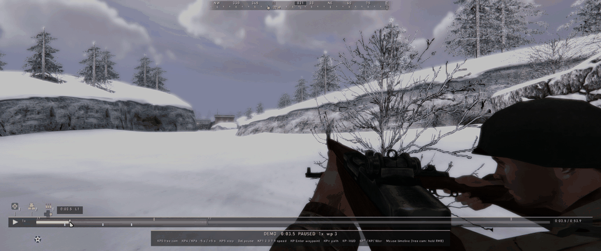

- **Click** anywhere on the bar to jump there. **Drag** to scrub: the picture follows the mouse.
- **Hover** to see the time under the mouse. The **mouse wheel** over the bar jumps 5 seconds.
- **The play button** on the left pauses and resumes; the speed is shown next to it.
  Clicking in the picture also pauses and resumes.
- **Markers:** green ticks are enemy soldiers killed (by anyone), orange ticks are player and
  allied deaths, a red flag is the recording player's own death, a gold square is an objective
  added or completed, and a blue tick below the bar is a camera waypoint. Hover a marker to see
  what happened; click it to jump to that moment.
- **Highlights:** your kills, multi-kills, close explosions, wrecked vehicles and completed
  objectives are marked too. **PgDn** jumps to the next one, **PgUp** to the one before.
- **Long demos** scrub as fast as short ones: once a stretch has been played or jumped through,
  jumping back into it is instant.
- **Map changes** split the bar (L1, L2 ...). The map that is loaded is lightly shaded. A drag
  stays inside it; let go past the split and the other map loads.
- **In the free camera** the mouse turns the camera, so hold the **right mouse button** to get the
  cursor.
- The bar is never in a clean picture: it hides with the KP - modes, and neither the bar nor the
  editor panel is in an F10 render. `demo_timeline 0` turns it off.
- **F10 renders** play steady at 60 fps, however slow the PC renders, and stop by themselves at
  the demo's last frame. With [ffmpeg](https://ffmpeg.org) installed (on your PATH, or named by
  `cl_ffmpegPath`) the result is a small `videos/videoNNNN.mp4`; without it you get the AVI as
  before. `cl_aviMp4 2` keeps both, `0` AVI only. The video carries the game's sound (see
  Render sound below).

## Trim and save clips

Mark a piece of the demo and keep it as its own demo.

- **[** marks the clip's start at the playback time, **]** its end. They show on the timeline as green
  brackets, with the range between them shaded.
- **Click a bracket** to select it (it turns white and the picture jumps to that frame); **drag it** to
  move it, and the picture follows while you drag. **Del** with a bracket selected clears it (the start
  clears both).
- **\\** saves the range as a new demo, `demos/<demo>_clipN.dm_17`, which the Film Room lists. If you
  dragged a bracket, the editor first visits the start and end to mark them (the bar says SAVING
  CLIP...) and then brings you back. Captions inside the range go with the clip.
- **Render range only** (F1 menu, Timeline): with it on, a render of this demo (F10 or the Film Room's
  render) records only the marked range and finishes the video at its end. It wins over a saved
  highlight reel.
- The points are kept per demo, in `demos/cameras/<demo>.clip`.

## Titles and captions

Put text on screen at a moment of the demo; it burns into renders.

- **Y** opens a text box at the playback time (the picture holds still) - with the F1 menu open
  too, or from the menu's **Add caption** (which closes the menu first). Type, **Enter** keeps it,
  **Esc** drops it. Left / Right / Home / End / Backspace / Delete edit as usual.
- A caption shows lower centre for **Caption length** seconds (F1 menu, Timeline; default 4), fading in
  and out.
- Each caption is a lilac tab under the timeline, with a band for how long it shows. **Click** it to
  select it (the picture jumps there), **click again** or press **Enter** to edit it, **Del** removes it.
  Emptying the text and pressing Enter removes it too. Changing Caption length while a caption is
  selected changes that one.
- Captions are kept per demo, in `demos/cameras/<demo>.cap`; deleting the demo in the Film Room removes
  them.

## Highlight reel

**KP 8** builds a reel of about a minute from the demo's best highlights and plays it. Press
**F10** while it plays to render just the reel. `demo_reel clear` goes back to the whole demo.

## Free camera

Away from the soldier's eyes, every player is drawn as his full character, from any angle and
distance: his uniform, helmet, gear, the gun in his hands and the ones on his back, every armory
skin and every armory gun, animating exactly as recorded - sprinting, sliding, prone, leaning,
aiming, reloading, throwing, dying. Weather falls around the camera and the soldier's own sounds
come from where he stands.

The camera ignores whatever happens to the soldier's own view. When he scopes in or aims down his
sights, the camera keeps its own field of view and no scope overlay is drawn:

| His eyes, scoped | The free camera, same moment |
|---|---|
| 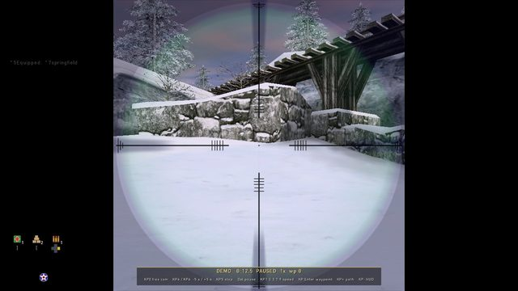 | 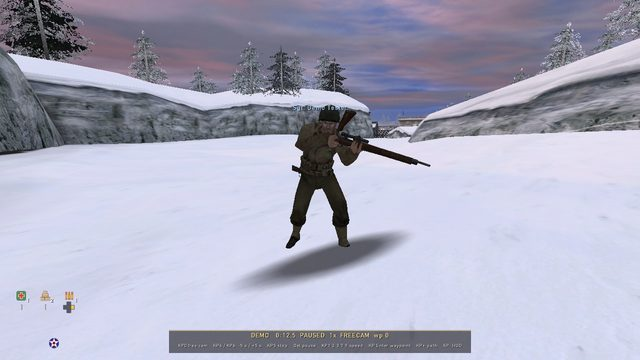 |

To frame a particular player, use his slot number from `demo_names`:
`demo_camera chase 200 90 80 1` puts the camera 200 units from player 1, 90 degrees round from
where he faces, 80 units up.

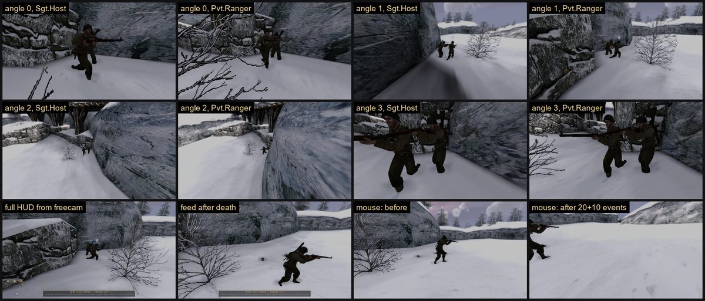

## Camera paths

Pause, place the camera, press **KP Enter**; move on in the demo, place it again, press KP Enter
again. **KP +** flies the camera through every waypoint on a smooth curve, in step with the demo's
own time. Waypoints added at the same moment play as a fly-through instead
(`demo_pathSegTime` seconds per leg).

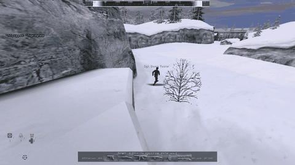

| Command | Does |
|---|---|
| `demo_waypoint add` | Adds a waypoint at the camera, now |
| `demo_waypoint update 2` | Moves waypoint 2 to the camera (`retime` also moves its time) |
| `demo_waypoint delete 2` | Deletes waypoint 2 |
| `demo_waypoint goto 2` | Jumps to waypoint 2 |
| `demo_waypoint list` | Lists them |
| `demo_camera_clear` | Deletes them all |

**Slow motion.** Give a waypoint its own speed and the path slows into it and speeds back out:

```
demo_waypoint speed 2 0.25     // waypoint 2 plays at quarter speed
demo_waypoint speed 0.5        // the waypoint nearest the camera, half speed
```

The change is eased from one waypoint to the next, so nothing jolts. `demo_waypoint list` shows each
waypoint's speed, and the status line shows the speed as it ramps.

**Keep someone in shot.** While the path flies the camera, it can keep aiming at a player or a spot:

| Command | Does |
|---|---|
| `demo_path follow 1` | Keep player 1 centred (`demo_names` lists the slots) |
| `demo_path lookat` | Keep aiming at whatever the centre of the view is on now |
| `demo_path lookat 120 -340 64` | Keep aiming at that point |
| `demo_path follow off` | Back to the waypoints' own aim (`lookat off` does the same) |

Speeds and the aim lock are saved with the path.

**Zoom and tilt.** **Z** zooms the free camera in and **X** out; **,** and **.** tilt it left and
right. Each press shows the new value for a moment (hold **Shift** for 1-degree steps). Set them
before **KP Enter** and the waypoint keeps them: the path then eases the zoom and the tilt from one
waypoint to the next, the same way it eases the speed. The menu has a slider for each.

## The auto-director

**G** hands the camera to the auto-director. It frames one player at a time - over the shoulder,
side on, low from the front, high and wide - and cuts to a new shot every few seconds. Just before
a highlight, a kill or a death it cuts to the player it is about: wide for explosions, vehicles and
multi-kills, close for one man's kill. It pulls the camera in rather than look through a wall.

It runs on the demo's own clock, so the highlight reel (KP 8) and an F10 render get the same cuts
every time, and a jump on the timeline re-frames at once. **G** again, **KP 0** or playing a camera
path hands the camera back.

## A clean picture, and filters

**KP -** hides every HUD element - in play too, including while F9 records, and it stays hidden
through map changes and into an F10 render. The scope and iron-sight picture stays: it is the view,
not the HUD. The console command is `cleanhud`.

| Full HUD | KP - |
|---|---|
| 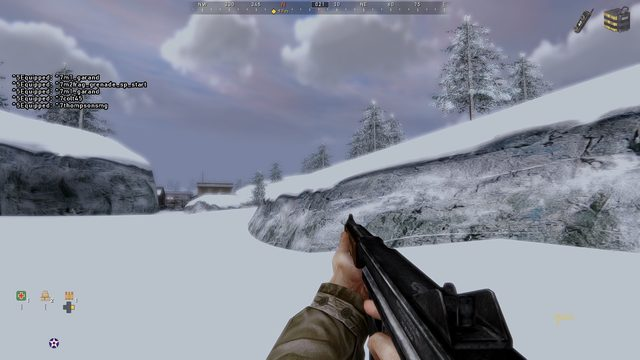 | 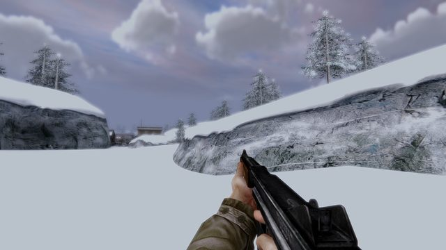 |

**KP *** and **KP /** step through ten film looks, in play or in a demo. The name shows for a
moment, unless the HUD is hidden, so it never lands in a clean recording.

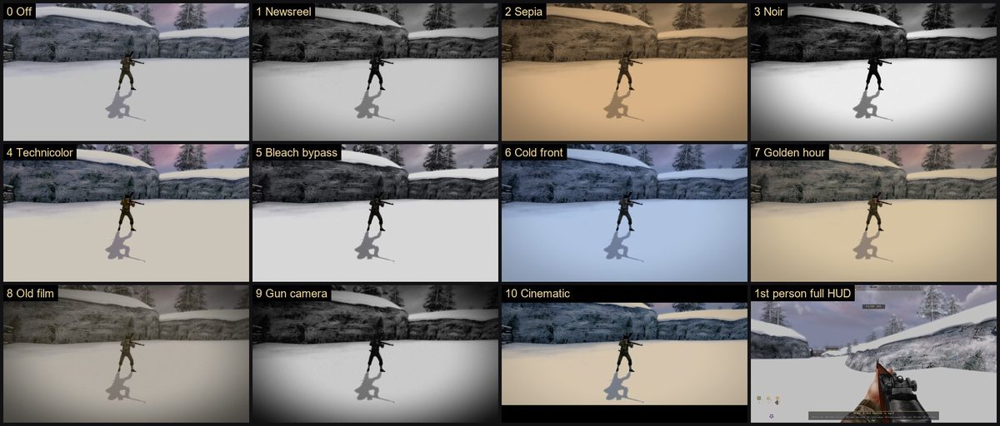

**H** is the clean shot: no HUD, crosshair, gun, arms, name tags or icons over heads, just the
scene. Through a scope the scope view stays. Press **H** again to get back what you had.

**L** adds black letterbox bars for a 2.39:1 picture. `demo_letterbox 1.85` picks another shape,
`demo_letterbox 0` turns them off. Both stay on through an F10 render.

`filter list` prints them, `filter sepia` or `filter 2` picks one, `filter off` clears it, and
`r_ppFilterStrength 0.5` softens any of them. Cinematic adds 2.39:1 bars on screens narrower than
that.

## Film effects for renders

**Depth of field (J)** blurs what is nearer or farther than the focus point, like a film camera.
**Shift+J** makes it stronger one step at a time (0.1 to 1.0, then back round); stronger means a
shallower sharp band. At **Focus distance** 0 (F1 menu) the focus is automatic: on the player or
point a camera path's aim lock holds, otherwise the nearest thing around the centre of the screen.
Set a distance to fix it there. The first-person gun always stays sharp.

**Motion blur (K)** smears the picture along the camera's movement. **Shift+K** makes it stronger.
Playback shows a quick preview; an F10 or Film Room render does the full effect by blending several
in-between frames into each video frame (`demo_mblurFrames`, default 4), so the render takes that many
times longer.

**Outlines (B)** draw the players - or, one press later, the players and every AI soldier - as
coloured outlines you can see through walls: blue for the Allies, red for the Axis, with a faint fill
where a wall hides them. They go into renders while they are on, and only cover the soldiers the demo
carries.

All three need the gl2 renderer; in gl1 the switches do nothing. Their strengths and the focus
distance have sliders in the F1 menu (Render, Players).

## Render sound

F10 and Film Room renders record the game's sound with the picture, and the MP4 gets it too.
While a render runs the sound goes into the video file instead of your speakers, so you hear nothing
until it finishes. Picture and sound stay in step however long the render, through jumps and map
changes. A jump back into an earlier map in the middle of a render reloads the demo and carries on
in the same video.

- **M** (while a demo plays) turns render sound on or off; it is on to begin with.
- Your game volume does not matter: a muted game still records full sound. **Render volume** in the
  F1 menu (Render) sets the file's level, 0 to 2x.
- Turned off during a render, the rest of that video is silent; turned on during a render that started
  without sound, it applies from the next render.

**Pick what stays on screen.** With the full HUD up, **1** turns the kill feed off and on, **2** the
chat, **3** the compass and **4** the objective cards and panel - each on its own, so you can keep
the compass and lose the chat. They stay as you leave them, for every demo; in a game they change
nothing.

## Other players, map changes

Every player in the demo, not only the one who recorded it, plays back with his own skin, helmet
and guns. A demo that changes map part-way plays straight through: the clock runs on across the
change, seeking works everywhere, and jumping back into an earlier map reloads the demo for you.
You can start another demo with `demo name` while one is playing.

**I** opens a corner view through another player's eyes while you watch; **O** switches it to the
next player. It sits on top of letterbox bars and filters stop at its edge.

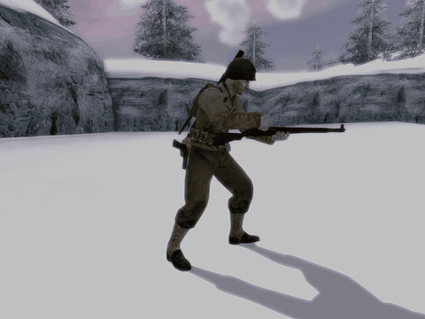

## Renaming players

```
demo_names
demo_setname 0 "Sgt. Demo Tester"
demo_setname 0 -          // back to the recorded name
```

The new name shows over his head, on the scoreboard and in the kill feed.

## Every command

| Command | Does |
|---|---|
| `demo_seek 1:30` | Jump to a time (seconds or minutes:seconds) |
| `demo_seekby -10` | Jump relative to now |
| `demo_step 3` | Pause and step 1 (or 3) snapshots |
| `demo_pause` | Toggle pause; `1` / `0` sets it |
| `demo_speed 0.25` | Playback speed, 0.05 to 16 |
| `demo_camera ...` | `on`, `off`, `fov 70`, `speed 500`, `chase`, `where`, `set`, `save`, `load` |
| `demo_waypoint ...` | See Camera paths |
| `demo_path play` | Play / stop the path |
| `demo_hidehud` | Cycle the demo HUD modes, or `0` / `1` / `2` |
| `cleanhud` | Hide / restore every HUD element |
| `filter ...` | Pick a filter |
| `demo_names` | List the players by slot |
| `demo_setname 3 "Name"` | Rename slot 3 (`-` restores) |
| `demo_waypoint speed [n] <x>` | Playback speed at a waypoint, 0.05 to 16 |
| `demo_path follow <slot>` / `lookat [x y z]` | Aim lock while the path plays (`off` clears) |
| `demo_clean` | Clean shot on / off (H) |
| `demo_letterbox_toggle` | Letterbox bars on / off (L) |
| `demo_mark next` / `prev` | Jump to the next / previous highlight |
| `demo_reel` | Build and play the highlight reel; `play`, `clear` |
| `encodevideo <name>` | Encode `videos/<name>.avi` to MP4 |
| `demo_zoom +` / `-` / `<fov>` | Zoom the free camera (Z / X) |
| `demo_tilt +` / `-` / `<deg>` | Tilt the free camera (, / .) |
| `demo_director` | Auto-director on / off (G); `on`, `off` |
| `demo_overlay <killfeed\|chat\|compass\|objectives> [0\|1]` | One overlay on / off (1 - 4) |
| `demo_clip in` / `out` / `save [name]` / `clear` | Trim and save a clip ([ ] \\) |
| `demo_caption new` / `add <sec> <text>` / `edit` / `del` / `len <sec>` / `clear` / `list` | Captions (Y) |
| `demo_audio [toggle\|0\|1]`, `demo_audioVolume <0-2>` | Sound in renders (M) |
| `demo_dof [on\|off\|toggle\|step]`, `demo_dof strength <0.1-1>`, `demo_dof focus <units>` | Depth of field (J) |
| `demo_mblur [on\|off\|toggle\|step]`, `demo_mblur strength <0.1-1>`, `demo_mblur frames <1-8>` | Motion blur (K) |
| `demo_outline [next\|0\|1\|2]` | Outlines (B) |

| Setting | Default | Meaning |
|---|---|---|
| `demo_fov` | 90 | Free camera field of view |
| `demo_camSpeed` | 320 | Free camera flying speed |
| `demo_pathSegTime` | 2 | Seconds per leg of a fly-through path |
| `r_ppFilterStrength` | 1 | How strongly the filter is applied |
| `demo_editor` | 1 | `0` plays demos the old way |
| `demo_timeline` | 1 | `0` hides the timeline bar |
| `demo_letterbox` | 0 | Letterbox aspect; 0 is off |
| `demo_ovKillfeed`, `demo_ovChat`, `demo_ovCompass`, `demo_ovObjectives` | 1 | Overlays shown in demos (1 - 4) |
| `demo_renderRange` | 0 | `1` renders only the marked clip |
| `demo_captionLen` | 4 | Seconds a new caption shows |
| `cl_aviAudio` | 1 | Sound in renders |
| `cl_aviVolume` | 1 | The render's sound level, 0 to 2 |
| `demo_mblurFrames` | 4 | In-between frames blended per video frame |
| `cl_aviMp4` | 1 | `1` = MP4 only, `2` = MP4 and AVI, `0` = AVI only |
| `cl_ffmpegPath` | | Full path to ffmpeg.exe when it is not on your PATH |

## Recording everything

A normal demo only holds what the game sent *you*: the players, soldiers and effects near you. Fly
the free camera somewhere you never looked and that part of the map is empty. When **you host**,
F9 records **the whole map** instead: every player, every soldier, every shot, explosion and sound,
wherever it happens. Nothing to type and nothing to switch on: host a game, press **F9**, play,
press **F9** again. The file is the same `demos/lastclip`, it plays with `demo lastclip`, and F10
renders it as before. It keeps going across map changes.

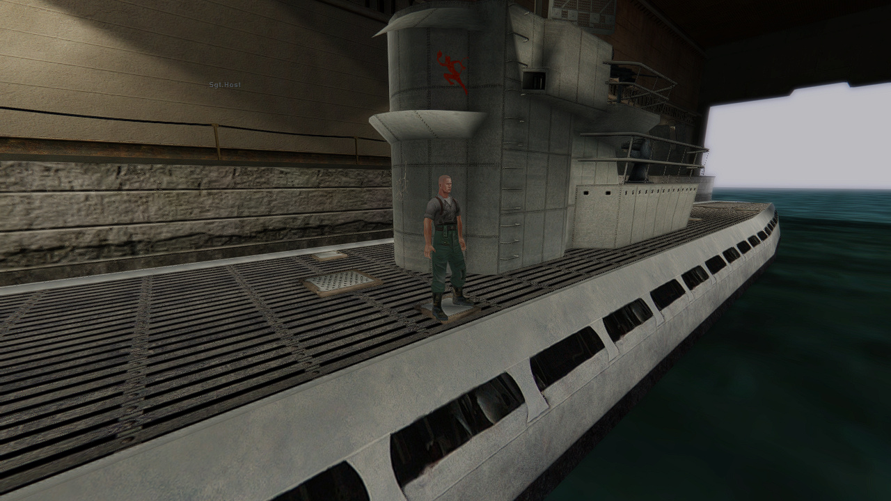

- **On someone else's server** F9 records the normal demo of what you saw (only the server can
  see everything).
- **Dedicated servers record every map by themselves** into `demos/auto_<date>_<time>_<map>`, and
  delete the oldest ones so the disk never fills. Server owners can tune it; players never need to:

| Setting | Default | Does |
|---|---|---|
| `sv_autoRecord` | `1` | `1` = dedicated servers record every map, `2` = listen servers too, `0` = off |
| `sv_autoRecordMax` | `30` | Keep at most this many auto demos |
| `sv_autoRecordMaxMB` | `2048` | ...and at most this many MB of them |
| `cl_recordFull` | `1` | `0` = F9 on your own server makes a normal demo |

`sv_record <name>`, `sv_stoprecord` and `sv_recordstatus` do it by hand from the server console.
The recorder costs the server 0.1 to 0.2 ms a frame. A whole-map demo is less than twice the size
of a normal one: roughly 40-50 MB an hour on a coop map.

## Where things are saved

| File | Holds |
|---|---|
| `demos/mynight.dm_17` | The recording |
| `demos/cameras/mynight.cam` | Its camera path |
| `demos/cameras/mynight.names` | Its renamed players |

They live in your game's `maintt` home folder. The `.cam` and `.names` files are plain text: send
them with a demo to share a finished camera move.
