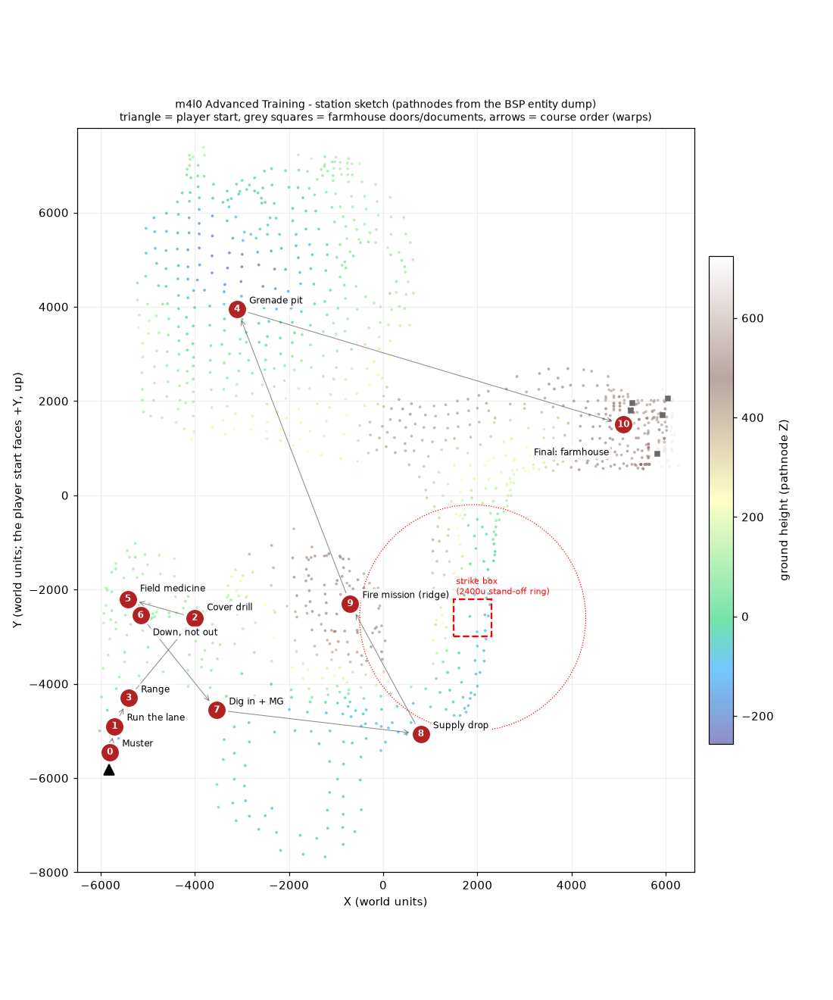

# Advanced Training on m4l0: plan (2026-11-09)

**Status: PLANNED, finalised 2026-11-09. Plan only: do not build yet** (user: "Plan out how m4l0 will
work but don't build her"). Nothing here is built. No code was changed and the game was not launched.

**Decisions taken (user + coordinator, 2026-11-09).** These replace open questions 1, 2, 3, 4, 10 and 11:

| # | Decision |
|---|---|
| D1 | The Farmhouse raid stays, behind `coop_advTraining`: 1 = Advanced Training, 0 or unset = the raid (3.1). |
| D2 | **The existing paradrop is the supply drop** (user: "existing paradrop is fine"). That means the signal-smoke paratrooper drop plus the ammo-box deployable. No new crate airdrop. |
| D3 | Self-heal stays on the **medkit key** (8 / D-pad up). Holding USE patches a teammate. Coop medkit behaviour doesn't change. |
| D4 | **One smoke per squad.** One trainee throws it and the squad uses the drop together. No paradrop reset is needed inside a course run. |
| D5 | Lean, slide, bracing and throws from cover have no script hook. They're **taught by text only**: no proxy checks, no engine getters. |
| D6 | **No rain** during the course: `level.coop_weatherTheme = "none"` in the training branch, as the basic range does. The raid keeps `"rain"`. |

Still unresolved: see section 6, "For later".
See the station layout map in section 8 and the station walkthrough in section 9.

**The request.** Basic training (`maps/training.scr`) stays as it is. m4l0 becomes **Advanced Training**: a coop course for 1-4 players, also playable solo, that teaches every add-on the mod puts on top of vanilla.

**User additions (2026-11-09).** The course must also teach:
- calling and using a supply drop;
- calling a bombing run, on a range where trainees can't be hit;
- placing and using sandbags;
- using medkits.

Each of these gets its own station.

**Tags used in this plan:**
- **[V]** = I checked it in code, the entity dump or a config.
- **[I]** = inferred, or taken from docs that haven't been re-checked.
- **[SPIKE]** = has to be proven in Phase 0 before anything is built on it.

---

## 0. Findings that shape the design (read first)

1. **The instructor voice can't be heard on m4l0 yet [V].**
   - All stock training lines are filtered to maps whose name contains `train`. For example, `ubersound/uberdialog.scr:90` has `alias training_01 ... maps "train"`, and `training_positive_feedback` in `ubersound.scr:1808` is the same.
   - The `maps` field decides where an alias loads (TRAPS, TIKI and sound-alias traps; bug-2248). So on m4l0, `playsound training_NN` plays nothing.
   - **Fix:** a coop-owned copy of the lines we reuse, filtered to `maps "train m4l0"`.
   - Don't use the token `m4`. It also matches m4l1, m4l2 and m4l3 (bug-2394).

2. **The coop framework does not run in single player [V].**
   - `coop_mod/main.scr::main` returns early when `level.gametype == 0` (main.scr:82-86).
   - `allysquad.scr::ally_squad_init` ends on gametype 0 as well.
   - So "solo" has to mean a 1-player **coop listen server** started with `ui_startdmmap 2`. A `spmap`/`map` boot would give a bare retail m4l0 with no add-ons at all.

3. **There are no action events to hook [V].**
   - The `eventsystem.scr` bus only ever fires `mainScriptLoaded` plus a few map-specific names.
   - "The player did X" has to be detected one of three ways:
     - **polling** player state: `self.coop_incover`, `gettorsostate`, `getlegsstate`, `self.flags["coop_*"]`, `self.turret`;
     - a **single training tap** inside `challenges.scr::chal_bump` and `xp.scr::xp_award`, which nearly every action already passes through;
     - **calls the system already makes**, such as `daily_onRevive` or `loot.scr::searched`.
   - Section 4 has the full table.

4. **One supply drop per map [V].**
   - `paradrop.scr::smokeDropZone` sets `level.coop_paradrop_active = 1`, and no code ever resets it.
   - The binocular strike is limited by `level.coop_binoc_uses` and a 10-second cooldown.
   - The bombing run needs a per-trainee reset (new script). The paradrop doesn't: one smoke per squad (D4).

5. **The bombing run hurts players [V].**
   - Each bomb is `radiusdamage <pt> 600 900`: 600 damage over a 900u radius (aircraft.scr:763, officer.scr:5105), credited to `world`.
   - A P-47 hit by flak crashes with `radiusdamage 350 600` at a point nobody chose (aircraft.scr:988). Flak is controlled by `coop_airstrikeFlakChance`, default 15 (aircraft.scr:1341).
   - The safe range needs all three of these:
     - stand-off distance;
     - a script-side minimum-distance veto;
     - no flak.

6. **Paradrop is switched off on m4l0 today [V].**
   - `officer_positions.scr:582-594` sets `coop_feature_paradrop = 0` and turns on a deferred officer boss.
   - `coop_counter.scr:74` already exempts m4l0 from the counter-attack.
   - `alarm.scr::alm_blocked` has **no** per-map opt-out flag. `autoexec.cfg` forces `coop_alarm 1`.

7. **Category-4 hints show once per profile, so they're no good for instructions [V].**
   - `feed.scr` cat 4 is "shown once per player profile; `coop_hints 0` = never".
   - A second run of the course, or a host with hints off, would get no instructions.
   - Instruction text must use cat 1 or 2, or the objective lines.

8. **What players can actually do with medkits in coop [V]:**
   - **Self-heal:** the medkit key, `append name ,8mk` on key 8 / D-pad up, calls `medkit.scr::medkit_use`. It plays a torso animation and is cancelled by moving or taking damage.
   - **Patch a teammate:** hold USE near a hurt, standing teammate (`medkit_teamheal_monitor`).
   - **Self-revive while downed:** hold USE (`dbno_selfrevive`). The downed prompt reads "Tap USE: Medic, Hold USE: Self-Revive" (medkit.scr:570).
   - **Supplies:** one medkit per life (`dbno.scr:35`). Medkits also come from pickups and body searches. A team revive costs the reviver a medkit (dbno.scr:1024).
   - **"Hold USE while standing still to bandage" is not the coop system.** It's the MP-modes medkit, `mp_medkits.scr`, which is MP-isolated. In coop, self-heal is the medkit **key**. **D3:** that stays as it is. The station teaches the medkit key and mentions hold-USE only for patching a teammate.

9. **What "supply drop" means in this mod [V]:** there are two things, and neither is an airdropped crate.
   - **Signal smoke → C-47 paradrop.** Throwing it calls a stick of Allied paratroopers (`paradrop.scr`, `parasquad.scr`). They include a medic, and they set up a .30 cal with an ammo can.
   - **Ammo box deployable.** The `,abx` command on key 0 / D-pad right; one per player per match (`ammobox.scr`).
   - `models/static/supplydropcrate.tik` only appears in the build-mode catalog.
   - The station teaches both. **D2: this is the supply drop.** No crate airdrop will be built.

10. **The weapon rack exists [V].** The agent inventory said it didn't, but the attic has a `rack` hotspot that opens `hzm_wpnview` (`ui/hzm_attic_go_rack.cfg`, generated by `gen_weapon_viewer.py`).

11. **Basic training currently has no home in the attic [V].** The 17 attic hotspots are:
    - options, mp, newgame, brief, records;
    - 6 radios;
    - film, music, fieldreport, bugbox, needle, rack.

    None of them is training. Basic training is only reachable from the coop start menu, on the **"Training / Secret"** page (`ui/coop_start.urc:166`, `ui/coop_start/m0.cfg`). Tile 1 there is `training`; tile 2 is `m4l0`, "The Farmhouse".

12. **Side observations on basic training. These are out of scope; logged as questions only.**
    - `training.scr` tests `level.gametpye` (a typo) in eight places. That variable is always NIL, so the key-name branch probably never takes the SP path [I].
    - Several stock lines contradict the mod's bindings:
      - training_37 says "SECONDARY ATTACK = pistol whip", but bash is V;
      - training_46, 50 and 51 also refer to "SECONDARY ATTACK", but in the mod RMB is ADS.
    - Advanced Training must not reuse those four lines.

---

## 1. Add-on inventory

**Key to the columns:**
- **Default**, where the value comes from:
  - `cd` = `coop_mod/coop_defaults.cfg` (a true default the player can change);
  - `ax` = `autoexec.cfg` (re-forced every launch);
  - `eng` = engine default;
  - `—` = always on.
- **Basic?** = whether `training.scr` already covers it.
  - It doesn't cover any add-on. It's the retail course: look, move, jump, duck, ladder, explosives, doors, pistol, Thompson, sniper, grenades, MG42.
  - "partly" = the vanilla half is taught there.
- **Status** comes from FEATURES.md and the code read. Rows marked UNVERIFIED are worth a playtest whatever happens to this plan.

| # | System | How the player uses it | Control (default) | Cvars / default | Status | Code | Basic? |
|---|---|---|---|---|---|---|---|
| 1 | Sprint + stamina | Hold to sprint; stamina drains; hold while aiming = hold breath | Shift `+speed`, L3 | `coop_sprint 1`, `coop_sprintMult 1.22`, `coop_sprintStamina 30`, `coop_sprintBreath 1` (ax) | UNVERIFIED | engine `Player::TickSprint` | no |
| 2 | Walk | Hold for a slow, quiet walk | Alt `+button12` | — | — | engine | no |
| 3 | Sprint-to-slide | Sprint, then hold crouch | Shift+crouch | `coop_slide 1` (eng) | UNVERIFIED | `Player::TickSlide` | no |
| 4 | Prone + roll | Hold crouch to go prone; roll while prone | hold C/Ctrl, pad B | `coop_prone 1` (eng, archived) | no row (bug-3560) | `Player::TickCoopProne` | no (duck only) |
| 5 | Lean (+ corner lean in cover) | Lean left/right | Q / E | `coop_coverLean 1` (ax) | vanilla + coop | engine | no |
| 6 | Take cover (wall / low) | Walk into a wall or crouch at low cover. A/D glide along it, RMB at an edge to peek, S to leave | automatic; toggle `,c1x` (unbound) | `coop_coverAuto 1` (cd), `coop_coverViewRaise 25` (cd) | v3.2 harness-verified on a branch [D]; confirm shipped game.dll | engine `Player::TickCoopCover`; `coop_mod/takecover.scr::coop_cover_toggle` | no |
| 7 | Blind fire / throw from cover | Fire or throw while in cover | LMB / G in cover | — | v1.10.63 [D] | engine player.cpp ~19901 | no |
| 8 | Third-person / over-the-shoulder ADS | 3P camera; ADS eases to the shoulder; swap shoulder | `,7tp` (unbound), MOUSE3 `shoulderswap` | `cl_freecamAutoFace 1`, `cg_adsShoulderRight` | UNVERIFIED | `coop_mod/thirdperson.scr`; cgame `CG_AdsForceFirstPerson` | no |
| 9 | ADS + aimed reloads | RMB aims down the sights; reloading while aimed keeps the aim | RMB `+button13` | `coop_vmAdsAnims`, `coop_scopeKeepZoom 1` (ax) | VERIFIED (45 guns) | engine `CondCoopAds`, usercmd bit 13 | no (scope toggle only) |
| 10 | Rifle-butt bash | Melee | V `+attacksecondary` | — | — | engine/statemap | no (taught as "secondary") |
| 11 | Gun bracing | Stand still at cover, a corner or a ledge: less sway | automatic | `coop_brace 1` (eng) | SHIPPED, untested in play | engine `COOP_BRACED` | no |
| 12 | Quick grenade + cooking | Tap = throw; hold = cook | G `+coopnade`, RB | `coop_quickNade 1`, `coop_quickNadeCook`, `coop_quickNadeReturn 0.9` (eng) | UNVERIFIED | engine relay `cg_consolecmds.c` / `gamecmds.cpp` | no (slot select only) |
| 13 | Quick-draw sidearm | Hold to draw the pistol | H `+coopsidearm`, D-left | `coop_sidearmSwap` | no row | engine | no |
| 14 | Weapon/ability wheel + emotes | Hold for the wheel; page 3 = emotes (salute is free, the rest unlock) | TAB `+coopwheel`, pad Y | — | v1.10.62/63 | `coop_mod/emotes.scr::emote_request` | no |
| 15 | Heavy MG overheat / cook-off | Sustained fire heats the gun; a cooked gun locks out | — | per-gun TIKI `coopheatrates` (MG42 `50 8 25 2 125`) | UNVERIFIED | engine `weapturret.cpp TurretGun` | partly (MG42 use, no heat) |
| 16 | Medkit self-heal | Press the medkit key and stand still; moving or damage cancels | 8 `,8mk`, D-up | `level.coop_healthDropFreq 10`; `level.coop_noMedkit` per map | VERIFIED | `coop_mod/medkit.scr::medkit_use` | no (auto health only) |
| 17 | Patch a squadmate | Hold USE near a hurt, standing teammate | F hold | — | VERIFIED | `medkit.scr::medkit_teamheal_monitor` / `medkit_teamheal` | no |
| 18 | DBNO: downed state | Lethal damage downs you; bleed-out ring; tap USE = call a medic, hold USE = self-revive (costs a medkit), hold to give up | USE while downed | `coop_dbno 1`, `coop_dbnoTimer 90` (ax) | SHIPPED-VERIFIED (anims UNVERIFIED) | `coop_mod/dbno.scr::dbno_enter`, `medkit.scr::dbno_selfrevive` | no |
| 19 | Team revive | Hold USE on a downed teammate for 5 s (costs the reviver a medkit) | F hold | `coop_teamRevive 1`, `coop_teamReviveTime 5.0`, `Range 80` (ax) | SHIPPED-VERIFIED | `dbno.scr::dbno_teamrevive_monitor` | no |
| 20 | Ally squad: downed + revive | A downed Allied NPC is revived by standing next to him (free) | proximity | `coop_allyHealthMult`, `coop_allyBleedOut 120`, `coop_allyReviveDist` / `Frac` (script defaults) | UNVERIFIED | `coop_mod/allysquad.scr::ally_go_down` / `ally_revive` | no |
| 21 | Last Man Standing lives | Limited respawns per player | host menu | `coop_lmsLives 0` = off (cd), `coop_lmsLateJoin 1` (cd) | coop lives: no row | `main.scr::lmsCheckLives` ~1894 | no (rule; explain only) |
| 22 | Sandbag deployable | Aim and press: places a bag wall that stops bullets; 2 per life | 9 `,9cv`, D-down | `level.coop_noDeployables` | UNVERIFIED | `coop_mod/cover.scr::cover_place` (the bags; `takecover.scr` is player cover) | no |
| 23 | Ammo box deployable | Drop a crate; anyone holds USE on it to resupply; 1 per player per match | 0 `,abx`, D-right | `coop_ammobox_refills 2`, `coop_ammobox_amount` | UNVERIFIED | `coop_mod/ammobox.scr::ammobox_place` / `ammobox_refill` | no |
| 24 | **Supply drop = signal smoke paradrop** | Pick up the Signal Smoke, select it, throw it in the open: C-47s drop a paratrooper stick (medic + .30 cal + ammo can) on the smoke | grenade slot / wheel | `level.coop_feature_paradrop` (m4l0 sets **0**), `level.coop_c47Chute` | SHIPPED-VERIFIED (reward items); squad brain UNVERIFIED | `paradrop.scr::smokeDropZone` / `coop_paradrop_main`, `parasquad.scr`; pickup recipe `objective_drop.scr::coop_objdrop_smoke_pickup`, `maps/m1l2a.scr::coop_tutorial_smoke_pickup` | no |
| 25 | **Bombing run = binocular air strike** | Pick up the Binoculars, aim at an open-sky point, fire: radio call, a P-47 pair drops a stick of bombs | inventory item (`toggleitem`), LMB | `coop_binoc_skyCheck`, `coop_airstrikeFlakChance 15` (cd), `level.coop_feature_binoc` | SHIPPED-VERIFIED | engine fire hook → `officer.scr::binoculars_fired` → `coop_bombing_run_sequence` → `aircraft.scr::bomb_run` | no |
| 26 | Use-to-loot / body search | Aim at a gun or body and hold USE: take gun, take ammo, search body (medkit/ammo/grenade odds) | F hold | `coop_lootUse 1`, `coop_lootSearch 1`, `coop_lootSearchTime 1.75` (cd) | no row | engine `Player::TickCoopLoot` → `coop_mod/loot.scr::searched` | partly (auto pickup only) |
| 27 | One-mag pickups / exact-ammo respawn / health drops | Pickups give one magazine; enemies drop health every N kills | — | `coop_pickupOneMag 1` (cd), `coop_exactAmmo 1` (ax) | UNVERIFIED | `itemhandler.scr`, `medkit.scr::healthItemSweep` | partly |
| 28 | AT supply points | Infinite bazooka/panzerfaust plus shells near vehicle objectives | walk over | — | no row | `coop_mod/atsupply.scr` | no (no vehicles on m4l0: mention only) |
| 29 | Objectives menu + toasts + compass bar | O opens the objective menu; a card appears for each new objective; marker on the compass bar | O `vstr coop_obj` | `coop_objToast`, `coop_hideObjCards 0` (cd), `coop_compassBar 1` (cd) | VERIFIED / SHIPPED | `objectives.scr::coop_obj_push` / `coop_obj_toast`; cgame | partly (retail compass) |
| 30 | Event feed / icon prompts / hold bars | Bottom-left feed; context prompts ("hold USE") | — | `coop_feed`, `coop_hints` | UNVERIFIED | `feed.scr`, `actprompt.scr`, `holdbar.scr` | no |
| 31 | Coop HUD | Hit marker, damage indicator, HUD fade, bleed ring, XP bar | — | `coop_hitMarker 1`, `coop_dmgIndicator 1`, `coop_hudFade 1` (cd) | UNVERIFIED | cgame | no |
| 32 | Ready gate | Whole squad presses USE to continue | F | — | used by the briefing | `coop_mod/readygate.scr` | no |
| 33 | Spectator / join-in-progress | A late joiner gets a card, then spawns with or follows a live player | — | `coop_specHold`, `cg_hzmJoinCard` | v1.10.64 | `menumirror.scr`, `joincard.scr` | no |
| 34 | Officer + reinforcement waves | Kill the officer (or destroy the radio) to stop the waves; he drops binoculars or smoke | — | `coop_officerScale`, `coop_officerMaxHeals 2` | VERIFIED | `coop_mod/officer.scr` | no |
| 35 | Alarm (+ alarm snipers) | A guard runs to a switch; hold USE for 3 s on the switch to silence it | F hold | `coop_alarm 1` (**ax**; the script header says 0) | UNVERIFIED | `coop_mod/alarm.scr::alm_start` / `alm_deactivate` | no |
| 36 | Final counter-attack + carry-over penalty | Waves after the last objective; losing makes the next map harder | — | `coop_counter 1` (ax), `coop_counterSecs 150`, `coop_counterPenalty 1` | UNVERIFIED | `coop_counter.scr`, `carry.scr` | no (explain only) |
| 37 | Surrender / recruit | A German may surrender; walk up to him to recruit him | proximity | `coop_aiSurrenderChance 12`, `coop_surrenderRecruit 1` (cd) | no row | `coop_mod/surrender.scr::convert` | no |
| 38 | Disguise / stealth | Papers and uniform; guards check you; bash the officer to contain a bust | F | `coop_stealthStart 1` etc. | verified on m2l2a | `bust.scr`, engine `is_disguised` / `has_disguise` | no |
| 39 | Armory loadout + finishes + cosmetics | F7: two primaries, sidearm, grenade; weapon finishes; helmets, gloves, skins | F7 `hzm_armory` | `coop_lockLoadout` (server.scr default 1) | UNVERIFIED | `loadoutpick.scr::loadout_set` / `loadout_finish`, `helmet.scr`, `gloves.scr` | no |
| 40 | Weapon rack / viewer | Attic rack: look at guns and finishes | attic hotspot `rack` | — | shipped [V file] | `ui/hzm_wpnview`, `gen_weapon_viewer.py` | no (menu only) |
| 41 | Progression | XP, 13 ranks, ~376 `chal_def` challenges, 12 medals, Service Record, Daily Orders (5 a day) | Service Record `,chx` | `coop_xp 1` (ax), `coop_dailyOrders`, `coop_utcClock 1` | UNVERIFIED | `xp.scr`, `challenges.scr`, `medals.scr`, `daily.scr` | no |
| 42 | Hardcore | Host rule: HUD cuts, 1 medkit, no self-revive while a teammate is up, respawn waves | host menu | `coop_hardcore 0` (cd, latched) | UNVERIFIED | `hardcore.scr` | no (explain only) |
| 43 | Collectibles / holdout | Hidden blueprints; checkpoint wave defence | — | `coop_holdout` | UNVERIFIED | `collectible.scr`, `holdout.scr` | no (mention only) |
| 44 | Vehicles / seats / AA guns | Ride seats, 2nd-player tank gunner, mannable flak | F | — | t2l2 verified | `vehiclehandler.scr` | no. **m4l0 has no vehicles [V]: out of scope** |
| 45 | Comms | Vanilla voice menu | X `instamsg_main` | — | vanilla | — | no (mention) |
| — | Pings / markers | **Not implemented.** Bus 10 is debug god-mode; 11-13 are "coming soon" stubs (player.scr:704-713) [V] | — | — | — | — | — |
| — | Medic class | **Not implemented** (DECISIONS: "will become a MEDIC-class ability") | — | — | PLANNED | — | — |
| — | Bipod | PLANNED; gun bracing replaces it | — | — | — | — | — |

**Passive systems (nothing to teach, so not stations):** ragdoll, gore, corpses, helmet pop, tinnitus, hit flinch, composure, weapon lag, DDA, enemy count scaling, AI dynamics, suppression, smoke screens, weather, music.

---

## 2. Mission design

### 2.1 The m4l0 ground

m4l0 is "The Farmhouse", a secret retail level of Normandy bocage farmland. Measured from the 1286 pathnodes [V], it spans X −6016..6264 and Y −7672..7384, with the ground rising to Z ~500-720 at the farmhouse plateau in the east.

- **No turrets, no vehicles, no ladders.** Crates, sandbags and walls are BSP geometry, not entities [V].
- **It is big.** Start to farmhouse is ~12,000u, so stations are connected by squad **warps** (`main.scr::playersWarpto <origin> <angle> 1`, which also moves the respawn point), not walks.

The stock content must be **removed** in the m4l0 training branch [V]:
- **AI:** 21 placed Germans, 36 `ai_actor` enemy spawners and 4 `enemyspawnertrigger`s; the `dogs` loop (it never ends).
- **Triggers:** trigger1 and trigger2; both bomber triggers (the flyover); the broken `change_to_objective2` trigger (a known script error); the objective2 and objective3 triggers; `level_end_trigger`. Objective3 calls `missioncomplete` with no checks.
- **Spawn and officer setup:** spawn warpers m4l0_update1-3; the officer boss config; `level.alarm`.

The 4 Rangers stay. They become the ally-squad prop (captain, medic and two privates at (−5456..−5392, −2304..−2368, 72)).

### 2.2 Course order (movement → combat → teamwork → systems → final)

All coordinates are **sketch values [I]**. Each one must be checked in Phase 0 with `docs/tools/bsptrace.py` (hull traces and sightlines) and a walk test before anything is placed.

| St | Name | m4l0 location (sketch) | Teaches (inventory #) |
|---|---|---|---|
| 0 | Muster | Start lane, (−5800 −5450 40), facing north | Objective menu (29), event feed (30), wheel and salute (14), Armory and the rack, by mention (39, 40) |
| 1 | Run the lane | Start lane northward, (−5800 −5400) → (−5600 −4300); hedgerow banks | Sprint and stamina (1), walk (2), slide (3), prone and roll (4), lean (5), quick-draw sidearm (13) |
| 2 | Cover drill | Zone B farm walls, x −4700..−3300, y −3400..−1800 | Wall and low cover, glide, peek (6); blind fire and throw from cover (7); shoulder view (8) |
| 3 | Range | North end of the lane: firing line (−5400 −4300 80), targets at 700 / 1000 / 1300u up the lane | ADS and aimed reload (9), bracing (11), bash (10), hit marker (31) |
| 4 | Grenade pit | Zone E bowl, (−2918 3986 −264) / (−3448 3914 −220) | Quick-nade, cooking (12); throw from cover again (7) |
| 5 | Field medicine | Ranger rally, (−5420 −2336 72) | Medkit self-heal (16), patching a squadmate (17), loot / body search for a medkit (26) |
| 6 | Down, not out | Same rally field, open ground | DBNO (18), team revive (19), self-revive (18), ally revive (20); LMS and Hardcore explained (21, 42) |
| 7 | Dig in | Zone C field near (−3533 −4557 35) facing north-east | Sandbags (22), ammo box (23), the MG nest with overheat (15) |
| 8 | Supply drop | Zone C open field around (800 −5064 −66); the old update1 spawn ground | Signal smoke paradrop (24), ammo box again (23), one-mag pickups (27) |
| 9 | Fire mission | Ridge firing line at (−700 −2300 ~480), looking east into the creek valley; target box centre (1900 −2600 ~0), about 2,600u away; check with bsptrace | Bombing run (25), with radio and red smoke |
| 10 | Final exercise | Farmhouse plateau: start (4519 946 507), objective = the documents (5284 1956 742) | Everything, against live, weakened enemies; officer kill → reward (34); ready gate (32) |

Mentioned only, on a text card at the end with no station: alarm and counter-attack (35, 36), surrender and recruit (37), disguise (38), collectibles and holdout (43), vehicles and AT supply (44, 28). "For later" 4 asks whether to drill any of them.

### 2.3 Station details

**Common rules for every station:**
- The objective line is pushed with `objectives.scr` (`coop_obj_push`) and **is** the on-screen text. One table, `level.at_obj[n]`, feeds both the menu and the HUD, following the HUD = objective-menu rule.
- Progress counts go into the objective text, e.g. "Cover drill: peek and fire from cover [1/3 trainees]".
- Per-player sub-steps use `feed_player` category 2 lines. Never category 4.
- Each station ends with `training_positive_feedback` and the stock line training_16 ("You have a new objective. Complete this objective.") as the next objective arrives.

**Reusable stock lines.** These need the alias copy from finding 1. The lines carry the voice of the radio instructor. No new recording.

| Line | Text (stock) | Used at |
|---|---|---|
| training_01, 02 | Field-training opening; "Pay attention…" | St 0 |
| training_08, 09, 10, 11 | Objectives key, check-off, yellow, arrow | St 0 |
| training_16 | "You have a new objective. Complete this objective." | every station change |
| training_15 | "Good. Now press your OBJECTIVES key again." | St 0 |
| training_39 | "More accurate… short bursts and while not moving." | St 3 (bracing) |
| training_42, 43 | Reload any time; reload before combat | St 3 |
| training_52 | "Use bank shots with the grenades…" | St 4 |
| training_30 | "Move away… to avoid being injured." | St 9 |
| training_33, 35 | First-aid supplies; "Press USE to grab these items" | St 5, 8 |
| training_57, 58 | "…keep your head under fire." / "You're dismissed…" | End |
| `training_positive_feedback` | the tick sound | every success |
| `coop_radio_*` (existing coop) | airstrike request/response, paradrop, standby, static | St 8, 9 |

Never use lines 37, 46, 50 or 51 (they describe vanilla secondary-attack binds, finding 12). Never use 03-07 or 17-22 (they refer to basic-course geometry).

#### Per-station spec (success check = how the script knows)

**St 0, Muster.**
- *Goal:* get the squad together and open the objective menu.
- *Lines:* training_01, 02 and 08-11.
- *Check:* Pressing O can't be detected [V], so don't gate on it. Use the **ready gate** instead (`readygate.scr::coop_readyGateStart`, done when `level.coop_readyGateDone == 1`), with the text "Press USE when ready".
- *Also:* one salute through the wheel. Check `flags["coop_emoteBusy"] == 1`, or watch for `daily_onEmote` through the tap in 4.2.
- *Objective:* "Muster: salute the instructor and report ready [0/N]".

**St 1, Run the lane.** Five sub-drills on one lane, each its own checklist row:
- **Sprint** a 600u segment. Check `getlegsstate == "SPRINT_FORWARD"` [V] while the player crosses two waypoint triggers.
- **Stamina:** the HUD shows it, but script can't read the value. The text says "run until you're winded"; only the sprint itself is checked.
- **Walk** past a "sentry post". Check `+button12` through the walk legs state [SPIKE: state name], or speed under a threshold for 3 s.
- **Slide** under a low bar. Text only (D5): there's no slide flag [V], so there's no check.
- **Prone** through a hedgerow crawl. Check `getlegsstate` starts with `PRONE_` [V-ish, from the agent; confirm].
- **Lean:** text only (D5), at a hedge corner. No check.
- **Quick-draw:** hold H. Check `flags["coop_activeWeapon"]` changes to the sidearm class.
- *Objective:* "Run the lane: sprint, sneak, crawl, quick-draw [n/4]" (slide and lean are taught on the way, unchecked).

**St 2, Cover drill.**
- Three wall-cover spots (BSP walls) and one low wall. Each has a shootable target placed so it can only be hit from that cover.
- *Check, per player:*
  1. `self.coop_incover >= 2` [V; it's an engine getter], held for 1 s;
  2. a `COVER_PEEK_TORSO` torso state while peeking [V name, from the agent];
  3. a blind-fire hit, i.e. `self.coop_bf_t` set within 0.75 s of a target hit [V];
  - Throwing from cover is taught by text only (D5); it has no check.
- **Shoulder view:** text only. It's toggled by `,7tp`, which is unbound by default, so we'd say "bind it in Controls" (for later 3).
- **Targets:** spawn a `trigger_multiple` with `spawnflags 128` (TRIGGER_DAMAGE: takes damage and fires on hit, `trigger.cpp:211/285` [V]) plus a visible model. [SPIKE: inline `spawnflags` on spawn sets it before the constructor reads it; this is how the basic-training BSP targets work.]
- *Objective:* "Cover drill: take cover, peek, blind-fire [n/3]".

**St 3, Range.**
- Three lanes at 700, 1000 and 1300u, with pop-up targets (the TRIGGER_DAMAGE recipe), the target shown or hidden by script.
- *Checks:*
  1. 3 hits while ADS. ADS has no getter [V]; use `gettorsostate` = `AIM` or `ATTACK_*_AIM` at the moment of the hit [SPIKE: exact state names from the statemap].
  2. 1 aimed reload: the torso reload state while aimed [SPIKE].
  3. 3 hits at 1300u. **Bracing is taught by text only (D5):** "rest the gun on the sill and hold still". The check is just the 3 far hits.
  4. Bash a dummy sack: the `MELEE` torso state plus a damage trigger at bash range.
- *Ammo:* the station refills ammo between attempts, so nobody is stranded.
- *Objective:* "Range: aimed shots, aimed reload, long shots, bash [n/4]".

**St 4, Grenade pit.**
- Three "bunkers": low walls with a damage trigger inside each.
- *Checks:* destroy the targets. A cooked throw is one where the `CHARGE_ATTACK_GRENADE` torso state lasted more than 1.5 s before release [SPIKE].
- The station hands out grenades (`ammo grenade` / `agrenade`, copying the basic-training `ammo_spawners`).
- *Objective:* "Grenade pit: clear 3 bunkers, one with a cooked grenade [n/3]".

**St 5, Field medicine.**
- **Self-heal:**
  - On entry, the script sets each trainee to 60% health (`health` set, no damage event) and `flags["coop_medkits"] = 2`.
  - *Check:* `medkit_use` ran to completion: `flags["coop_medkit_in_use"]` goes 1 → NIL **and** health ≥ the coop maximum, or the tap sees `chal_on_heal`.
- **Patch a squadmate** (2+ players):
  - *Check:* `xp_award … "Patched a Squadmate"`, caught by the tap.
  - *Solo:* replaced by healing a hurt Ranger. Stand next to the "wounded" Ranger and ally-revive him, which is the free proximity revive. Cleaner than inventing an NPC heal.
- **Body search:**
  - A Ranger "casualty" corpse is planted. [SPIKE: is a planted corpse searchable? The engine path goes through `loot.scr::searched player corpse ammo clip nade`.] Fallback: a dead German dummy spawned and killed out of sight. Precedent: `alarm.scr` / the officer scripts spawn and kill actors.
  - *Check:* `loot.scr::searched` is called for that player; tap it with one `level.coop_trainingMap` line.
- **Wording.** One line: "Your medkit is the medkit key. Holding USE next to a hurt teammate patches him up." (D3)
- *Objective:* "Field medicine: use a medkit, patch a squadmate, search a casualty [n/3]".

**St 6, Down, not out.**
- *How players go down:* by script, `thread coop_mod/dbno.scr::dbno_enter <player> "chest"` [V; the same call as the debug bus slot 14]. No damage is dealt, and no friendly fire is needed.
- *Pairs (2+ players):* trainees take turns, one downed and one reviving.
  - *Check:* the revive completion fires `daily_onRevive reviver downed` and `xp_award reviver 10 "revive"` → the tap.
  - Every trainee does one revive and one self-revive. The **self-revive check** is `daily_onSelfRevive`.
- *Solo:* self-revive, then an ally revive. `allysquad.scr::ally_go_down` on a Ranger, then check `chal_bump … "allyrevive"` through the tap.
- *Medkits:* restocked before each drill, because revives cost the reviver a medkit.
- *Bleed-out:* must never kill a trainee here. Use a training override in `dbno_bleedout_timer` (`level.coop_trainingDbnoTimer`, e.g. 600 s), or if bleed-out does fire, they simply respawn at the station.
- *Explained on screen:* LMS lives, Hardcore's self-revive rule, and "tap USE to call for a medic".
- *Objective:* "Down, not out: revive a trainee, revive yourself [n/2]". Solo: "…revive the Ranger, revive yourself".

**St 7, Dig in.**
- *On entry:* `flags["coop_cover_placements"] = 2` (the per-life value, `dbno.scr:36`), and the ammo-box one-per-match ledger is cleared for each trainee (`level.coop_ammobox_dropped[key]`). [V names; the reset is new script.]
- **Sandbags:**
  - *Check:* `flags["coop_cover_placements"]` decreases, or `level.coop_cover_count` rises. Each bag must be inside the marked arc (distance from an anchor < 400u).
  - Then a hit-proof drill: a scripted "sniper" target fires harmless tracer FX at the bag? Too fancy. Replacement: "crouch behind your bags and take cover". Check `coop_incover >= 2` within 150u of one of the player's own bags (`chal_nearOwnCover` exists in `challenges.scr:1826` [V], so reuse it).
- **Ammo box:**
  - Fire the MG down to half ammo, then resupply from a box.
  - *Check:* `chal_bump user "ammoboxuse"` through the tap [V].
- **MG nest:**
  - Spawn `statweapons/mg42_gun.tik` at the sandbag line. The basebuild MG42 row (x −3533, y −4457..−5157) is a placement reference only; `mp_basebuild_stations.scr` is MP-isolated and is **not** called.
  - *Check:* overheat the gun, i.e. `self.turret` then `coopoverheated == 1` [SPIKE: getter or return form], then wait for the cool-down.
  - The text teaches burst discipline.
- *Objective:* "Dig in: place sandbags, take cover behind them, resupply, overheat the MG [n/4]".

**St 8, Supply drop.**
- *Recipe copied from* `objective_drop.scr::coop_objdrop_smoke_pickup` / `m1l2a.scr::coop_tutorial_smoke_pickup` [V].
- *Setup:*
  - `level.coop_feature_paradrop = 1` in the training branch.
  - Spawn the smoke pickup (glow plus a `trigger_use`).
  - The pickup gives `models/weapons/coop_smoke_grenade.tik` and sets `level.coop_paradrop_armed = 1` and `level.coop_smoke_player`.
- **One smoke per squad (D4).** The system is global: one armed smoke, one owner. The first trainee to pick it up throws it, and the whole squad then uses the drop.
  - The **station check is squad-wide**: the drop landed, and each trainee resupplied once.
  - A smoke thrown somewhere invalid can't be re-armed. In that case the station's 4-minute timeout or the skip vote moves on, and the feed says "the drop is on its way".
- *Check:* `smokeDropZone` runs. Tap it with `xp_support_call … "paradrop"` / `chal_support_call … "reinforce"`, or watch `level.coop_paradrop_active == 1`.
- The paratroopers land and set up. Their arrival is a sight to walk through:
  - the medic;
  - the .30 cal that players can mount;
  - the **ammo can** they leave: resupply from it with USE.
  - *Check:* `ammoboxuse` again, or `flags["coop_weaponPickedUp"]` for a one-mag pickup on the ground.
- **Afterwards [new script]:** remove the paratroopers when the squad warps on to St 9, so they don't drift into the strike box. No re-arm (D4). Phase 0 reads `parasquad.scr` for a teardown; `coop_paradrop_cleanup_marker` exists, squad removal is TBD.
- *Lines:* `coop_radio_paradrop`, plus training_33/35 at the ammo can.
- *Objective:* "Supply drop: signal the drop with smoke, resupply from the paratroopers [n/2]".

**St 9, Fire mission (bombing run), on a safe range.**
- *Recipe:* `officer.scr::coop_binoc_grant`, then `binoculars_fired` [V].
- *Setup:*
  - Grant the binoculars to each trainee in turn. `coop_binoc_uses` is a level global.
  - A **target box** is marked with a red-smoke emitter and old wrecks / dummy targets, such as spawned `models/static/...` props.
- **Safety, all three required:**
  1. **Firing line ≥ 2,400u from the target-box centre.** That is the 900u blast radius plus the stick scatter (8 bombs along a random heading; `coop_strike_scatter` minr/maxr) plus margin.
  2. **New veto in `binoculars_fired`:** when `level.coop_trainingMap == 1`, deny any aim point within `level.coop_trainStrikeMinDist` (2000u) of any player, or outside the target box. Reuse the existing denial path (`feed_player … "strike_deny"` + `coop_radio_standby`).
  3. **No flak:** a level override read in `aircraft.scr::flakPlan` (`level.coop_noFlak == 1` → chance 0). Never write the cvar from script (TRAPS T7).
- Also: a trigger volume that keeps trainees behind the firing line while a run is in progress. It pushes them back, and the text says "Stay behind the line" (training_30).
- *Check:* `binoculars_fired` accepted the strike, i.e. the `xp_support_call … "bombing"` / `chal_support_call … "airstrike"` tap. A target in the box destroyed is the success flavour.
- *Reset:* `level.coop_binoc_uses = 1` and the 10 s cooldown cleared for the next trainee. With 4 players: 4 strikes at ~25 s each (radio 7.5 + 3.5 + the run).
- *Objective:* "Fire mission: call a bombing run on the target box [n/N]".

**St 10, Final exercise: take the farmhouse.**
- *Start:* warp to (4519 946 507). There's time to place sandbags and an ammo box before the go signal (ready gate).
- *Enemies:* a reduced live garrison. Respawn the farmhouse placed AI as a scripted set of 6-10, **with an officer**. Killing him drops the binoculars or smoke reward through the normal `coop_officer_death_drops`, which shows the officer system for real.
- *Safety:*
  - DBNO is forced on and the training bleed-out override stays active.
  - Respawn is always on. LMS is ignored on this map (see 2.5).
  - The documents objective cannot fail.
- *Objectives:*
  1. "Kill the officer".
  2. "Take the documents". The stock `$documents` / `objective2` mechanism, re-scripted to finish the course.
- *Optional:* a 60 s mini counter-attack. (for later 4).
- *End:* training_57, 58; the graduation award (3.3); then return. See 3.4 for which command.

### 2.4 Coop pacing: when some players finish a station early

- **Per-player checklists, squad-wide advance.** Each player's rows tick for him alone (cat 2 feed plus the objective counter).
- The station advances when **every active, non-spectator player** has completed it **or** the squad ready-gates past it:
  - a finished player gets "Done: press USE to vote to move on";
  - unfinished players can also vote.
  - This uses the existing `readygate.scr` [V]. Spectators count only if they pressed (bug-3474 semantics).
- **Finished players get free practice** at the station. Targets keep popping and grenades and medkits keep refilling, so nobody stands idle.
- **Late joiners** go through the join card, then spawn at the **current** station (its spawn set is moved with `playersWarpto … 1`). Earlier stations are credited as "skipped". The award (3.3) requires the stations the player actually completed, or is waived for the final only (for later 1).
- **A player who disconnects mid-drill** is dropped from the count at the next poll (`$player` array; TRAPS T5 NIL vs NULL).
- **Pairs drills** (St 5 and 6) pair players in entnum order. An odd player out gets the solo variant (the Ranger).

### 2.5 Safe practice: nothing may strand or punish

These are new `level.coop_trainingMap == 1` gates, each a one-line early-out at an existing site:

| Risk | Gate |
|---|---|
| LMS lives used up in training | `main.scr::lmsCheckLives` re-reads the cvar on every player-count change [V], so a plain level override would be stomped. Gate the lives logic off on this map. |
| Alarm guard on a training map | `alarm.scr::alm_blocked`: add `if( level.coop_trainingMap == 1 ){ end "training" }` [V; there is no flag today]. |
| Counter-attack | Already exempt (`coop_counter.scr:74`) [V]. |
| Officer waves outside the final | `level.coop_noOfficerWaves = 1` (officer.scr:132-136) [V]. The final spawns its officer by script; check `coop_officer_init` can be started late, otherwise use a plain scripted officer actor plus `coop_officer_death_drops`. |
| Carry-over penalty to the next map | `carry.scr` gated off [I]. |
| XP / challenge / daily farming (a scripted DBNO pays XP) | The tap in `chal_bump` / `xp_award` swallows normal awards on this map and routes them to the station logic instead. Only the graduation award pays (3.3). |
| Bleed-out death in St 6 | Training timer override; a death just respawns at the station. |
| Bombing run / flak crash | 2.3 St 9, three layers. |
| Grenade self-damage | Allowed (it's the lesson), but the station heals the player to full on success or failure. |
| Fall / out-of-bounds | No `trigger_hurt` in the dump [V]. Add a per-station "lost trainee" sweep: more than 2500u from the station anchor for 10 s → warp back. |
| A soft-locked station (a target that can't be hit, a missing paratrooper) | Every station has (a) the ready-gate vote to skip and (b) a 4-minute timeout that marks the station complete for everyone, logged as `^~^~^ ATRAIN skip st=<n> why=timeout`. |
| Exit triggers | All removed (2.1). The course decides when it ends. |
| Spawn warpers | `m4l0_update1-3` are not threaded in training mode. `level.coop_disableSpawnWarper = game.true`, as `training.scr` does. |

---

## 3. Integration

### 3.1 Keep the Farmhouse raid? (recommended: yes, behind one switch)

The map name has to stay `m4l0`. Every per-map table keys on it: `spawnlocations.scr`, `aircraft_envelope.scr` (ground z 136, class A), `officer_positions`, `coop_counter`, `lobbybrief`, and the aliases' `maps` filters. Animation packs gate on a **prefix of the map name** (TRAPS, TIKI traps), so a renamed BSP copy such as `coop_advtrain` would also match the `coop` include token and pull packs into a map that never had them. **Do not rename or copy the BSP.**

`maps/m4l0.scr::main` branches on a non-archived cvar:
- `coop_advTraining 1` → the Advanced Training branch;
- otherwise → today's Farmhouse raid, untouched.

The launch paths `set coop_advTraining 1` (not `seta`: TRAPS T7, a one-way latch). The Farmhouse tile sets it to 0. One map, two missions, and the existing raid isn't lost. **Decided: D1.**

**Where the switch is read:** in `main` before `waitthread coop_mod/main.scr::main` only if that read needs no wait (it doesn't; `getcvar` is instant). The branch sets `level.coop_trainingMap = 1` **after** `main.scr::main` returns and before `level waittill prespawn`. That keeps the rule: no wait before or inside `main.scr::main`.

### 3.2 How players reach it

1. **The 3D attic** (`ui_atticMain 1`), following the "menu homes in-world" rule.
   - A new hotspot **appended last** in `make_main3d.py`. `ui_scene_hot` is the 1-based list position, so inserting anywhere else shifts every later hotspot (filmroom README).
   - It's a prop that **lights up when highlighted** (the `scenelabel` "on" state, the film projector recipe).
   - The same prop is the home of **both** courses. Clicking it opens a small styled two-card screen: **Basic Training** / **Advanced Training**. Basic training has no attic home today (finding 11).
   - Prop candidates (for later 2): a practice target on a stand, or a helmet plus field manual on a crate (stock statics only).
   - The card launches exactly what the coop start menu's Apply does: `exec coop_mod/start_server.cfg`, then `set ui_dmmap m4l0`, `set coop_advTraining 1`, `ui_startdmmap 2`. It's a listen server, so solo = 1 player. Basic Training does the same with `training`.
   - Test in the live 3D attic with `seta ui_atticMain 1`.
2. **The classic (flat) main menu:** an "Advanced Training" entry beside wherever Basic Training lives. Today that's only the coop start page (for later 2).
3. **The coop start menu:** on the "Training / Secret" page, tile 2 becomes **Advanced Training** (`set ui_dmmap m4l0; set coop_advTraining 1`). The Farmhouse moves to a tile 3, or keeps tile 2 with a toggle.
   - `ui/hzm_mapnames.txt`: `m4l0|Advanced Training`. The Farmhouse title comes from the branch.
   - `variables.scr:224`: retitle "Secret Dog Map".
   - New tile art `hzmtile/m4l0_c/_s` and a loading still (QA under the no-AI-slop rule).
4. **Dedicated servers:** `map m4l0` with `coop_advTraining 1` in the server cfg. Not part of the default rotation (`maplist.scr` has m4l0 at line 45: check whether the rotation reaches it).

**SP vs coop gametype:** a `spmap m4l0` boot gets the retail level with no coop. Under `coop_advTraining 1` it should show one line ("Advanced Training needs coop: start it from the menu"). Nothing more, because the coop framework is off in gametype 0 (finding 2).

### 3.3 Reward

Proposed:
- **One new challenge**, "Advanced Training: Graduate", appended **at the end** of `chal_init`. Saved pins are stored by catalogue position, so inserting mid-list breaks them (bug-1362).
  - `chal_def "atgrad" "<cat>" "Graduate" "Complete Advanced Training" "atgrad" 1 "<reward>"`, granted with `chal_grant`.
  - The reward is a cosmetic unlock (an emote such as "at ease", or a finish), via `chal_add_unlock`.
- **XP:** a flat `xp_award <p> 100 "training" "Advanced Training complete"`, once per profile. Use the challenge's done flag `coop_chalD_atgrad` to stop repeat payouts.
- **A medal** is derived automatically if `medals.scr` keys one on the challenge category. Otherwise no medal (for later 1).
- Daily Orders: none on this map.

### 3.4 Finish

The basic course ends with `exec global/missioncomplete.scr briefing/briefing1 1`. Advanced Training should **not** start a campaign. Options, decided in Phase 1:
- return to the lobby or the menu;
- restart the course (`stuffsrv "map m4l0"`, the clean restart that CLAUDE.md allows).

Never `bsptransition` or `leveltransition`.

---

## 4. Technical approach

### 4.1 Files

| File | New/changed | Content |
|---|---|---|
| `maps/m4l0.scr` | changed | `main` branch on `coop_advTraining`; the training branch strips stock content, sets level flags and `level.coop_weatherTheme = "none"` (D6), `thread maps/m4l0/at_course.scr::start` |
| `maps/m4l0/at_course.scr` | new | the station sequencer, objective table, ready gates, warps, skip/timeout, the tap handler |
| `maps/m4l0/at_st_*.scr` | new, one per station group (move, combat, medic, support, final) | Split so one parse killer kills one station, not the course (TRAPS T1: compile is all-or-nothing per file). Same pattern as `maps/e1l1/scene3.scr` |
| `maps/m4l0/at_targets.scr` | new | shootable target spawn/pop/reset (TRIGGER_DAMAGE recipe), dummy props |
| `ubersound/` (coop alias file) | changed | copies of the reused `training_NN` aliases with `maps "train m4l0"`; grep name **and** maps for an existing collision |
| `maps/m4l0_precache.scr` | changed | the training models (targets, mg42, smoke, binocs, paratrooper tiks) |
| `coop_mod/challenges.scr` | changed | the tap at the top of `chal_bump` (`if( level.coop_trainingMap == 1 ){ thread maps/m4l0/at_course.scr::tap local.player local.stat local.amount; end }`); `atgrad` appended to `chal_init` |
| `coop_mod/xp.scr` | changed | same one-line tap/swallow in `xp_award` |
| `coop_mod/officer.scr` | changed | the strike-distance veto in `binoculars_fired`; a binoc cooldown reset hook |
| `coop_mod/aircraft.scr` | changed | `level.coop_noFlak` in `flakPlan` |
| `coop_mod/alarm.scr` | changed | `alm_blocked` training gate |
| `coop_mod/main.scr` | changed | the `lmsCheckLives` training gate |
| `coop_mod/dbno.scr` | changed | the training bleed-out override |
| `coop_mod/paradrop.scr` | changed (maybe) | only if `parasquad.scr` has no teardown: a label that removes the stick. No re-arm (D4). |
| `coop_mod/officer_positions.scr` | changed | the m4l0 block reads `level.coop_trainingMap` (boss off, paradrop on) |
| `ui/…`, `make_main3d.py`, `coop_start/m0.cfg`, `hzm_mapnames.txt` | changed | menus, 3.2 |

**Config-only parts:** the cvar switch, start cfgs, map names and tiles. **Script:** everything else.

### 4.2 The tap (the one design idea worth reusing)

- **The problem:** most actions have no event, but nearly every one goes through `chal_bump`, the `daily_on*` forwards or `xp_award`.
- **The fix:** while `level.coop_trainingMap == 1`, those entry points pass the call to `at_course.scr::tap <player> <stat> <amount>` and **end**. Training doesn't pay normal progression, and every station sees the action with no new engine work.
- **What the tap can see:**
  - stats: `revive`, `allyrevive`, `ammoboxuse`, `blindfire`, `coverkill`, `grenade`;
  - support calls: `airstrike`, `reinforce`;
  - `chal_on_heal`;
  - the XP labels "Patched a Squadmate" and "Revived Ally".
- **What still needs polling:** cover, ADS, prone, sprint, MG heat, loot.

### 4.3 TRAPS that apply here

- **T1 parse killers:**
  - no em-dash, no `(-1)` or bare negatives in command arguments, no BOM;
  - no prose standing where a statement should be; no newline inside a string literal;
  - `}end` returns a value, not a call; an `EV_SETTER` is assigned, not called; no unknown commands.
  - Run all four scanners (`depthscan2`, `linecheck`, quote scan, `prosecheck`) plus a server load with `developer 1` and no `Couldn't compile`.
- **No `wait` in or before `main.scr::main`.** The branch flag read is a non-waiting `getcvar`.
- **Map name / TIKI prefix gating.** Don't rename. If a station needs an anim pack the map doesn't get, add an `$include`; `check_map_anims.py` fails the build on unresolved `anim` / `playsound` / model paths.
- **Sound-alias `maps` filter** (finding 1); `say` is an animation call.
- **MP isolation** (`check_mp_isolation.py`, 22 clauses, runs inside `build.ps1`):
  - nothing on this path may call an `mp_*.scr` (basebuild stations, `mp_medkits`);
  - `feed.scr` is coop-only and fine.
  - Any edit to a shared file must leave MP's `coop_mpRun` paths untouched.
- **T5:** `$player` is 1-indexed; NIL ≠ NULL; check `!= NULL` before each player use in the loops.
- **T7 cvar hygiene:** `set`, not `seta`, for the switch; never write server cvars such as flak or LMS from script.
- **T8 stufftext is lossy.** Only `feed.scr` iprint (reliable) and `ihuddraw` with `hudresend`.
- **T16 unbounded `waittill`.** Every station wait is a poll with a timeout.
- **T24 text channel:** route everything through `feed.scr` and `objectives.scr`, never raw `iprintlnbold` (the basic course still uses it).
- **"Coop systems that touch EVERY actor find the scripted ones."** The Rangers and the dummies must be excluded from DDA, surrender, AI dynamics and loot as needed. Give scripted dummies `nodamage` / `notsolid` and the `blastshield 1` flag near St 9.
- **Dedicated/listen parity** (DECISIONS): verify on both. The harness is `launch_dedicated_2player.ps1 -Map m4l0` with `coop_advTraining 1`.

### 4.4 Risks

| Risk | Mitigation |
|---|---|
| Engine getters that only exist on some branches. The agent found `+coopwheel` / `+peek` missing from the `hzm-coop-working` checkout; cover v3.2 is on `cover-seamless` | Phase 0: confirm against the **deployed** `game.dll` (G:\mohaa-gl2) which getters and states exist: `coop_incover`, `coop_bf_t`, `coopoverheated`, the torso-state names |
| Shootable spawned targets | Phase 0 spike (TRIGGER_DAMAGE flag). Fallback: dummy actors with `takedamage` + `waittill damage` (officer.scr precedent) |
| Paratrooper teardown | Phase 0: read `parasquad.scr` and find its cleanup. Re-arm is not needed (D4) |
| Sightlines and stand-off on the m4l0 ridge | `bsptrace.py` before placing St 9; move the box if the ridge can't see 2400u+ |
| Lean / slide / brace / grenade-from-cover have no detection | Taught as text only (D5); nothing gates on them |
| m4l0 is big; warps feel abrupt | A 0.5 s fade (`uiveil`-style client black) around each warp [I] |
| UNVERIFIED systems (sprint, prone, quick-nade, paradrop squad, sandbags…) misbehave in the drill | The course doubles as their playtest; log each finding to the buglog |
| Scope creep | Mentioned-only systems stay text cards unless the user picks them (for later 4) |

---

## 5. Effort and build order

Estimates are in working sessions of one agent, with a playtest at the end of each phase.

| Phase | Work | Estimate |
|---|---|---|
| **0: Spikes** (no shipped change) | Alias copy proof (one line plays on m4l0); TRIGGER_DAMAGE target spawn; the getter/state census on the deployed `game.dll`; strip list proven (boot with no AI, no script errors); `bsptrace` sightlines for St 3/9; paratrooper teardown read | 1 |
| **1: MVP course** | Branch + sequencer + objective table + ready gates + warps + skip/timeout; St 0, 1 (sprint/prone/quick-draw), 2 (cover), 3 (range), 5 (medkit), 6 (DBNO/revive); the tap; LMS/alarm/officer/XP gates; Advanced Training tile on the coop start page | 2-3 |
| **2: Support stations** | St 7 (sandbags, ammo box, MG heat), 8 (supply drop + reset), 9 (bombing run + three safety layers), St 4 (grenades) | 2 |
| **3: Final + award + menus** | St 10 (farmhouse, officer, documents); `atgrad` challenge + XP; the attic prop + two-card screen + flat-menu entry; tile art + loading still; HUD + objective-menu stills per station (the HUD = menu proof) | 2 |
| **4: Polish** | Lean / slide / brace proxies, pair rotation polish, 1/2/4-player dedicated + listen runs, README media | 1 |

**Total: ~8-9 sessions.** The MVP (Phases 0-1) is playable solo and in coop.

---

## 6. Decisions and "for later"

**Resolved, 2026-11-09.** D1-D6 are tabulated at the top of this file:

| Old question | Resolution |
|---|---|
| Keep the Farmhouse raid? | D1: yes, behind `coop_advTraining` |
| What is the "supply drop"? | D2: the existing paradrop (signal-smoke paratroopers) plus the ammo box |
| Medkit self-heal on hold-USE? | D3: no, it stays on the medkit key |
| One smoke per squad or per trainee? | D4: one per squad. The bombing run stays one strike per trainee, in turn |
| Detecting lean / slide / brace / cover throws | D5: text only. No proxies, no engine getters |
| Weather | D6: no rain in the course (`coop_weatherTheme "none"`) |

**For later.** Decide these when the build is scheduled; none of them blocks the plan:

1. **Award.** Is challenge + XP + cosmetic unlock right, and which unlock? Is a medal wanted? Must late joiners finish every station, or only the final?
2. **Attic prop.** A practice target on a stand, or a helmet and field manual on a crate? Should it also be Basic Training's first attic home? Does the flat menu need an entry?
3. **Unbound binds.** The shoulder camera (`,7tp`) and cover toggle (`,c1x`) are unbound by default. Should training bind them, or just point at Controls?
4. **Mentioned-only systems.** Should any become a station: alarm switch, surrender/recruit, a disguise papers check, a 60 s counter-attack at the end of the final?
5. **End of course.** Return to the menu/lobby, or restart the course?
6. **Basic training side fixes**, as a separate small pass: the `level.gametpye` typo, and lines 37/46/50/51 that contradict the RMB = ADS and V = bash binds.

---

## 7. Verified vs inferred

- **Verified in code or data:**
  - the alias `maps "train"` filter;
  - the SP early return in `main.scr`;
  - the event bus contents;
  - the paradrop single-use latch;
  - the bomb and crash `radiusdamage` values and the flak cvar;
  - m4l0's officer and paradrop config and the counter exemption;
  - the alarm having no opt-out flag;
  - feed category-4 once-per-profile;
  - the medkit, team-heal and self-revive controls, plus per-life medkits and sandbags;
  - the bind cfgs (`coop_defbinds4.cfg`: 8/9/0);
  - the readygate API;
  - `playersWarpto`;
  - `chal_bump` / `chal_def` / `chal_grant`;
  - the binocular strike path;
  - the smoke tutorial recipes;
  - TRIGGER_DAMAGE in `trigger.cpp`;
  - the attic hotspot list and generator rules;
  - coop start page tiles 1 and 2;
  - the 37 basic-training stations and lines.
- **From the entity dump [V]:** m4l0 entity origins, triggers, AI counts, no turrets, vehicles or ladders.
- **From sub-agent code reads, not re-opened by me:** engine getter names (`coop_incover`, `coop_bf_t`, `coopheat`/`coopoverheated`) and the legs/torso state names.
- **Inferred [I]:** all station coordinates and sightlines; the zone character from images; `carry.scr` gating; warp fades.
- **[SPIKE] (prove in Phase 0):** spawned damage-trigger targets; state names for ADS, reload, walk, slide and grenade charge; body-search on a planted corpse; paratrooper teardown.

---

## 8. Station layout map



**`m4l0_stations.png`** in this folder:
- It's drawn from the 1286 `info_pathnode` origins in `map_entities/m4l0_entities.txt`, coloured by ground height, so it shows the walkable ground, not the BSP itself.
- Red discs are stations, numbered as in 2.2; the arrows show the course order (squad warps).
- The red dashed box is the strike target and the dotted ring is the 2,400u stand-off. The St 9 firing line sits just outside the ring.
- The generator script was a one-off and wasn't kept. Re-plot when the coordinates firm up.

ASCII version (not to scale; +Y = up = the start's facing):

```
 Y +7000 |      .-- sunken field / creek (lowest ground) --.
         |      |            [4] Grenade pit               |
 Y +4000 |      |             (-3100, 3950)                |
         |      '------------------------------------------'        farmhouse plateau (z 500-720)
 Y +1500 |                                                    .-------------------------------.
         |                                                    | [10] FINAL: take the farmhouse |
         |                                                    |  docs (5284,1956)  doors ##    |
         |                                                    '-------------------------------'
 Y -2000 | [5] Medicine  [2] Cover    ridge     creek valley
         | [6] DBNO      drill        [9]-----> {STRIKE BOX}  <- 2,400u stand-off ring
         |  (Rangers)   (farm walls)  firing     (1900,-2600)
 Y -4300 | [3] Range ^                line
         | [1] Lane  |   [7] Dig in + MG42                [8] Supply drop (open field)
 Y -5450 | [0] Muster|    (-3533,-4557)                       (800,-5064)
         |  ^ start (-5816,-5824)
         +----------------------------------------------------------------------------------- X
          -6000        -3500          -700        +800      +1900        +4500        +6000
 Order: 0 > 1 > 3 > 2 > 5 > 6 > 7 > 8 > 9 > 4 > 10   (2 is reached on foot from 3; the rest are warps)
```

---

## 9. Walkthrough: what the player sees, hears and does

This is written as one player in a squad of two ("you" and "Baker"), with what changes when solo.

**Conventions for every step:**
- **Objective line:** the yellow objective, which is also the left-hand card; HUD = objective menu.
- **Feed:** small bottom-left coop lines, category 2 (never hints).
- **Voice:** the stock radio instructor (aliases copied to m4l0).
- **Tick:** the `training_positive_feedback` key-click.
- **Weather:** clear, with no rain.

**Loading.** The loading still is the Advanced Training tile art. Its caption reads *"Advanced Training - every coop skill, one field."*

### St 0, Muster: start lane

- **See:** the hedgerow lane at dawn, with your squad around you. Ahead, a radio crate and a flag pole.
- **Hear:** *"Lieutenant Powell, it's time to commence field training."* / *"Pay attention and you might even stand a chance on the battlefield."* Then the objectives lines (08-11).
- **Objective:** *Muster: salute the instructor and report ready [0/2]*.
- **Do:**
  1. Hold TAB for the wheel, open the emote page and salute. Tick. Feed: *"Wheel: hold TAB. Emotes are on page 3."*
  2. Feed: *"Your Armory (F7) sets your loadout and weapon finishes. Change it any time in the lobby."*
  3. Press USE to report ready. The ready-gate roster shows *2/2 ready*.
- **Solo:** the same, gate of 1.

### St 1, Run the lane

- **See:** a 600u lane marked by two flag stakes, a "sentry post" sandbag hut, a hedge with a low gap, and a sign stake at a hedge corner.
- **Hear:** *training_16* ("You have a new objective…").
- **Objective:** *Run the lane: sprint, sneak, crawl, quick-draw [0/4]*.
- **Do:**
  1. **Sprint** between the stakes (Shift). Tick when you cross the second stake while sprinting. Feed: *"Sprint drains stamina. Let it recover before a fight."*
  2. **Sneak** (hold Alt to walk) past the sentry hut. Tick.
  3. **Crawl:** hold crouch to go prone and crawl through the hedge gap. Tick. Feed: *"Hold crouch to go prone; you can roll while prone."*
  4. **Quick-draw:** hold H at the end stake. Tick when the pistol comes out.
  - Text only, no tick:
    - at the low bar, *"Sprint, then hold crouch to slide"*;
    - at the hedge corner, *"Q / E to lean around corners"*.
- **Coop:** finish early and the feed says *"Done. Press USE to vote to move on."* You can keep running the lane.
- **Next:** the line completes and the squad walks on to the range at the north end (no warp).

### St 3, Range: north end of the lane

- **See:** a firing line with a sill and a sandbag rest, and three lanes of pop-up targets at 700, 1000 and 1300u. An ammo crate refills you.
- **Hear:** *training_42/43* (reload lines), then *training_39* ("more accurate… short bursts and while not moving").
- **Objective:** *Range: aimed shots, aimed reload, long shots, bash [0/4]*.
- **Do:**
  1. Right-click to aim down the sights and hit 3 targets. The hit marker flashes. Tick.
  2. Reload while still aiming. Feed: *"Aimed reloads keep your sights on target."* Tick.
  3. Rest the gun on the sill, hold still and hit 3 targets at 1300u. Feed: *"Rest the gun on cover and hold still. It steadies itself."* That's bracing, by text only. Tick.
  4. Walk to the straw dummy and press V to bash it. Tick.

### St 2, Cover drill: farm walls (Zone B)

- **See:** stone farm walls with three yellow chalk marks, a low wall, and targets that are visible only from the edge of each wall.
- **Objective:** *Cover drill: take cover, peek, blind-fire [0/3]*.
- **Do:**
  1. Walk into a wall; the camera eases and you lock to it. Tick. Feed: *"A / D slide along cover. S steps away."*
  2. At an edge, hold RMB to peek out and hit a target. Tick.
  3. Fire from behind the low wall without peeking (blind fire) and hit the target. Tick.
  - Text only: *"G throws a grenade from cover"* and *"Third-person shoulder view: bind it in Controls."*

### St 5, Field medicine: the Ranger rally

- **See:** four Rangers, one lying wounded. A "casualty" body by a cart.
- **Hear:** *training_33/35*.
- **Objective:** *Field medicine: use a medkit, patch a squadmate, search a casualty [0/3]*.
- **Do:**
  1. Your health is set to 60% and you're handed 2 medkits. Press **8** (the medkit key) and stand still. You see the bandage animation and the *"Applying medkit…"* bar. Tick.
  2. **Patch:** Baker's health is at 60% too. Stand next to him and hold USE. Tick for the healer.
     - **Solo:** walk to the wounded Ranger and stand over him; the free ally revive. Tick.
  3. **Search:** aim at the casualty and hold USE: take gun, take ammo, search body (a medkit). Tick.

### St 6, Down, not out: same field

- **See / hear:** the screen drops to the downed view: grey vignette, bleed ring, and the prompt *"Tap USE: Medic / Hold USE: Self-Revive"*. No damage is ever dealt.
- **Objective:** *Down, not out: revive a trainee, revive yourself [0/2]*.
  - **Solo:** *Down, not out: revive the Ranger, revive yourself [0/2]*.
- **Do:**
  1. You're downed by script. Hold USE to self-revive; it uses a medkit. Tick.
  2. Baker is downed. Hold USE on him for 5 s; the hold bar fills. Tick. Then you swap roles.
     - **Solo:** a Ranger goes down with a red glow and a star. Stand next to him. Tick.
  - Feed lines explain the rules: *"Tap USE to call for a medic."* / *"Last Man Standing: limited lives, set by the host."* / *"Hardcore: no self-revive while a teammate is still up."*
- **Safety:** the bleed-out is paused here. If you somehow die, you respawn on this field.

### St 7, Dig in: the open field (warp)

- **See:** after a fade, a bare field. An MG42 on a sandbag base faces north-east over a line of target posts.
- **Objective:** *Dig in: place sandbags, take cover behind them, resupply, overheat the MG [0/4]*.
- **Do:**
  1. Aim at the ground inside the chalk arc and press **9**. A sandbag wall appears; you have 2. Tick.
  2. Crouch behind your own bags until you lock into cover. Tick.
  3. Use the MG42. Hold the trigger: the heat climbs, the gun steams and locks out. Tick. Feed: *"Fire in bursts. A cooked MG42 stops firing until it cools."*
  4. Press **0** to drop your ammo box, or use Baker's: hold USE on it to resupply. Tick.

### St 8, Supply drop: open field east (warp)

- **See:** a glowing signal-smoke grenade on a crate.
- **Hear:** *training_16*.
- **Objective:** *Supply drop: signal the drop with smoke, resupply from the paratroopers [0/2]*.
- **Do:**
  1. One of you picks up the smoke (the first to press USE). Feed to everyone: *"Baker picked up the Signal Smoke."*
  2. He selects it and throws it into the open. Purple smoke rises. Radio squelch, then *coop_radio_paradrop*. Feed: *"C-47 inbound - Allied paratroopers dropping in."* Three C-47s pass over and chutes come down on the smoke.
  3. The stick forms up: a medic, riflemen, and a .30 cal set up with an ammo can. Walk to the can and hold USE to resupply. A tick for each trainee.
  - **Squad check (D4):** the drop has landed and everyone has resupplied once.

### St 9, Fire mission: the ridge (warp)

- **See:** you stand on the ridge firing line, marked with stakes and a "stay behind the line" sign. Far below, in the creek valley, is a target box marked with red smoke and wrecked carts. On your screen, the binoculars icon.
- **Hear:** *training_30* ("Move away… to avoid being injured").
- **Objective:** *Fire mission: call a bombing run on the target box [0/2]*.
- **Do (one trainee at a time; the other watches):**
  1. You get the binoculars. Select them, aim at the red smoke and fire. The radio says *coop_radio_airstrike_req*, then HQ answers with *coop_radio_airstrike_resp*.
  2. About 11 s later two P-47s dive across the valley and walk a stick of bombs through the box. Tick when your strike is accepted.
  3. Then the binoculars pass to Baker.
- **Wrong aim:** if you aim near the line or outside the box, you get *"Negative - outside the training range"* plus *coop_radio_standby*. Nothing drops.
- **Safety:** step past the line while a run is under way and you're nudged back.

### St 4, Grenade pit: the sunken field (warp)

- **See:** a low bowl with three concrete "bunkers", each holding a target, and a grenade crate.
- **Hear:** *training_52* ("Use bank shots…").
- **Objective:** *Grenade pit: clear 3 bunkers, one with a cooked grenade [0/3]*.
- **Do:**
  1. Tap G to throw a quick grenade. Each bunker you destroy gives a tick.
  2. For the last one, hold G to cook the grenade, then release. Feed: *"Hold to cook. Don't hold too long."*
  - You're healed to full after each attempt.

### St 10, Final exercise: the farmhouse (warp)

- **See:** the farmhouse plateau, with the house ahead and doors shut. A 30 s ready-gate lets you set up sandbags and an ammo box first.
- **Hear:** *training_16*.
- **Objectives:**
  1. *Kill the officer*;
  2. *Take the documents*.
- **Do:**
  1. Ready up and assault. A small garrison (6-10 Germans, weakened) and one officer hold the house.
     - Use cover, ADS, grenades and revives as needed. DBNO is on and the bleed-out is long, so you can't run out of lives.
  2. The officer falls and drops binoculars or smoke, using the normal officer reward. Feed: *"The Officer dropped…"*
  3. Go upstairs to the study, where the documents are on the ornate desk. Press USE.
- **End:**
  1. Voice: *training_57* ("…keep your head under fire") and *training_58* ("You're dismissed… Good luck.").
  2. The card *"Advanced Training: Graduate"* plus XP pops up on the first completion only.
  3. The closing text card lists the systems you'll meet in missions: alarms, counter-attacks, surrender, disguise, collectibles, vehicles.
  4. Return per "for later" 5.
