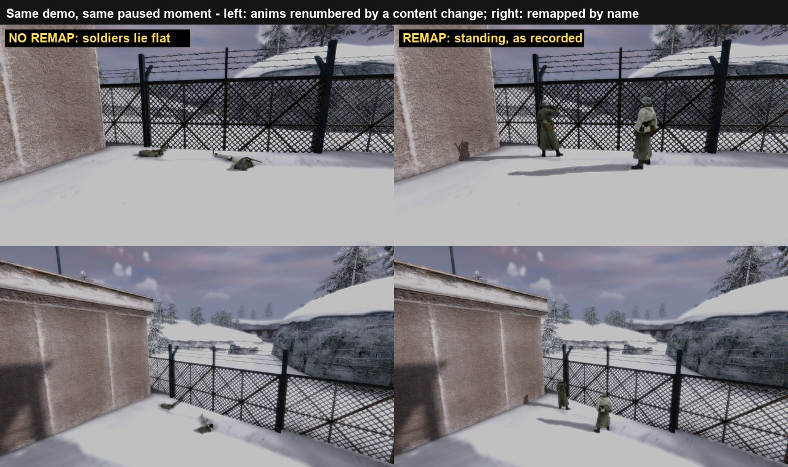

# Old demos play back with wrong animations (bug-10330)

Tester Grahn's two demos (`9.dm_17` m2l2a, `10.dm_17` m2l2b), played in v1.10.52: players vanish,
sink or walk while standing still, AI anims are wrong, and death ragdolls differ. The camera,
speed and timeline controls work.

## Verdict: confirmed. Every content change renumbers the anims a demo stores

1. **A demo stores anim numbers, never names.** Each entity's `frameInfo[0..15].index` is a 13-bit
   number (`msg.cpp entityStateFields_ver_15`). The gamestate carries model names only. Before this
   change it carried no mod version either (checked: serverinfo, systeminfo, all 2,876 configstrings).
2. **The number is the alias's rank in its tiki.** `TIKI_GetAnimOrder` (`tiki_anim.cpp:50`) qsorts
   aliases with `Q_stricmp`, which folds to UPPER case, so `_` sorts after letters.
   `TIKI_InitTiki` (`tiki_files.cpp:997`) then skips clips that fail to load. So adding or
   removing one alias or clip renumbers every anim that sorts after it.
3. **Playback resolves the numbers against the playback machine's pk3 stack.** A release is about
   45 layered pk3s. Since mid-October the anim lists changed through `assets_tex` and the overlays
   `coop_fixes` (v1.10.36), `fixes2`/`late` (v1.10.37), `coop_fx` (v1.10.38), `coop_stress`
   (v1.10.41) and `assets_tey` (v1.10.53).
4. **Measured** (`tiki_anims.py`, mid-October stack vs today's install): the player tikis grew from
   1,616 to 1,709 anims, and **1,521 of 1,616 player indices (94%) now name a different anim**. The
   first change was `coop_turret_crouch_idle/_fire` (Oct 12), which by itself renumbers 1,157.
5. **Grahn's demos are older than mid-October.** The recorded `version` string is the
   `18d2343f` exe built **Sep 28**, which shipped in v1.10.2–v1.10.7. His m2l2a model list also
   lacks `precache.scr` entries added on Oct 5 (`coop_planesmoke_trail`) and Oct 11
   (`garandsmoke`, `coop_wound1`, `coop_headlamp`), which today's m2l2a demo has.
6. **Ragdolls** are client-side physics and are not in the demo. They differ because the cgame
   ragdoll code changed, and because the death anim that sets the start pose is itself misnumbered.

### Evidence that the tools are right
- `demo_probe.py` decodes both demos completely: 44,776 and 28,403 snapshots, 0 parse failures.
- On a demo recorded today (`demoedcombat.dm_17`, m2l1), `tiki_anims.py` with the installed stack
  decodes AI legs and torso to `mp40_stand_nervous_*`, `mp40_walk_patrol_left`, `death_back2`,
  `mp40_aim` and `mp40_shootauto`. The local player decodes to `smg_stand_idle`,
  `coop_dbno_idle` and `smg_reload`. Weapon-consistency score 0.88, against about 0.68 for Grahn's.
- Grahn's demos decode to nonsense under today's stack (a still German officer plays
  `grenade_crouch_walk_*`; MP40 soldiers play `thompson_*` and `rifle_crouch_hit_*`). They also
  decode badly under every older stack I could rebuild from git. His September `assets_tex`
  (v1.10.1 build, 1,305,479,899 bytes) is not on this machine, and the git tree alone does not
  reproduce a packed release (untracked files are packed too).

## Options

| | What | Fixes old demos? | Fixes future? | Cost |
|---|---|---|---|---|
| **A** | Record the mod version and warn on mismatch at playback | no (warns "unknown version") | warns only | **mod part DONE** (below); engine warning about 1 h |
| **B** | Save each tiki's anim names with the demo; remap by name at playback | only with C | **yes**, for any later content change | about 1–2 days engine + test |
| C | Rebuild a named release's anim tables offline and write B's sidecar for an old demo | yes, per demo, if its release is known | – | B + about half a day of tooling, plus a 1.3–2.5 GB download per candidate release |
| D | Freeze anim numbering (append-only alias lists) | no | partly; breaks on any removed or renamed clip | ongoing discipline, easy to violate |

**Recommendation: A now (done), B next, C only if these specific demos matter.** B is the real
fix: it makes every future demo independent of content changes. C reuses B's playback path, so it
costs little once B exists. D is not worth it, because the sort and the dropped-clip rule mean even
careful edits renumber.

### Done in this session (cheap and safe)
- `docs/tools/gen_version_cfg.py` now emits `sets coop_modVersion "vX.Y.Z"` (`sets` = set plus
  `CVAR_SERVERINFO`), and `ui/coop_version.cfg` is regenerated. The host's version then rides in
  configstring 0, so **every demo recorded from the next release on names its content version**.
  Serverinfo is about 868 of 1,350 chars, so there is room. The main-menu label still links the same
  cvar. **Not deployed, not released, not playtested.**

### A: the engine warning (not applied; ready to drop into any engine branch)
`cl_parse.cpp` `CL_ParseGamestate`, after `CL_SystemInfoChanged()`:
```c
// HZM coop [bug-10330] a demo stores anim NUMBERS whose meaning depends on the tiki set.
if (clc.demoplaying) {
    const char *rec  = Info_ValueForKey(cl.gameState.stringData + cl.gameState.stringOffsets[CS_SERVERINFO], "coop_modVersion");
    const char *mine = Cvar_VariableString("coop_modVersion");
    Cvar_Set("cl_demoContentVersion", rec);
    if (!*rec)
        Com_Printf("^3This demo predates content stamping: player and AI animations may not match this install.\n");
    else if (Q_stricmp(rec, mine))
        Com_Printf("^3Demo recorded with %s, this install is %s: animations may not match.\n", rec, mine);
}
```
The demo editor HUD can show `cl_demoContentVersion` beside the timeline.

### B: built (engine branch `demo-animtab`, worktree `openmohaa-hzm-animtab`, cut from `rel-1.10.38-engine` 03bb4e2e)
New `code/qcommon/demo_animtab.cpp/.h` (added to `qcommon/CMakeLists.txt`, so an existing build dir needs a
re-configure). Hooks:

| where | what |
|---|---|
| `cl_main.cpp` `CL_Record_f` / `CL_StopRecord_f` | `CL_DemoAnimTab_Record()`: append the current map's tables |
| `cl_cgame.cpp` `CL_InitCGame` (after `TIKI_FinishLoad`) | the same, for a recording that crossed into a new map |
| `cl_main.cpp` `CL_PlayDemo_f` | `DemoAnimTab_Load(name)` (no sidecar = inactive, plays as before) |
| `cl_cgame.cpp` `CL_GetSnapshot` | remap `frameInfo[].index` on the copy for cgame (never `cl.parseEntities`) |
| `cl_filmroom.cpp` replay save / `demo_export` | write tables / copy the source demo's sidecar |
| `sv_demo.c` | tables per gamestate written to a file stream, at close, on `sv_savereplay`; removed with the demo |

`demo_animRemap 0` turns the remap off (A/B). `developer 1` prints the per-model table summary, and every
model that actually needed remapping prints `^~^~^ ANIMTAB remap model=… renumbered=N missing=M`.
Matching is by name: the k-th anim of a name maps to the k-th of that name, because random groups share
one name. A recorded anim this install no longer has falls back to the model's `idle`.
**Verified 2026-11-01** on the registered harness `G:\mohaa-animtab` (commit `1c964fe5`, live v1.10.54 DLLs,
runner `tools/run_animtab.py rec | shift | unshift | play TAG`):
- Recording an m2l1 demo wrote 854 model tables (35 distinct lists, 381 KB beside a 291 KB demo). Every
  list equals `tiki_anims.py`'s independent numbering; the only spelling differences are random-group
  anims, which the engine stores under their stem.
- 60 aliases that sort first, added through a homepath-only pk3, push every recorded number off by 60.
  Remap off: soldiers lie flat. Remap on: the frame matches the unchanged-content baseline (mean pixel
  difference ≤ 0.03/255). The log shows `recorded=2662 loaded=2722 renumbered=2662 missing=0` per AI
  tiki, and the same for the player tikis.
- Unchanged content: 78 of 78 tables are identity, and nothing is remapped.



**Known gap:** Film Room `getdemo` downloads the server demo and `.dmi` but not the `.animtab`. A
missing file makes the stock download path drop the client, so it needs a server-side "has sidecar"
flag first.

### B: design notes (as planned)
- **Record:** when the demo file opens (`CL_Record_f`, and `sv_demo.c` for server-side recordings),
  write `<demo>.animtab`. For each `CS_MODELS` entry that is a skeletal tiki, store
  `hash(alias list)` plus the list, deduplicated: the 40-odd soldier tikis share a handful of lists,
  so expect about 100–300 KB uncompressed. Take the names from the same `dtiki_t` the client uses
  to read the numbers (`TIKI_NumAnims` / `TIKI_Anim_NameForNum`).
- **Play:** load the sidecar, build an `old index -> new index` table per model by alias name
  (case-insensitive; a missing name maps to the tiki's `idle`, or index 0). Apply it to
  `frameInfo[].index` **on the copy handed to cgame** (`CL_GetSnapshot`), never on
  `cl.parseEntities`, which is the delta base for the next snapshot.
- **Test:** record on today's content, add one alias that sorts early to `anims_shared.txt` (in a
  harness-only pk3), and play back. It must look the same with the sidecar and wrong without it.

## Tools (`tools/`)
- `demo_probe.py <demo> [--json out] [--samples out]`: offline protocol-17 demo reader. Netfield
  tables and `NetByteToStrChar` are regex-read from `msg.cpp`, so they follow the engine.
- `tiki_anims.py <tik> [--rev R | stack mode] [--diff OLD [NEW]]`: engine-exact anim numbering.
  It mirrors `$include`, `$define`, `$path` (ignored inside skipped `includes`/`$mapspec` blocks;
  retail `new_generic_human.tik` has a stray `$path …/mp_tunisia_lib.tik` inside one),
  `includes`/`$mapspec` prefix matching, the upper-fold sort and dropped clips.
- `hypo.py <samples> <map> [date...]`: scores which content date a demo decodes best under.

Traps found while building them: `Q_stricmp` folds to UPPER, not lower; a `//***` comment must not
open a block comment; Git-Bash heredocs turn `\x00` in Python source into a real NUL.
