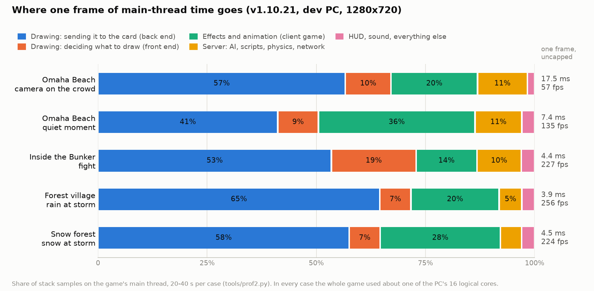

# More work on the GPU, more than one core — where the frame goes today and what to do about it

**Date:** 2026-10-12. **Status:** research only. Nothing in the engine or the mod was changed, built or committed.
**Question (user):** "research how we can put more work in this game on the GPU vs cpu, and where it needs to be on
the cpu, how we can leverage more than one core."

**How to read the numbers.** Every number is tagged **[M]** = measured today by this study (the run tag and file
are given; raw output is in `data/`) or **[E]** = estimated (the reasoning is given). All measurements are the
released **v1.10.21** binaries (cgame `6d6799b2`, game `689d0db1`, renderer `4bc77ba0`, exe `affd0767`) in the
private test copy `G:\mohaa-hudfeed3`, on the dev PC (Ryzen 7 9700X, 8 cores / 16 threads, RTX 5070 Ti 16 GB),
1280x720 window, frame cap and vsync off for the measurement windows. Three other test clients from other sessions
were running on the same PC, so absolute milliseconds are noisy (about ±0.1–0.3 ms on a null A/B); **shares of a
frame and same-session A/B differences are the solid part.**

---

## 1. One-page summary

### Where the time goes today

| Case (run tag) | One frame, uncapped | Drawing: back end | *(of it, inside the GL driver)* | Drawing: front end | Effects + animation (cgame) | Server: AI, scripts, network | HUD, sound, rest |
|---|---:|---:|---:|---:|---:|---:|---:|
| **Omaha Beach, camera held on the battle** (`omaha_crowd`) | **17.5 ms / 57 fps** | 57 % | 21 % | 10 % | 20 % | 11 % | 2 % |
| Omaha Beach, quiet moment (`omaha_solo`) | 7.4 ms | 41 % | 23 % | 9 % | 36 % | 11 % | 3 % |
| Inside the Bunker, fight (`bunker_fight`) | 4.4 ms | 53 % | 19 % | 19 % | 14 % | 10 % | 3 % |
| Forest village, rain at storm (`rain3_m5l1a`) | 3.9 ms | 65 % | 27 % | 7 % | 20 % | 5 % | 3 % |
| Snow forest, snow at storm (`snow3_m6l1a`) | 4.5 ms | 58 % | 21 % | 7 % | 28 % | 5 % | 3 % |
| Omaha again, drawn at 2560x1440 + post effects (`omaha_1440`) | 16.7 ms | 60 % | 23 % | 10 % | 17 % | 11 % | 1 % |

All **[M]**: frame time from a null `r_hzmAB`, shares from 20–40 s of stack samples of the main thread
(`tools/prof2.py`, cut into subsystems by `tools/analyze.py`; table in `frame_split.md`).

Four facts carry the rest of this report:

1. **The game uses about one core out of sixteen, and the graphics card is not the limit.** In every case the main
   thread was busy for the whole frame; all other threads together (six skinning workers, the sound mixer) used
   0.01–0.17 of a core; the GL driver's own threads used 0.00 **[M]**. Drawing Omaha at four times the pixels
   (2560x1440 internal) with the post effects on did not change the frame time (16.7 ms against 17.5 ms) **[M]**.
   On this card, more GPU power would buy nothing; less CPU work per frame buys everything. *(Not measured: a
   weaker card. A 3060 Ti at 1440p may well be GPU-limited in places — see §4.)*
2. **Two thirds of a heavy frame is drawing soldiers and props.** On Omaha, switching entity drawing off live saves
   12.1 ms of 18.7 ms **[M]** (`r_hzmAB r_drawentities`). The world is 2.9 ms, sprites 1.4 ms, smoke 1.0 ms **[M]**.
   The engine still copies every vertex of every model to the card every frame: **970,000 vertices (37 MB) and
   4,100 draw calls per frame** on Omaha **[M]** (`r_hzmPerfStats`).
3. **The server (AI, scripts, physics, snapshots) is small:** 2.0–2.9 ms per 25 ms server tick, 8–12 % of the main
   thread on Omaha with ~95 living actors, with one or with four connected players **[M]**. Path finding and AI sight
   traces did not reach 0.3 % in any run **[M]**.
4. **A surprising share is plain waste that needs neither the GPU nor more cores** — bookkeeping loops, work done
   for shadow views that is then thrown away, a collision trace per snowflake. These showed up only because the
   bigger costs were removed in v1.10.20/21.

Yesterday's "12.5 ms on Omaha" figure was an average that included long stretches where the idle test player was
dead and looking at the sea bed (see `data/gr_omaha_solo.jpg`). With the camera held on the battle it is 17.5 ms.
On a tester-class CPU (i7-9700F, roughly 1.6x slower per core **[E]**, not measured) that is about 28 ms, 35 fps.

### The top five moves, ranked by gain for the effort

| # | Move | Kind | What the player notices | Saving on **Omaha, camera on the battle** (17.5 ms today) | Effort | Risk / what could look or play wrong | Hardware | Off switch |
|---|---|---|---|---|---|---|---|---|
| 1 | **Stop the waste** — six small fixes found by this measurement (§2.0): emitter bookkeeping, a per-particle map lookup, shadow-view work that is discarded, the terrain cache's own key, a trace per snowflake, skinning the workers miss | neither (plain CPU fixes) | Higher fps everywhere; biggest on Omaha, terrain maps and in snow | **2.0–3.5 ms (12–20 %)** **[E]** = sum of the measured shares below, less what cannot be removed. Snow map: ~25 % **[E]**. Bunker: ~15 % **[E]** | 4–6 days | Low. Each is a cache or a skipped duplicate; the engine already has a "compare against the real answer" verify mode to copy | Any | One cvar each |
| 2 | **Models live on the card** — static buffers + skinning and model lighting in the vertex shader | **GPU** | Higher fps wherever there are many soldiers/props; frees the six skinning workers | **2.6–3.9 ms (15–22 %)** **[E]** from measured shares: skin on the main thread 5.1 % + copy 6–7 % + per-vertex lighting 5–6 % + upload 2.6 % | 12–18 days | Medium. Wounds need a CPU-skinned copy of the hit body part; faces with morph targets and 28 odd surfaces stay on the CPU path; model lighting has to match what the CPU does today or soldiers change brightness | OpenGL 3.x (uniform buffers); everything this renderer already runs on except the GL 2.0 fallback, which keeps today's path | `r_hzmGpuSkin 0` |
| 3 | **Draw sprites in big batches** (smoke, fire, blood, sparks) | GPU-side batching | Higher fps in smoke/fire; nothing else | **0.9–1.4 ms (5–8 %)** **[E]**: sprites cost 1.4 ms **[M]**, 2,270 sprites go out as 940 separate draws **[M]** | 4–6 days | Low–medium: a sorting mistake shows as smoke popping in front of / behind fire | Any (instanced version: OpenGL 3.3) | cvar |
| 4 | **World, terrain and static models from buffers that stay on the card** | **GPU** | Higher fps on terrain and foliage maps | **1.0–1.5 ms (6–8 %)** **[E]** of the 2.9 ms the world costs **[M]**; Bunker ~15 % **[E]** | 8–12 days | Medium: static-model lighting and dynamic lights move into the shader; terrain detail levels change as you move | Any | cvar per part |
| 5 | **A real render thread** — the drawing back end on its own core | **multicore** | The single largest jump, and it grows with every item above | Frame time becomes the *larger* of two halves instead of their sum: today **17.5 → ~10.5 ms (−40 %)** **[E]**; after moves 1–4, **~9 → ~6 ms** **[E]** | 5–7 weeks, in three slices that each ship | High. Every HZM renderer feature (wounds, frame generation, screenshots, MSAA resolves, video, the hitch log) touches it; mistakes are crashes and hangs, not wrong pixels | Any (2+ cores) | `r_hzmRenderThread 0` = today's path, must stay forever |

Order of work: **1 → 3 → 2 → 4 → 5**. Moves 1–4 are independent, each ships alone, and together take Omaha from
17.5 ms to about 9 ms **[E]** on one thread. Move 5 is the only *multicore* item that changes the picture; it is last
because it is the riskiest and because 2 and 4 make it easier (less shared CPU data crossing between the two threads).

**Not worth doing** (details §4): the server/AI on its own thread (≤ 10 % and the mod already ships a
separate-process "Dedicated" host), parallel AI or snapshots, GPU particle or rain simulation, GPU culling, multi-draw
indirect, audio threading, a Vulkan or DX12 port.

---

## 2. GPU moves in detail

### 2.0 First: the waste that needs neither (move 1)

These are not GPU or multicore items. They are listed first because they are the best gain for the effort, and because
moving wasted work to the GPU or to another core would still be waste.

| What | Where | Measured share of the main thread | Why it is waste | Fix |
|---|---|---|---|---|
| Emitter bookkeeping | `cgame/cg_commands.cpp:4872` `UpdateEmitter` → `cg_commands.h:531` `GetEmitTime` | **12.7 %** Omaha quiet, **5.9 %** Omaha battle **[M]** | For every model that owns an emitter, a linear walk over every entity that ever used that emitter. The v1.10.21 filter (bug-3491) only skips models with *no* emitter | Index by entity number (a small hash or a per-entity slot). Result identical by construction |
| Is this particle in a visible part of the map? | `cgame/cg_tempmodels.cpp:1092` — `CM_PointLeafnum` once per temp model per frame | **4.9 %** Omaha quiet **[M]** (`callees.py … ::AddTempModels`) | A map-tree walk for every particle every frame; particles barely move between frames | Keep the leaf with the particle; refresh it every few frames or after it has moved a set distance |
| Terrain re-tessellated in every shadow view | `renderergl2/tr_terrain.c:1351` `R_TessellateTerrain` inside `R_AddTerrainSurfaces`, called per view | **~6 %** Bunker (`R_DoTriMerging` 2.7 + `R_DoGeomorphs` 1.9 + `R_TessellateTerrain` 1.4 under `R_RenderSunShadowMaps`) **[M]** | The level-of-detail pass runs again for each of the three shadow views although the camera has not moved (`tr_world.c:868-881` already skips the *prepare* step for them) | Tessellate once per frame |
| Soldiers added to every shadow cascade, then dropped | `tr_model.cpp:1444-1447` (comment: "still added to every cascade and still dropped in the backend") | part of **4.4–4.9 %** Omaha, **4.0 %** Bunker (`R_AddEntitySurface` under the shadow views) **[M]** | With `r_charShadows 0` (the default) the front end still poses and queues them for three extra views | Reject them in the front end, where the back end would |
| The terrain cache's own key | `renderergl2/tr_surface.c` `TM_Key` (the bug-3497 terrain memo) | **4.7 %** Bunker **[M]** | Hashing every patch's vertex and triangle lists three or more times a frame to learn that nothing changed | A change counter bumped by the tessellator replaces the hash (and move 4 removes the copy as well) |
| A collision trace per snowflake | `cgame/cg_nature.cpp:122-132, 458-521` (`CG_Rain` → `CM_BoxTrace`) | **14–18 %** on the snow map at storm, 0.8 ms of 4.4 ms **[M]** (`r_hzmAB cg_rain` and `callees.py … !CG_Rain`). Rain at storm on m5l1a: 0.1 ms **[M]** | Two or three world traces per flake per frame to find roofs and ground | The renderer already builds a top-down rain-occlusion grid at map load (`tr_hzm_wet.c:650` `R_HZMWetBuild`): one lookup replaces the traces. Flakes then land where the grid says, not on thin overhangs the grid misses — compare screenshots |
| Skinning the worker threads do not cover | `RB_SkelMesh` calling `SKEL_Skin` inline on the main thread | **9.5 %** snow map, **7.3 %** rain map, 2.4 % Bunker, 1.0 % Omaha **[M]** (`parents.py … !SKEL_Skin`) | `R_SkelPreskin` runs for colour passes only (`tr_backend.c:826-829`) and skips surfaces under 24 vertices; whatever falls outside is skinned on the main thread. **Not root-caused** — which models these are on the forest maps was not identified | Let the worker pass cover depth-only lists too. Move 2 removes it entirely |

Proof for each: `r_hzmAB "<the new cvar> 0 1"` on the named map shows the saving live; a verify mode in the style of
the existing `RPSTAT4 verify (checked/DIFFERENT)` counters proves the cached answer equals the real one; then the
map-rotation tester (Phase 2, 54 maps) with `GLERRORS=0` and no script errors.

### 2.1 Models on the card: static buffers, GPU skinning, lighting in the shader (move 2)

**Today.** Every skeletal surface, every frame, every view: bones are evaluated on the CPU (front end,
`R_AddSkelSurfaces`, 4.4 % on Omaha **[M]**), vertices are skinned on the CPU (six workers + main thread; a cache
skips unchanged bodies), copied into the shared `tess` arrays, lit per vertex on the CPU
(`RB_FillModelLightingColors` → `RB_Light_Real`, 5.9 % **[M]**), copied again into a mapped GPU buffer
(`RB_UpdateTessVao`, 3.3 % **[M]**) and drawn — one draw call per surface. The skin cache holds CPU arrays only
(`tr_model.cpp:2028-2278`); there is no model geometry resident on the card at all.

**What is in the way, measured from the game's own files** (`tools/skd_census.py`, all 1,672 `.skd/.skb` in the
retail paks and the mod, `data/skd_census.txt`) **[M]**:

- The format stores, per vertex, a list of (bone, weight, offset-in-that-bone's-space) — no bind-pose position. That
  is fine for a shader: position = Σ weight × (bone matrix × offset). Four such entries per vertex fit in five vertex
  attributes.
- **99.99 % of character vertices have four weights or fewer** (83.5 % have exactly one, 12.9 % two, 3.1 % three,
  0.4 % four). Across all skeletal files 97.2 % of vertices are bound to a single bone — most "skeletal" models in
  this game are rigid props.
- 99.4 % of all surfaces (94.1 % of character surfaces) can go down a four-weight, no-morph GPU path. The rest: 11
  files with morph targets (faces) and 8 files with a five- or six-weight vertex. Those surfaces keep today's CPU path.
- Bones per mesh: limit 100 (`TIKI_MAX_BONES`); 1,382 of the 1,672 files have fewer than 20.
- The shader plumbing already exists and is unused: rend2's `u_BoneMatrix`, `ATTR_BONE_INDEXES/WEIGHTS`,
  `glslMaxAnimatedBones` are compiled in for MDR/IQM models, which this game never loads (`tr_glsl.c:194, 1249`,
  `tr_init.c:508`). OpenJK's rend2 does the same job with a uniform block of `mat3x4` bone matrices and four weights
  per vertex (source cited at the end).

**What breaks, and the answer for each.**

| Consumer of CPU-skinned vertices | Anchor | Answer |
|---|---|---|
| **Wounds (gore).** The hit test intersects the bullet segment with the just-skinned triangles and reads the UV | `tr_gore.c:879-1086` `R_GoreSkelSurfaceCheck` | It only runs for surfaces of entities within 200 units of a pending impact, and exits at once when none is pending (`:892, :950`). Skin *those* surfaces on the CPU on demand with the existing pure `SKEL_Skin`. The texture half of the wound system does not depend on skinning |
| **Model lighting** — per-vertex on the CPU, all lights | `tr_shade.c:2721-2892`, `tr_sphere_shade.cpp:416` | Becomes a short light list in the vertex shader. This is the part that can *look* different: the result must be compared pixel-for-pixel against the CPU path |
| Shadows from soldiers (sun cascades, lamp shadows) | `tr_main.c:3803` | Same shader does the skinning for the depth pass; simpler than today |
| Stencil / projection shadows (`cg_shadows 2/3`, not the default) | `tr_shadows.c:158-305` | Keep the CPU path when that mode is selected |
| Tag attachments (weapons in hands, helmets) | `tr_model.cpp:915, 3752` | Unaffected — they come from bones, not vertices |
| Level-of-detail collapse (per-draw index rebuild) | `tr_model.cpp:3175-3222` | Cache one index buffer per LOD step actually used |
| Deform shaders, distance fade, morph faces | `tr_shade.c:3206-3222` | Any surface whose shader deforms vertices, or that has morphs, stays on the CPU path |
| The old renderer (`renderergl1`) | — | Untouched. This is `renderergl2` only |

**Expected gain [E].** On Omaha (battle) the removable main-thread shares are: `R_SkelPreskin` 5.1 % + the copy,
cache lookup and inline skin inside `RB_SkelMesh` ≈ 8 % + per-vertex lighting ≈ 5 % + the skeletal part of the upload
≈ 2.6 % ≈ **21 %**; allowing for what stays (bone upload, one buffer bind per model) **15–22 %, 2.6–3.9 ms of
17.5 ms**. Bunker ≈ 12 %; rain and snow maps ≈ 10–14 % (mostly the inline skinning in §2.0). It does **not** reduce
the number of draw calls, which is the other half of the entity cost (see 2.3). It also frees the six worker threads,
which matters for move 5.

**OpenGL needed.** A uniform block (OpenGL 3.1) or a plain uniform array of 100 × 3 vec4 (fits the 1,024-component
minimum of OpenGL 3.x); integer vertex attributes (3.0). The renderer asks for a 3.2 core context first and falls back
to 2.0 (`sdl_glimp.c:720-767`). **Fallback:** on a 2.0 context, or when `glslMaxAnimatedBones` comes back under 100,
keep today's path — it has to stay anyway for wounds, morphs and the off switch.

**Smallest safe slice.** (a) *Rigid props first:* a model whose surfaces are all single-bone needs no skinning at all
— a static buffer plus one matrix. That is 97 % of the vertices in the game's model files (how many of Omaha's 1,390
entities that is was **not measured**). (b) Then four-weight characters. (c) Then lighting in the shader.

**Proof.** A fixed camera on Omaha with the game clock stepped (the harness's `fixedtime` runs), screenshots with
`r_hzmGpuSkin 0` and `1`, image difference at rounding level; `r_goreTest` wound placement identical on both paths;
`r_hzmAB r_hzmGpuSkin 0 1` for the gain; map rotation for crashes; a soak on Omaha with three joiners.

### 2.2 Sprite and particle batching (move 3)

Sprites are simulated in cgame and drawn one quad at a time, with a new batch every time the shader changes
(`tr_backend.c:2941-3030`, `tr_sprite.c:82-218`). They are sorted by depth, so smoke, fire and blood interleave:
**2,270 sprites become 940 draw calls** on Omaha **[M]**. Almost all of the cost is the driver, not the quad
building: of the 7–13 % the sprite pass takes, three quarters is inside the GL driver **[M]**. Live cost: 1.4 ms on
Omaha at 1280x720, 2.0 ms at 2560x1440 internal **[M]**.

Options, cheapest first: (1) additive sprites (fire, flashes, sparks) do not need depth order — collect them into one
batch per shader; (2) put the common smoke/fire/blood sheets into one texture array so depth-sorted alpha sprites
share a batch; (3) instanced quads (OpenGL 3.3) so the CPU writes one small record per sprite instead of four
vertices. (1) and (2) work on any card and get most of the gain; (3) is optional.

**Not recommended: simulating particles on the GPU** (transform feedback, compute). The simulation is 4–9 % on Omaha
**[M]**, half of it the map lookup in §2.0; particles collide with the world, leave marks and are capped at 1,100
(`cg_max_tempmodels`). After the cheap fix there is 2–4 % left to win, against a second copy of the whole effect
system. Rain is 0.1 ms **[M]**; snow is the trace problem in §2.0, not a simulation problem.

### 2.3 Fewer, cheaper draw calls

After the vertex work is gone, the largest single block left is submitting draw calls: `RB_IterateStagesGeneric`
is **20.5 %** of the Omaha frame for 4,100 draws — about 1 µs each, most of it in the driver (including 5–9 % of the
frame in the driver's per-call lock) **[M]**.

- **Instancing of repeated rigid models** (debris, shell cases, dropped weapons, hedgehogs, crates): possible once
  2.1(a) exists; needs OpenGL 3.3; the gain depends on how many identical props are in view, which was **not
  measured**. Worth a counter before any work.
- **Multi-draw-indirect / bindless "one call per material"** (OpenGL 4.3–4.6): not recommended. Every soldier surface
  has its own texture and its own bone set; merging them needs texture arrays or bindless textures and a material
  system this renderer does not have. Daemon (Unvanquished) built exactly that as a separate OpenGL 4.6 code path.
- **The depth pre-pass draws everything twice.** `r_depthPrepass 0` did not change the draw count (4,155 vs 4,006)
  or the frame time **[M]** — the pass is forced on by the shadow system (`tr_backend.c:1663-1665`). Skipping the
  pre-pass for skeletal models would cut their draws by up to half but costs GPU overdraw; on this card the trade is
  good, on a weak card it may not be. **Not measured**; a one-day experiment once move 2 exists.

### 2.4 World, terrain and static models from resident buffers (move 4)

None of the world is on the card either. BSP surfaces are copied attribute by attribute into `tess` every frame
(`tr_surface.c:315-404`; the `r_vaoCache` path is off by default and is itself a streaming cache); terrain is rebuilt
from linked lists per patch per view (`tr_surface.c:1909`); static models are copied and lit per vertex
(`tr_model.cpp:3407-3620`). The upstream rend2 "merged world VAO" does not exist in this tree. Live cost of the world:
**2.9 ms on Omaha** (static models 1.2, terrain 1.3, BSP the rest), **2.8 ms of 8.4 ms in the Bunker** **[M]**.

- *Static models:* geometry never changes. One buffer per model, per-instance baked vertex colours as a second
  stream, dynamic lights in the shader. The same shader work as 2.1.
- *Terrain:* a patch changes only when its level of detail changes. Keep each patch's last build in a buffer on the
  card; rebuild on change. Removes `RB_DrawTerrainTris` (2.6–6.9 % **[M]**) except on the frames a patch re-tessellates.
- *BSP:* build one static buffer at map load; draw ranges. 1–2.4 % **[M]** — smallest of the three, do it last.

**OpenGL needed:** nothing beyond what the renderer already requires. **Fallback:** the current path, per part.
**Expected:** roughly half of the world's cost **[E]** — the draw calls remain.

### 2.5 The rest of the list, assessed

| Candidate | Measured cost today | Verdict |
|---|---|---|
| GPU-side culling / occlusion | front-end world culling 0.2–1.9 % **[M]** | No. Nothing to win |
| Decals and marks | 0.1–0.7 % **[M]** | No |
| Shadow-map rendering | front end 4–12 % — mostly the waste in §2.0 **[M]** | Fix the waste; nothing GPU-specific |
| Post effects | 1.6–6 % of the main thread (driver calls for the full-screen passes); toggling `r_postProcess` moved the frame by ≤ 0.2 ms **[M]** | CPU side is fine. On a weak card this is a *GPU* cost and a settings question, not an engine one |
| Texture streaming | not a frame-time cost; first-use hitches are handled by the learned preload | No |
| Smoke (VSS) | 1.0 ms on Omaha: 0.6 renderer + 0.4 simulation **[M]** | Covered by sprite batching |
| HUD | 2–5 % **[M]**; every picture and string is its own flush + draw (`tr_draw.c:79-131`) | Falls out of slice 5a |

**Which players have the hardware.** Steam's September 2026 survey lists 92.2 % of GPUs as DirectX 12 class; on
Windows those drivers expose OpenGL 4.5/4.6. Everything recommended here needs OpenGL 3.x at most, which is every
card the gl2 renderer already starts on bar the 2.0 fallback. The only 4.x features in this report (multi-draw
indirect, compute) are in the "not recommended" column. **The mod's own bug reports already record the GL version
string — counting those would be better evidence than Steam's and was not done.**

---

## 3. Multicore moves in detail

**The state today [M].** One main thread does everything. Besides it: six skinning workers (`r_hzmSkinThreads`,
`tr_model.cpp:2589-3028`, fork-join, special-purpose — not a general job system), OpenAL Soft's own mixer thread, an
optional present thread for frame generation (`tr_hzm_framegen.c`, with its own shared GL context), the update
checker and the freeze watchdog. Nothing in `fgame`, `cgame`, `server`, `script`, `tiki` or `skeletor` uses a thread
or a lock. On Omaha the six workers together use 0.12–0.17 of a core; live they save 2.2 ms **[M]**.

**The ioquake3 render-thread split is gone from this renderer.** `renderergl2` has no `r_smp`, no render thread
functions, and exactly one `backEndData` (`tr_backend.c:29`, `tr_init.c:2430`); only a dead `smpActive` flag and one
`FIXME` remain (`tr_main.c:4177`). The prototypes survive only in `renderergl1/tr_local.h`. There is nothing dormant
to switch on.

### 3.1 A real render thread (move 5)

**Why it is the big one.** The back end is 41–65 % of the main thread **[M]**. Put it on its own core and a frame
costs the larger of (back end) and (everything else) instead of their sum. Omaha today: 57 % vs 43 % → frame ≈ 60 % of
today **[E]** (a few percent lost to hand-over). After moves 1–4 the back end is roughly 3–3.5 ms and the rest
5.5–6 ms **[E]**: ~6 ms a frame.

**What stands in the way** (all anchored by the code survey):

1. **2D drawing is immediate.** `Draw_StretchPic`, `Draw_StretchPic2`, `Draw_TilePic`, `DrawBox`, `R_DrawString`,
   `Set2DWindow` each call `R_IssuePendingRenderCommands()` and then draw straight away from the caller
   (`tr_draw.c:79-131, 621-656`, `tr_font.cpp:621`). The 3D scene is itself drawn from inside a UI widget
   (`cl_uiview3d.cpp:700`), so the first HUD element after it *executes the whole queued scene synchronously*. That
   is why the back end shows up under "cl" in `com_speeds`. The queued `RE_StretchPic` is still in the file, in a
   dead `#else`.
2. **One copy of the per-frame data.** `backEndData` (draw surfaces, entities, lights, polys, sprites, static-model
   data) and the global bone pool `TIKI_Skel_Bones[131072]` / `skeletorMorphCache[]` would be written by the front
   end for frame N+1 while the back end reads frame N. They need two copies and a swap, as id's original design had.
3. **Front-end code that calls OpenGL directly:** texture creation when a shader is first used mid-game
   (`tr_image.c:2395, 2469`), `RE_BeginFrame` state changes (`tr_cmds.c:403-527`), the wound compositor and its
   read-backs at end of frame (`tr_gore.c:2703`), cinematic upload (`tr_backend.c:1305`), the lightning bolt texture,
   screenshots, the VRAM accounting. Each becomes a render command or runs at a sync point.
4. **Back-end code that reads data the front end changes:** terrain linked lists (re-tessellated per view),
   `R_LightDirForPoint` and its memo, the pending wound impacts cgame queues with `RE_GoreImpact`, the pose memo vs
   the skin cache. Moves 2 and 4 remove most of these by construction, which is the reason for the order.
5. **The GL context has one owner.** Precedent in this codebase: the frame-generation present thread already runs a
   second, shared context with a fence-sync hand-over (`sdl_glimp.c:1480-1525`, `tr_hzm_framegen.c:1094-1154`).
6. **Latency.** A render thread adds up to one back-end time of delay between input and picture unless the main
   thread waits for the previous frame before submitting the next. Wait.

**Slices, each shippable alone.**

- **5a — queue the 2D.** Turn every immediate 2D call into a render command; one flush per frame at `RE_EndFrame`.
  No threading. Gain: the HUD stops being 15–30 separate flush+draw pairs (HUD + UI are 3–5 % **[M]**; expect 1–2 %
  **[E]**), and `com_speeds` starts telling the truth. Risk: draw order of HUD against the scene, scissor/viewport
  state (`RE_Scissor` writes GL directly today). Proof: screenshot diff of every menu and HUD state (the menu test
  harness exists), flush counter (`R_HzmPerf` out[2]) reads 1.
- **5b — two copies of the frame data, still one thread.** `backEndData[2]`, bone pool ×2, terrain build results
  snapshotted into the command; every front-end GL call moved behind a command. Proof: an assert in the central GL
  wrappers (`tr_dsa.c`) that no GL call happens between "front end begins" and "back end begins"; byte-identical
  screenshots.
- **5c — the thread.** `r_hzmRenderThread` (default 0, then opt-in for testers, then default on). The main thread
  hands over the command list and waits only if the previous one is unfinished. Proof: the same assert now checks
  thread identity; freeze watchdog and hitch log stay clean; two-hour Omaha soak with three joiners; `vid_restart`
  and map change 50 times in a row (the renderer DLL unloads on every `vid_restart` — workers must be joined, as
  bug-3487 found); the whole map rotation.

**Could the NVIDIA driver do this for us?** Its "threaded optimization" moves driver work to its own thread. It was
not active here: the driver's threads used 0.00 of a core while 19–27 % of our main thread was inside driver code
**[M]**. Forcing it is a per-user control-panel setting, not something the game can set, and this renderer does
several things that force the driver to synchronise (per-frame depth read-back for flares, persistent mapped buffers,
query results). **Not tested** (no system settings were changed). It is a five-minute experiment for the owner with
`r_hzmAB hzm_null 0 1` before and after — but it cannot be a plan, because it cannot be shipped.

### 3.2 A small job system (the enabler, not a goal)

The skinning pool is a fork-join pool with a skin-specific job struct. Generalising it to "run this function over N
items and wait" is 2–3 days and lets the following share the same workers. Each is small alone:

| Job | Share today | What blocks it | Verdict |
|---|---|---|---|
| Bone posing (`R_AddSkelSurfaces` → `TIKI_GetFrameInternal`) | 3–5 %, plus the same again inside shadow views **[M]** | One skeletor per (entity, model) is shared by server, cgame and renderer (`tiki_cache.cpp:305`, `skel_entity_cache`), allocated lazily; animation data is read from disk on first use (`tiki_files.cpp:648`). Safe only inside `RE_RenderScene` (nobody else runs) with allocation and first-use loads done on the main thread first | Worth doing **after** move 2, when posing is the largest CPU cost left per soldier. ~2–3 % net **[E]** |
| Sprite quad building, terrain patch builds, static-model packing | 0.3–2.6 % each **[M]** | They write into the one shared `tess` | No — moves 3 and 4 delete the work instead |
| Particle integration (cgame) | 2–4 % after §2.0 **[E]** | `CG_Trace` is not reentrant; list alloc/free during the walk; marks and shader registration as side effects | No |
| Image decode at map load | not a frame cost; the load itself was 11 s of client work for 1,416 images + 1,683 sounds (yesterday's hitch log) | Decoders call `ri.FS_ReadFile` / `ri.Malloc`; the Z_Malloc tag lists have no locks (`memory.c:100-204`) | **Yes, as a load-time feature**: decode on workers into plain buffers, upload on the main thread. The learned-preload list already says which files. Gain is seconds of loading, not fps; **not measured** how the 11 s splits between read, decode and upload |
| Shader (GLSL) compile | load time only | needs a GL context per thread, or `ARB_parallel_shader_compile` | Low priority |

### 3.3 The server on its own thread — measured, and not recommended

**The prize is small.** Server + game is 8–12 % of the main thread on Omaha and in the Bunker, 5 % on the forest
maps **[M]**; 2.0 ms per 25 ms tick with four clients connected (`omaha_4p`), 2.5–2.9 ms with ~95 actors awake
**[M]**. Inside it on Omaha: `Actor::Think` 4.2 % + `PostThink` 3.5 %, snapshot encoding 2.4 %, the script VM
1.5–2 %, path search 0.0 %, sight traces 0.0–0.2 % **[M]**. Amdahl: a perfect server thread makes Omaha at most
11 % faster; it would also remove the "frames that run a server tick are 2.3 ms slower" judder measured yesterday.

**The wall is large.** Shared, unlocked state between server/game and client on a listen server, from the survey:

- the collision map: one global `cm`; every trace bumps `cm.checkcount` and stamps brushes, patches and terrain
  (`cm_trace.c:1280, 247-298`), uses a file-global `sphere` (`:37`) and one global temp box model
  (`cm_load.c:77-79`). cgame prediction, particles, rain, smoke and sound occlusion trace against the same map;
- one skeletor per entity shared by the server's animation and the renderer's (`tiki_cache.cpp:305-344`);
- the cvar table, the command buffer and tokeniser, `Com_Printf`, the filesystem handle table, the `Z_Malloc` tag
  lists (`TAG_TIKI`, `TAG_GENERAL`) — none locked;
- direct calls across the boundary: `gi.HudDraw*` writes `cls.HudDrawElements[]` and calls cgame
  (`sv_ccmds.c:2086-2219`); the sound system calls back into the game (`snd_openal_new.cpp:1841`); the client reads
  `svs.time` and `svs.clients[]`; save/load reaches both sides; `Com_Error` unwinds with a `longjmp` that only
  works on the main thread;
- the script VM and event system are one object graph with one clock: `Actor::Think` pauses and unpauses the script
  director around itself (`actor.cpp:8190-8240`), every script statement is an `Event` dispatched synchronously to
  an entity, and all the pool allocators are unlocked. It cannot be separated from the rest of `fgame`.

**The same result already ships with no threading:** the coop start screen's *Dedicated* option launches
`omohaaded.exe` as a second process and joins it (`client/cl_dedicated.cpp`). The game, AI, scripts and snapshots
then run on another core by construction. What it costs the host is that they become an ordinary client
(prediction and interpolation instead of same-frame loopback) and that the direct server→client shortcuts above
are inactive. **Not measured:** the host's frame time and feel in that mode against the listen server. That
measurement is one test run and is the right next step if host judder is the complaint.

### 3.4 AI, sight traces, path finding, snapshots, audio — measured, nothing to win

| Candidate | Measured | Why not |
|---|---|---|
| AI think in parallel | `Actor::Think` + `PostThink` 3–8 % **[M]** | Think posts events, runs scripts, writes `level.*`; movement uses file-global `mm`/`mml` (`g_mmove.cpp:37`). Not separable; and 8 % is the ceiling |
| Sight traces batched on workers | 0.0–0.2 % **[M]** | Already amortised: one enemy checked per call (`actorenemy.cpp:395`), dirty-time caches. Needs reentrant collision first |
| Path finding off-thread | 0.0–0.2 % **[M]** | Search state lives in shared `PathNode` objects and statics (`navigate.cpp:51-76`) |
| Per-client snapshots in parallel | 1.4–3.2 % with one client; 0.35 ms per tick with four **[M]** (yesterday's 4-player beach run: 0.7 ms per tick) | Shared counter stamps, the entity ring, writes into game entities during the visibility pass (`sv_snapshot.c:533-538, 675, 1161`) |
| Audio | `S_Update` 0.1–0.6 % **[M]**; the mixer is already on OpenAL's thread (0.01–0.04 core **[M]**) | Nothing left on the main thread worth moving |
| Reentrant collision (the enabler for all of the above) | — | 4–6 days on its own (per-thread check stamps, `sphere` into the trace struct, per-thread temp box). Only worth it if something above were worth it |

---

## 4. What not to do, and why

- **Server / AI thread.** ≤ 11 % by Amdahl, weeks of work against the list in §3.3, and the Dedicated host option
  already gives the same split.
- **Parallel AI, sight, paths, snapshots, audio.** All measured under 8 %, most under 1 % (§3.4).
- **GPU particle, rain or snow simulation.** Rain 0.1 ms; snow is a trace-per-flake bug; particles 2–4 % after a
  one-line cache (§2.0, §2.2).
- **GPU culling, multi-draw indirect, bindless.** Culling costs under 2 %; the rest needs OpenGL 4.3–4.6 and a
  material system rewrite to merge draws that have different textures and different bones.
- **More skinning threads or a faster CPU skinner.** What is left on the main thread is 5 % on Omaha; move 2 removes
  the whole category.
- **A general job system as a project of its own.** It is a tool for 3.2, not a result.
- **Tuning post effects for CPU.** They are 0–0.2 ms of main-thread time here. On a weak card they are a GPU cost:
  that is what the graphics presets and `r_renderScale` are for.
- **Counting on frame generation.** It shows more pictures; it does not make the game respond faster, and it sits on
  the same main thread.

**Vulkan / DX12 as an answer to "use the GPU more".** The honest version: the GPU is already idle (§1, fact 1). What
is slow is *our own* CPU work per vertex and per draw, all on one thread, and none of that is the API's fault. A
low-overhead API would shrink the driver's share — 19–27 % of the main thread today **[M]** — perhaps by half
**[E]**, so 10–13 % of the frame, which is less than move 1 gives in a week. The price is rewriting the back end:
`renderergl2` is 87,500 lines with 939 direct GL call sites and 62 GLSL shaders (the whole post-effect chain, MSAA
resolves, the wound compositor, frame generation, volumetric clouds, water) — months of work and a second renderer
to maintain, on a mod that must also keep the old cards running. The Vulkan renderers that exist in this engine
family (Quake3e, vkQuake3) port the *original* Quake 3 renderer, not rend2. DX12 adds Windows-only and no precedent
at all. The one real attraction — DLSS/FSR frame generation and upscaling, which need a DXGI or Vulkan swap chain —
does not need a port to explore: NVIDIA's driver has a per-application setting to present OpenGL on a DXGI swap
chain ("Vulkan/OpenGL present method"). Whether the driver-level frame generation then engages for this game is
**unknown and untested**; it is a ten-minute experiment for the owner, and it changes no code.

**Things this study could not measure — do not treat them as settled.**

- A GPU-limited PC. The tester report was an RTX 3060 Ti at 1440p; on the 5070 Ti here nothing was GPU-bound. Those
  players may be limited by MSAA (auto picks 8x on ≥ 10 GB cards **[M]** from the log), SSAO, the clouds or sheer
  resolution in places, and no CPU work fixes that. The engine has GPU timer marks (`r_gfxProbe`, `GPUTIME` lines)
  that would answer it on their hardware.
- AMD and Intel GL drivers. All driver shares here are NVIDIA's. AMD's OpenGL driver has historically cost more per
  draw call, which would make moves 2–4 worth more there, not less.
- A Holdout wave. Not started. Its live-enemy cap is 24 (`coop_holdoutCap`); the Bunker fight is the nearest
  measured case.
- Four players all looking at the beach. The four-client run measured the server side only (the host's camera ended
  up facing a bunker wall); the drawing cost per view is the single-player figure.
- The unreleased blizzard / downpour tier (`wxextreme.scr`, not in the deployed pak). Storm was the highest
  intensity measured.
- The instancing opportunity (how many identical rigid props are in view).
- How map-load time splits between file read, decode and upload.

---

## 5. Proposed order of work

Each slice ships on its own, has its own cvar, and has a test that proves it. Gains are for Omaha with the camera on
the battle (17.5 ms on the dev PC today) unless stated; they are **[E]** built from the **[M]** shares above.

| Slice | What | Days | Expected | The test that proves it |
|---|---|---:|---|---|
| **A1** | Emitter bookkeeping by entity index; particle leaf kept with the particle | 1 | −1.0 to −1.8 ms (6–10 %; up to 17 % of a quiet Omaha frame) | `r_hzmAB` on m3l1a; a verify cvar that also runs the old search and counts differences (must be 0); emitters visibly unchanged on m3l1a fires and m3l1b |
| **A2** | Tessellate terrain once per frame; reject soldiers from shadow cascades in the front end; terrain cache keyed by a change counter | 2 | Bunker −10 to −15 %; Omaha −3 to −5 % | `r_hzmAB` on m3l1b; screenshot diff of terrain and shadows at fixed camera; map rotation |
| **A3** | Snow/rain landing from the existing occlusion grid | 1–2 | Snow maps −14 to −18 % | `r_hzmAB` on m6l1a at storm; side-by-side stills under a roof and under trees |
| **A4** | Worker skinning for depth-only lists | 1 | Rain/snow maps −5 to −9 % | `r_hzmAB` on m5l1a; `SKELCACHE` counters show the inline path at ~0 |
| **B** | Sprite batching (additive first, then a shared texture array) | 4–6 | −0.9 to −1.4 ms | `RPSTAT sprites=… batches=…` falls from ~940 to under 100; smoke/fire stills and a GIF on m3l1a for sort errors |
| **C1** | Rigid models from static buffers (no skinning) | 4–5 | part of C2's gain; **measure** the rigid share first with a counter | screenshot diff; `r_hzmAB`; map rotation |
| **C2** | Four-weight GPU skinning, CPU path kept for wounds / morphs / 5+ weights / GL 2.0 | 6–9 | with C1 and C3: −2.6 to −3.9 ms | fixed-time screenshot diff on m3l1a and m3l1b; `r_goreTest` wound placement identical on both paths; soak with three joiners |
| **C3** | Model lighting in the vertex shader | 2–4 | (in the above) | pixel comparison against `RB_Light_Real` on lit and unlit soldiers, near lamps and muzzle flashes |
| **D** | Static models, terrain patches, then BSP from resident buffers | 8–12 | −1.0 to −1.5 ms; Bunker ~15 % | per-part cvar + `r_hzmAB`; `tess verts` per frame falls from ~970,000 to under 150,000; map rotation |
| **E1** | Queue all 2D drawing (slice 5a) | 4–6 | −1 to −2 %; accurate `com_speeds` | flush counter = 1 per frame; screenshot diff over the menu and HUD test set |
| **E2** | Two copies of the frame data; no GL from the front end (5b) | 8–10 | 0 (preparation) | GL-ownership assert never fires across the map rotation; byte-identical screenshots |
| **E3** | The render thread, default off → testers → default on (5c) | 10–15 | frame ≈ max(back end, rest): −35 to −40 % of whatever is left | assert on thread identity; freeze watchdog + hitch log clean on a two-hour Omaha soak with three joiners; 50 × `vid_restart` and map change; full map rotation; frame-generation and screenshots re-tested with it on |

Where this lands **[E]**: after A–D, Omaha on one thread ≈ 9 ms on the dev PC (110 fps; about 15 ms / 67 fps on a
9700F-class CPU); after E, ≈ 6 ms (and about 10 ms on the slower CPU). The one thing that would change this order is a
tester PC turning out to be GPU-limited — check that with `r_gfxProbe` on their hardware before starting C.

---

## Evidence and tools

- `frame_split.png`, `frame_split.md`, `data/frame_split.json` — the table and chart above.
- `data/out_<tag>.txt` — the run logs (com_speeds, every `r_hzmAB` line, counters, counter probes).
  `data/result_<tag>.json` — the same, structured. `data/prof_<tag>[_b].txt` — top functions, exclusive and
  inclusive, wall and CPU-cycle weighted. `data/prof_stacks_json.zip` — the folded stacks, re-cuttable.
- `data/skd_census.txt` — bone weights per vertex over all 1,672 skeletal model files.
- `data/gr_*.jpg` — what the camera saw in each run.
- `tools/measure.py` (the run driver; private harness `G:\mohaa-hudfeed3` only), `tools/prof2.py` +
  `stacksample.py` (stack sampler with per-thread CPU), `tools/analyze.py` (subsystem buckets), `tools/callees.py` /
  `parents.py` (who calls what), `tools/summarize.py`, `tools/chart.py`, `tools/skd_census.py`,
  `tools/driver_crowdcam.scr` (test-only overlay that holds the camera on the living actors; changes nothing in a map).
- Runs: `omaha_solo` (idle player, full A/B list), `omaha_crowd` (camera on the battle, full A/B list), `omaha_4p`
  (three joiners, server side), `bunker_fight`, `rain_m5l1a` / `snow_m6l1a` (weather unpinned), `rain3_m5l1a` /
  `snow3_m6l1a` (weather pinned at intensity 3), `omaha_1440` (`r_renderScale 2`, post effects on).
- Caveats on method: the sampler suspends the main thread ~250 times a second, which lowers fps during the 20 s
  profile windows (shares are unaffected; frame times are taken outside those windows). The snow and rain cameras
  were partly behind a tree trunk. `r_hzmAB` flips the cvar every 12 frames, so anything with a warm-up longer than
  that (the skin cache) is slightly understated. "In the GL driver" means the executing module was the NVIDIA
  driver, the kernel or the Windows graphics kernel under a renderer function.

**Prior analysis used:** `docs/proposals/omaha_perf_2026-10-11/omaha_profile.txt`; buglog bug-3483, 3486–3497.

**Outside sources used:**
- OpenJK rend2 `generic.glsl` — GPU skinning with a `std140` uniform block of `mat3x4` bone matrices and four
  weights per vertex: https://github.com/JACoders/OpenJK/blob/master/codemp/rd-rend2/glsl/generic.glsl
- Fabien Sanglard, "Doom 3 BFG source code review: multi-threading" — game + front end on one thread, back end on
  another, a small job list for the rest: https://fabiensanglard.net/doom3_bfg/threading.php
- ioquake3 mailing list, 2005–2007, on why `r_smp` was dropped from the build (driver and SDL thread-safety, a loss
  on Linux): https://icculus.org/pipermail/quake3/2005-November/000472.html and
  https://icculus.org/pipermail/quake3/2007-September/001999.html
- Unvanquished 0.55 release notes (GPU-side culling and a material system as a separate modern-GL path):
  https://unvanquished.net/unvanquished-0-55-awesomeness-has-arrived/
- Steam Hardware Survey, video cards, September 2026 (DirectX 12 class GPUs 92.2 %):
  https://store.steampowered.com/hwsurvey/videocard/
- Geeks3D on Intel HD 4000 Windows drivers (OpenGL 4.0 with some 4.3 extensions, no buffer storage):
  https://geeks3d.com/?p=8713

Statements about Quake3e / vkQuake3 (Vulkan ports of the original renderer) and about AMD's OpenGL driver overhead
are from general knowledge and were **not** checked against a source in this session.
